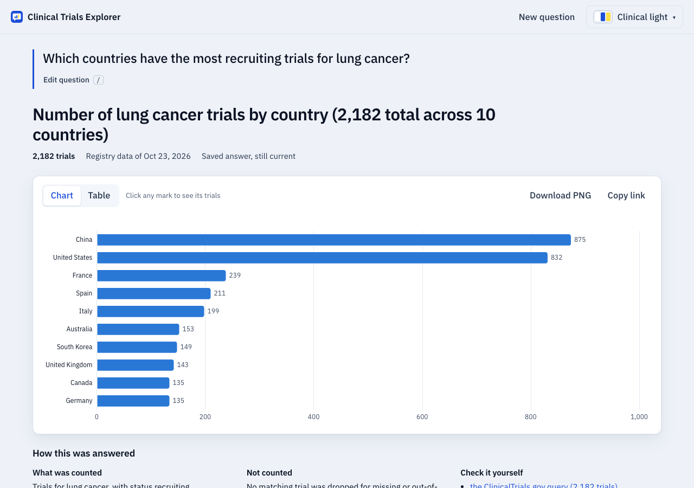
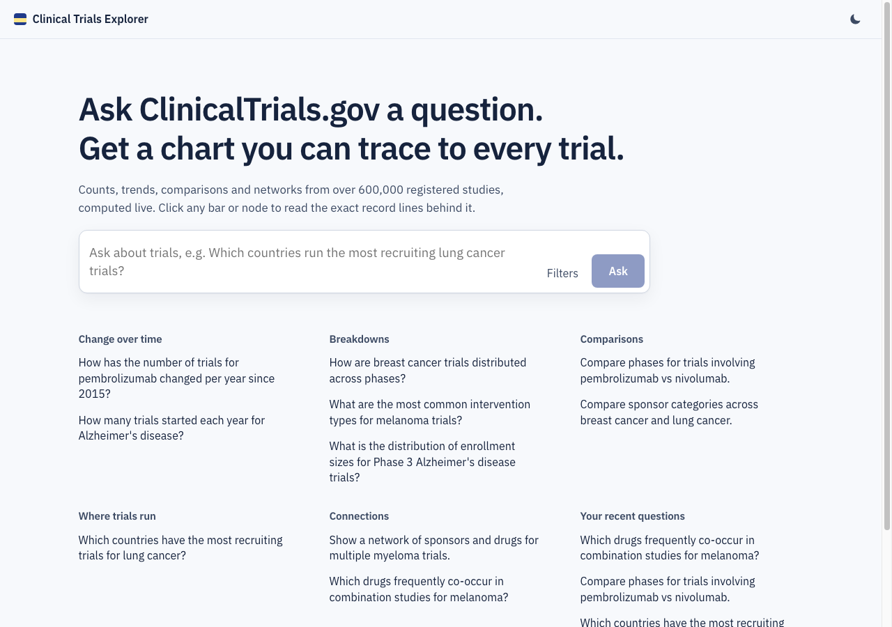
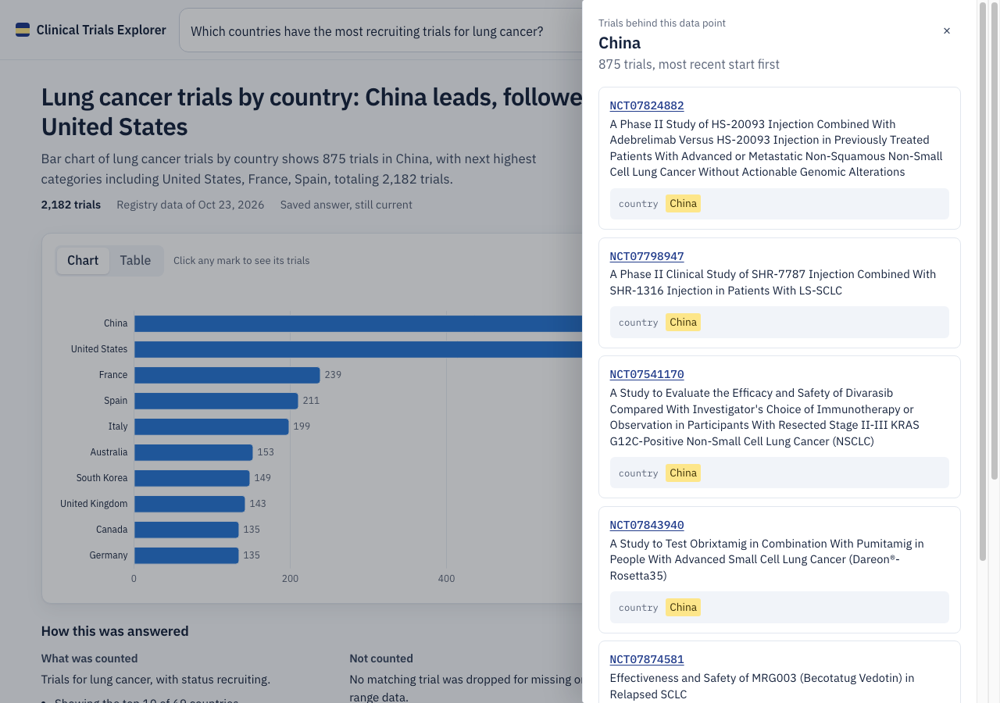
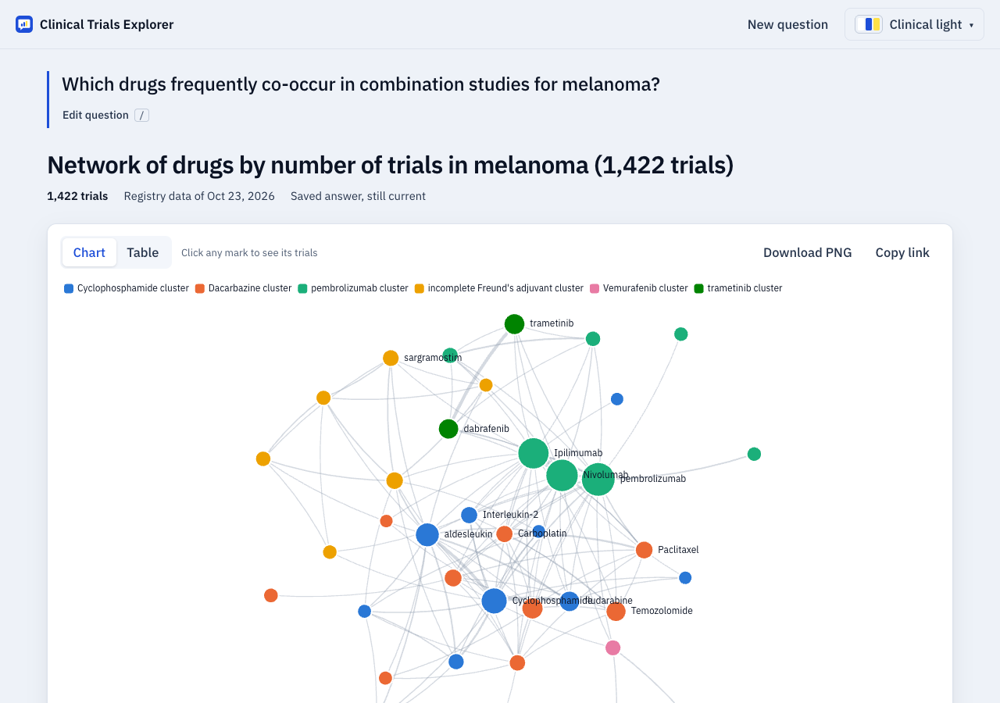
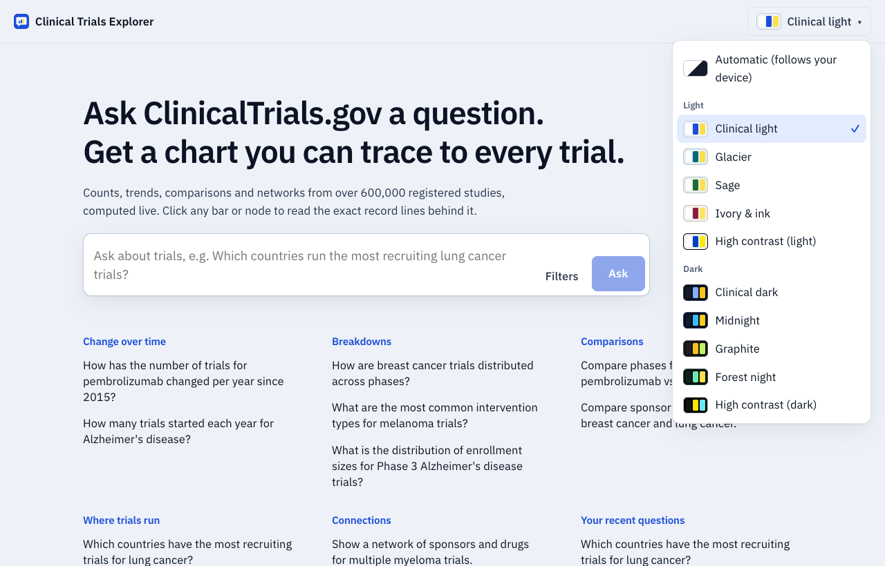
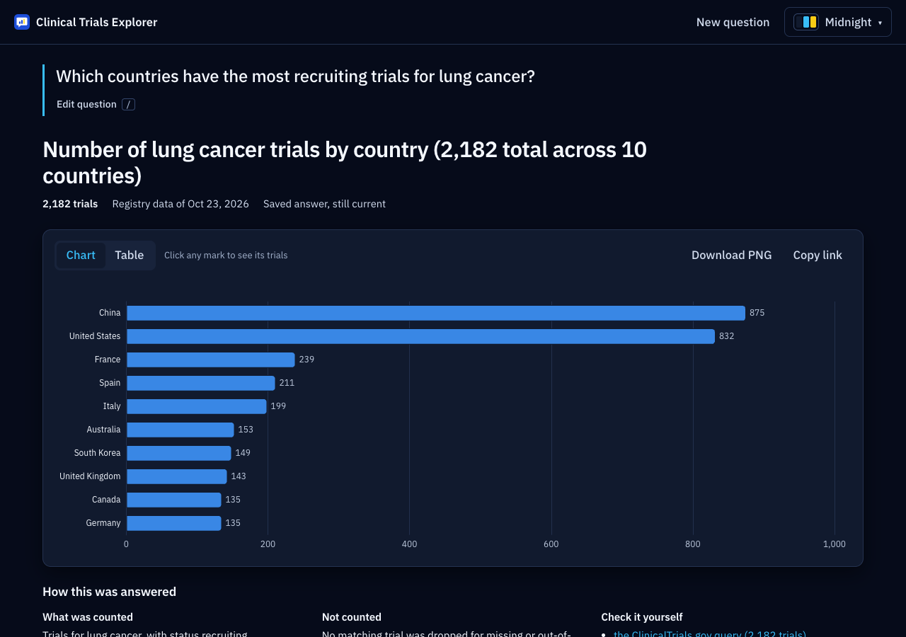
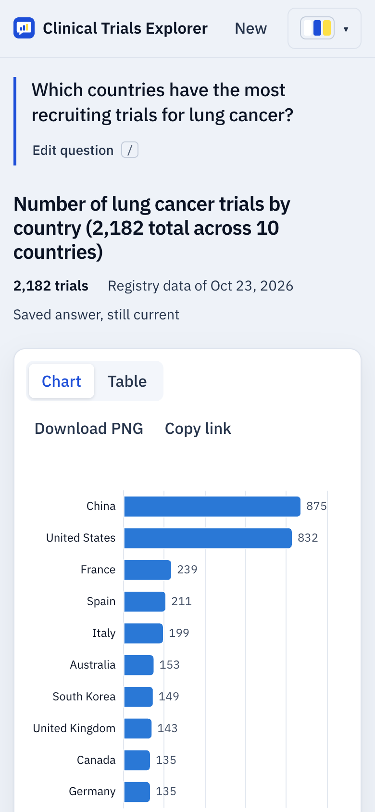

# ClinicalTrials.gov Query-to-Visualization Agent

Ask a question about clinical trials in plain words and get back a chart you can check. The backend turns the question into a structured, frontend-ready **visualization spec**, computed from live [ClinicalTrials.gov API](https://clinicaltrials.gov/data-api/api) data, with **citations for every data point**: the NCT ID plus the exact record field and value that put the trial there. A web app renders the specs and lets you click any bar, point or link to see the trials behind it.

**Contents**

- [Live demo](#live-demo) · [Run it locally](#run-it-locally-with-docker-compose)
- [Why it's interesting](#why-its-interesting) · [What's built](#whats-built) · [Web app](#web-app) · [How it works](#how-it-works)
- [API](#api): [endpoints](#endpoints), [`POST /v1/query`](#post-v1query), [response](#response) · [Examples](#examples-real-outputs)
- [Key design decisions](#key-design-decisions) · [Testing and validation](#testing-and-validation) · [Tools used and integrity](#tools-used-and-integrity) · [Limitations](#limitations)
- [Deployment](#deployment) · [Development](#development) · [Configuration](#configuration) · [Documentation](#documentation)

## Live demo

The whole system is deployed, so you can try it without installing anything:

| | |
|---|---|
| **Web app** | https://trials.cheiron.engineeradriel.com |
| **API** | https://api.cheiron.engineeradriel.com |
| **API docs, in the web app** | https://trials.cheiron.engineeradriel.com/docs shows how to call the API, with examples taken from recorded responses. The API also serves the full OpenAPI reference: [Swagger UI](https://api.cheiron.engineeradriel.com/docs) and [ReDoc](https://api.cheiron.engineeradriel.com/redoc). |
| **Infrastructure** | Kubernetes (k3s) on AWS EC2, with a PostgreSQL database running in the cluster for this demo. Everything is defined in Terraform and Kustomize; see [Deployment](#deployment) and [`infra/`](infra/README.md). |
| **Source code** | https://github.com/lonestarx1/clinical-trials-visualization-agent |

**The git history shows how the project was built.** Nothing was squashed. Every change went through a pull request with small commits, in this order:

1. Research and design: the requirements, the ClinicalTrials.gov API notes and the design questions, before any code.
2. Milestones M0 to M5: skeleton, data layer, charts, AI stages, networks, storage and jobs, then the web app.
3. Fixes found by testing against live data, the UI overhaul, deployment and the docs.

Features follow test-driven development: a failing `test:` commit, then the `feat:` or `fix:` commit that makes it pass. Browse the [merged pull requests](https://github.com/lonestarx1/clinical-trials-visualization-agent/pulls?q=is%3Apr+is%3Amerged) or run `git log --reverse`.

## Run it locally with Docker Compose

Requirements: Docker with Compose v2, and an OpenAI API key.

```bash
cp .env.example .env    # then set OPENAI_API_KEY
make up                 # same as: docker compose up -d --build --wait (postgres + api + web), then opens http://localhost:3000
curl -s localhost:8000/v1/query -H 'Content-Type: application/json' \
  -d '{"query": "How are breast cancer trials distributed across phases?"}'
# -> {"status": "ok", "visualization": {"type": "bar_chart", "title": ..., "encoding": ..., "data": [...]}, "meta": {...}}
```

- Web app: http://localhost:3000 (questions can be shared as `?q=...` links)
- API guide: http://localhost:3000/docs
- Interactive API reference (OpenAPI): http://localhost:8000/docs
- Stop with `make down`.



## Why it's interesting

Language models are good at reading questions and bad at counting. This project splits the work so that each side does what it's good at:

- **AI chooses, code computes.** The AI turns the question into a plan made of choices from fixed lists. Code fetches the data, computes every number and attaches every citation. The AI never produces a number or a citation.
- **Every number is traceable.** Each bar, bucket, node and edge lists the trials behind it, and each citation is checked against the record it came from before the response is sent.
- **Honest answers.** Counting rules are stated, excluded trials are counted, and a question we can't compute (such as an average duration) gets a clear refusal with a suggested alternative, not a different chart.
- **Exact, live data.** Charts come from ClinicalTrials.gov at request time, never from a sample, and the aggregated counts are cross-checked against the API's own counts.

## What's built

- **Pipeline:** question, then a validated plan, then live data, then a chart spec with citations and an AI-written, checked title.
- **Charts:** 7 types: bar, grouped bar, time series, histogram, scatter plot, network graph and single metric.
- **Measures:** trial counts, total and median enrollment, and distinct sponsors, drugs, countries and other entities, with an optional minimum number of trials.
- **Refusals:** the AI can't swap in a different measure. A question asking for something we can't compute gets a clear refusal and a suggestion.
- **Storage:** stored results with full citation lists, and plan and result caches that revalidate against daily data updates.
- **Speed:** background jobs for broad questions, and per-year counts without downloading every trial.
- **Cost control:** AI cost tracking per call, with a daily cap.
- **Results:** all 9 example questions from the assignment's appendix pass end to end against live data.
- **Deployment:** Kubernetes (k3s) on AWS, defined in Terraform.

**Planned:** a measured evaluation set for the AI stages and a model bake-off per stage. The current models are starting defaults. See [how it was built](docs/implementation-plan.md#whats-planned).

## Web app

A Next.js and Apache ECharts app in [`frontend/`](frontend/), built for people who need to trust the numbers:

- **Ask in plain words**, or refine with filters (drug, condition, sponsor, country, phase, status, years, chart type) shown as removable chips. The home screen has grouped example questions and your recent questions.
- **The question stays with its answer.** On submit, the search box moves up and becomes the page's heading, in your own words. Click it or press `/` to edit it in place, and `Esc` to cancel.
- **Every chart traces back to the trials.** Click any bar, point, node or link: a drawer lists the trials behind it, each with the exact record lines that put it there, highlighted (field path on hover), and pages through all of them.
- **Readable charts:** a colour-blind-safe palette validated for light and dark surfaces, horizontal bars for names, direct value labels, networks with clusters named after their largest entity, and a **table view** of every value.
- **Plain-language method notes:** what was counted, how the question was read, what was not counted, and links to the exact ClinicalTrials.gov queries. Technical details and the raw JSON fold away.
- **10 colour themes** (5 light, 5 dark, including high contrast) plus "Automatic". Clinical light is the default. Every theme passes contrast checks in CI (text ≥ 12:1, secondary text ≥ 7:1).
- **Smooth to use:** progress while answers are computed (real page progress for background jobs), shareable links to an answer (`?q=`) and to one data point's trials (`&d=`), PNG download, keyboard and screen-reader support, and phone layouts.
- **API guide** at `/docs`: how to call the API, with examples taken from recorded responses.

The charts are drawn **only from the response's `encoding`** ([`lib/adapter.ts`](frontend/lib/adapter.ts), tested against the example responses), which shows the schema renders without guessing. The app proxies `/api/*` to the backend, so the API address is a runtime setting (`API_BASE_URL`).

| Home | Evidence for one bar | Drug network |
|---|---|---|
|  |  |  |

| Theme picker | Midnight theme | Phone |
|---|---|---|
|  |  |  |

## How it works

```
request ─► validate (422) ─┬─► guard (AI, fail closed) ──────────────┐
                           └─► planner agent (AI + code tools) ──► gate (code) ─► compile ─► retrieve ─► aggregate ─► chart ─► verify citations ─► narrate (AI) ─► response
```

| Stage | Who | What |
|---|---|---|
| Guard | AI (`gpt-5.4-nano`) | Flags clearly malicious requests (prompt injection, misuse). Runs in parallel with planning. If it can't answer, the request is refused (503): **fail closed**. |
| Planner | AI agent (`gpt-5.4-mini`, LangGraph) | Turns words into **choices from fixed lists**: intent, chart type, dimension, measure, filters, comparison groups. Tools: `list_options`, `count_trials` (a real API count), `check_plan`, `submit_plan`. Bounded to 6 steps. |
| Gate | Code | Re-checks every plan: schema, chart compatibility, **entity grounding** (every drug, condition and sponsor must come from the question's own words), a stated reason for any filter the question didn't ask for, and **the plan must count what the question counts** ("how many sponsors" can't become a trial count). Structured request fields override the AI. |
| Compile, retrieve | Code | Plan -> Essie query tree (text from the request can only ever be a quoted phrase) -> ClinicalTrials.gov, with a global rate limiter, retries and a circuit breaker. Trials-per-year series are **counted with one call per year** instead of downloading every trial (2010-2020: 412 s → 57 s). |
| Aggregate, chart | Code | Every number. Measures: trials, total or median enrollment, and **distinct entities** (e.g. lead sponsors with at least 3 trials per year). Explicit counting rules for multi-valued fields, and nothing silently dropped (`meta.excluded`). Runs off the event loop, so a large question doesn't stall other requests. |
| Verify | Code | Every citation excerpt is compared with the record it came from; a mismatch fails the request. |
| Narrate | AI (`gpt-5.4-nano`) | Writes the chart title **with placeholders** filled from a fact sheet, so numbers are correct by construction. Checked for invented numbers, names not in the chart, evaluative claims, length and repeated phrases; one retry, then a template title. There is no free-text summary: it was removed as prone to hallucination and not required ([decision](docs/design/04b-ai-validation.md#revision-2026-10-24-the-ai-summary-is-removed)). |

**Networks:** one entity dimension gives co-occurrence (drugs used together); two give links between kinds (sponsor - drug, condition - drug, sponsor - collaborator, investigator - site). Node and edge weights are distinct trials, and edges also carry Jaccard similarity. The graph is pruned deterministically (recorded in `meta.network`) and communities are detected: in the melanoma example they separate lymphodepletion + IL-2 regimens, chemotherapy, checkpoint + BRAF/MEK therapy and peptide vaccines.

Models are configurable per stage (`GUARD_MODEL`, `PLANNER_MODEL`, `NARRATOR_MODEL`, each with a fallback model). The models above are starting defaults ([model selection](docs/design/20-model-selection.md)).

## API

The [API guide](https://trials.cheiron.engineeradriel.com/docs) walks through requests, responses, jobs and citation paging. The full schema is in the [Swagger UI](https://api.cheiron.engineeradriel.com/docs), [ReDoc](https://api.cheiron.engineeradriel.com/redoc) and at `/openapi.json`.

### Endpoints

| Method | Path | Purpose |
|---|---|---|
| `POST` | `/v1/query` | Question -> chart spec (200), or a background job for broad questions (**202** + `poll_url`) |
| `GET` | `/v1/jobs/{job_id}` | Job status, page progress, and the result when done (kept 24 h after finishing, then `410 expired`) |
| `GET` | `/v1/results/{result_id}/citations?datum=<key>&cursor=&page_size=` | **Every** trial behind one data point (bar, bucket, node, edge...), keyset-paginated |
| `GET` | `/v1/options` | Dimensions, measures, chart types and filter values with labels (for pickers) |
| `GET` | `/v1/usage` | Today's LLM calls and cost (admin token) |
| `GET` | `/health` | Database + ClinicalTrials.gov status and data timestamp |

### `POST /v1/query`

| Field | Type | Required | Notes |
|---|---|---|---|
| `query` | string | yes | 1-1,000 characters |
| `drug_name`, `condition`, `sponsor`, `country` | string or string[] | no | OR within a field; up to 10 terms of up to 200 characters. **Override the question.** |
| `trial_phase` | string[] | no | `PHASE1`... or labels like `"Phase 3"` |
| `status` | string[] | no | Overall status, e.g. `RECRUITING` or `"Recruiting"` |
| `start_year`, `end_year` | int | no | Start-date range |
| `compare` | 2-4 x `{label, drug_name?, condition?, sponsor?, country?}` | no | Comparison groups |
| `chart_type` | enum | no | `bar_chart`, `grouped_bar_chart`, `time_series`, `histogram`, `scatter_plot`, `network_graph`, `metric`. Checked against the plan: one that can't show the question answers 200 `could_not_interpret` (not 422: fit depends on the dimension the planner picks) |
| `top_n` | int 1-50 | no | |
| `match_mode` | `strict` \| `broad` | no | Drug/condition matching (default `strict`) |
| `sponsor_role` | `lead` \| `any` | no | Default `lead` |
| `citations` | `sample` \| `full` | no | Default `sample`. `full` inlines every citation, up to 2,000 per response (`CITATIONS_FULL_MAX`); above that it falls back to a sample and `meta.citations.reason` says why |
| `citations_per_datum` | int 1-50 | no | Default 5 |
| `phase_mode`, `condition_source`, `include_unknown`, `edge_metric`, `hide_query_entity` | | no | See [request fields](docs/design/05-request-fields.md) |

Unknown fields are rejected (422). Full schema: `/openapi.json`.

### Response

```jsonc
{
  "schema_version": "2.0",
  "status": "ok",                       // or no_matching_trials | out_of_scope | could_not_interpret (200, visualization null)
  "visualization": {
    "type": "bar_chart",
    "title": "...",
    "encoding": {                       // every data key is named here: no guessing
      "x": {"field": "phase", "type": "ordinal", "label": "Phase", "sort": "natural"},
      "y": {"field": "trial_count", "type": "quantitative", "label": "Number of trials", "unit": "trials"}
    },
    "data": [
      {"key": "PHASE2", "phase": "Phase 2", "trial_count": 3546, "citation_count": 3546, "citations_truncated": true,
       "citations": [{"nct_id": "NCT...", "url": "https://clinicaltrials.gov/study/NCT...", "title": "...",
                      "evidence": [{"field": "protocolSection.designModule.phases[0]", "excerpt": "PHASE2"}]}]}
    ]
  },
  "meta": {
    "interpretation": {...}, "filters": {...}, "assumptions": [...], "warnings": [...], "notes": [...],
    "counting_rule": "...", "additive": true, "unique_trials": 16765, "excluded": [{"reason": "no start date", "count": 5}],
    "api_queries": [{"group": null, "url": "https://clinicaltrials.gov/api/v2/studies?...", "total_count": 16765}],
    "data_timestamp": "...", "guard": {...}, "planner": {...}, "narration": {...},
    "usage": {"llm_calls": 4, "cost_usd": 0.0027}, "timings_ms": {...}, "trace_id": "..."
  }
}
```

Per chart type: [response schema design](docs/design/12-io-schema.md). Each data point carries up to `citations_per_datum` citations inline (all of them with `citations: "full"`), plus `citation_count`. The full list always comes from the citations endpoint, using the response's `result_id` and the data point's `key`. `meta.citations` reports the mode `requested` and `applied`, and the `reason` when they differ. `meta.cache` says whether the plan and result came from cache (`hit`, `revalidated`, `miss`).

Errors share one body, routing errors included: `{"error": {"code", "message", "details", "trace_id"}}` with codes `invalid_request` (422), `rejected_by_policy` (400), `unauthorized` (401, `/v1/usage`), `not_found` (404, also unknown paths), `method_not_allowed` (405), `expired` (410, results and jobs), `too_many_requests` (429), `upstream_unavailable` / `llm_unavailable` / `safety_check_unavailable` / `budget_exceeded` (503) and `internal_error` (500). Once the daily AI budget is spent, `budget_exceeded` goes only to questions that need a model call: an exact repeat whose stored answer is still valid is answered with no model call.

## Examples (real outputs)

Generated by [`scripts/run_examples.py`](scripts/run_examples.py) against the running stack on 2026-10-24 with live data, and never edited by hand. When schema 2.0 removed `visualization.summary`, a script dropped that key from them and set `schema_version` to `"2.0"`; nothing else changed.

| # | Request | Chart | Trials | Time |
|---|---|---|---|---|
| 1 | "How has the number of trials for this drug changed per year since 2015?" + `drug_name: Pembrolizumab` (the assignment's example) | [time_series](docs/examples/1-drug-trend.json) | 2,586 | ~10 s |
| 2 | "How are breast cancer trials distributed across phases?" | [bar_chart](docs/examples/2-condition-phases.json) | 16,765 | ~32 s |
| 3 | "Compare phases for trials involving pembrolizumab vs nivolumab." | [grouped_bar_chart](docs/examples/3-drug-comparison.json) | 4,228 | ~16 s |
| 4 | "Which countries have the most recruiting trials for lung cancer?" | [bar_chart](docs/examples/4-recruiting-countries.json) | 2,182 | ~11 s |
| 5 | "Which drugs frequently co-occur in combination studies for melanoma?" | [network_graph](docs/examples/5-drug-network.json) | 1,422 | ~16 s |

AI cost per question: about $0.003 (measured, `meta.usage`).

## Key design decisions

The full reasoning, the alternatives and the links to requirements are in [docs/design](docs/design/README.md) (21 decisions). The main ones:

- **AI chooses, code computes.** The planner picks from registry lists; all numbers and citations come from deterministic code. The AI writes only the chart title, with placeholders; there is no free-text summary.
- **Live API, exact answers.** Every chart is computed from ClinicalTrials.gov at request time, never sampled. A local mirror was designed twice and not built. The deciding reason is accuracy: the API resolves drug and condition synonyms, and a plain local match misses about 20% of "lung cancer" trials ([Q21](docs/design/21-local-mirror-revisited.md)).
- **Refuse rather than substitute.** If no measure computes what was asked (e.g. an average duration), the answer says so and suggests the closest question that can be answered, instead of quietly charting something else.
- **Strict matching by default.** Drugs match intervention names (with the API's own synonym expansion: "Keytruda" finds pembrolizumab trials); conditions are quoted phrases; "sponsor" means lead sponsor. `match_mode` and `sponsor_role` widen it. Measured in the [live probe](docs/api/live-probe.md).
- **Explicit counting rules.** 17% of trials have two phases, and trials list many drugs, conditions and countries. Every chart states its rule, whether bars add up (`meta.additive`) and how many distinct trials it covers.
- **Defence in depth.** Request validation, an AI guard, a strict plan schema, entity grounding, and an expression tree that makes query injection impossible. Verified live: an injection attempt matched under 100 trials, not all ~600k.
- **Caching that stays correct.** Repeated questions reuse the stored plan (no planner call) and the stored answer. ClinicalTrials.gov refreshes daily, so a stored answer is reused only if the data version is unchanged, or after revalidation: no matching trial updated since, and the same total (2 cheap counts instead of refetching). Measured: a repeat question in 0.9 s instead of 13 s, with 1 model call instead of 4.
- **Background jobs** for questions estimated above `SYNC_MAX_SECONDS` (60 s): 202 + polling with page progress, one active job per identical request, `SKIP LOCKED` workers, retries and restart recovery.
- **One registry.** A dimension is one entry (API fields, filter, enum, counting rule); options, validation, retrieval, aggregation and citations all read from it.

## Testing and validation

The code was written test-first: each `test:` commit fails before the `feat:` commit that follows it. Expected values are worked out by hand or from direct API counts, never copied from the code's output.

| Suite | Command | What |
|---|---|---|
| Offline (CI) | `make test` | 407 unit, contract and integration tests: compiler strings written by hand, chart numbers worked out by hand from recorded real trials and small fixtures, scripted fake models for the agents |
| Database (CI) | `make test-db` | 23 tests against Postgres (in its own `ctviz_test` database): repositories, stored results and citation paging, plan and result caches (per citation mode), background jobs (heartbeats, requeue after a restart, expiry), the daily budget (cached answers still served) |
| Live API | `make test-live` | 18 checks: query syntax against the real API, and **cross-checks**. Our aggregated counts equal the API's own counts exactly, and the sponsor counts and per-year counts equal an independent tally of the raw records |
| End to end | `make test-e2e` | 11 questions through the running stack, with real models and live data: **the 9 appendix questions all pass**, plus a sponsor-count question and a refused "average duration" |
| Web (CI) | `make test-web` | 57 tests: the chart adapter against the example responses, theme contrast gates, the question, evidence and API-guide helpers |

CI never calls ClinicalTrials.gov or a model: the live and end-to-end suites are opt-in.

## Tools used and integrity

- **Tools:** Claude Code (Anthropic) as the coding assistant; OpenAI models inside the product for the guard, planner and title stages ([design Q20](docs/design/20-model-selection.md)).
- **Designed deliberately:** the decisions in [`docs/design/`](docs/design/README.md), made one question at a time with reasons and alternatives: the architecture (the AI chooses, code computes), the schemas, the counting rules, the citation model and the deployment.
- **Generated and adapted:** code, tests and docs were drafted with Claude Code, then reviewed, tested and revised, test-first where possible.
- **How correctness was checked:** the test suites in [Testing and validation](#testing-and-validation), counts cross-checked against the API's own counts, and every citation checked against its raw record.

The full disclosure is in the [integrity note](docs/parts/08-integrity-note.md).

## Limitations

- Very broad questions that need per-trial data (e.g. sponsors per year across 273k trials) still take minutes, as background jobs. Plain trials-per-year counts are fast (one call per year). A local mirror would make the rest instant, but can't match the API's synonym search yet ([Q21](docs/design/21-local-mirror-revisited.md)).
- Shares and percentages are not a measure: "what share of trials have results, by phase" shows counts with and without results side by side, not a percentage.
- Two parts of the database design are not built: the page-level API cache (L1) and the `traces` table (traces live in logs and `meta`).
- Sponsor names are not merged across spellings ("Merck Sharp & Dohme LLC" vs "Merck & Co."). MeSH grouping inherits MeSH quirks: "aldesleukin" and "Interleukin-2" can be separate drug nodes.
- The ClinicalTrials.gov rate limiter, the per-client limit and the job workers are in-process (one instance). Several instances would need a shared store such as Redis.
- The AI stages have no measured evaluation set yet, and the models have not been compared in a bake-off (see [what's planned](docs/implementation-plan.md#whats-planned)).

## Deployment

Live at **https://trials.cheiron.engineeradriel.com** (web app) and **https://api.cheiron.engineeradriel.com** (API).

It runs on **Kubernetes (k3s) on one EC2 t3.medium**, defined in **Terraform** (network, node, IAM, ECR, Secrets Manager, DNS) and **Kustomize** (Postgres, API, web, Ingress with Let's Encrypt). `make deploy` builds, pushes and rolls out through an SSM tunnel: there's no SSH and no public Kubernetes API.

**Why this setup:** a short build window and low cost (about $1.50/day). k3s is real Kubernetes, with the same manifests and Helm as EKS, but without EKS's $2.40/day control-plane fee. The same Kustomize base also has an EKS overlay.

**In production** it would run on EKS across three zones, with:
- RDS for Postgres;
- background workers scaled on queue depth;
- one rate limiter shared by all pods (ClinicalTrials.gov limits per IP);
- CloudFront, WAF and an ALB in front;
- External Secrets, and GitOps deploys with Argo CD.

The reasons and alternatives are in [design Q19](docs/design/19-deployment-ui.md#revision-2026-10-25-what-was-actually-deployed). How to deploy from scratch is in [`infra/README.md`](infra/README.md).

## Development

| Command | What it runs |
|---|---|
| `make up` / `make down` / `make logs` | Start, stop and follow the Compose stack |
| `make test` / `make test-db` / `make test-live` / `make test-e2e` | See [testing](#testing-and-validation) |
| `make test-web` | Frontend type check + tests (Vitest) |
| `make lint` / `make fmt` | ruff, formatting check and mypy (strict) / auto-format |
| `make infra-plan` / `make infra-apply` / `make deploy` / `make infra-destroy` | Terraform and the k3s rollout ([`infra/README.md`](infra/README.md)) |

`POST /v1/debug/plan` runs a hand-written QueryPlan without the AI stages (disable it with `ENABLE_DEBUG_ENDPOINTS=false`).

Layout: [`backend/`](backend/) (FastAPI, Python 3.12, `uv`), [`frontend/`](frontend/) (Next.js), [`infra/`](infra/) (Terraform and Kubernetes), [`scripts/`](scripts/) (example runs and the API probe), [`docs/`](docs/).

## Configuration

All settings come from environment variables (or `.env`); only `OPENAI_API_KEY` is required. Defaults are in [`backend/app/core/config.py`](backend/app/core/config.py), and model prices in [`pricing.yaml`](backend/app/core/pricing.yaml).

## Documentation

| Document | What it covers |
|---|---|
| [API guide](https://trials.cheiron.engineeradriel.com/docs) | How to call the API: requests, responses, jobs, citation paging |
| [Swagger UI](https://api.cheiron.engineeradriel.com/docs) and [ReDoc](https://api.cheiron.engineeradriel.com/redoc) | The full OpenAPI reference |
| [Assignment](docs/assignment.md) and [requirement breakdown](docs/parts/README.md) | The original brief and every requirement it implies |
| [Integrity note](docs/parts/08-integrity-note.md) | Tools used, how correctness was checked, what was designed vs generated |
| [System design (Q1-Q21)](docs/design/README.md) | Each design decision, with reasons, alternatives and requirement links |
| [How it was built](docs/implementation-plan.md) | Milestones, the test-first workflow, and what's planned |
| [ClinicalTrials.gov API research](docs/api/contract.md) and [live probe](docs/api/live-probe.md) | What the API documents, and what it does when probed |
| [Example responses](docs/examples/) | Five real responses from the running stack |
| [Infrastructure and deployment](infra/README.md) | Terraform, k3s and deploying from scratch |

---

Built by [Adriel](https://engineeradriel.com).
