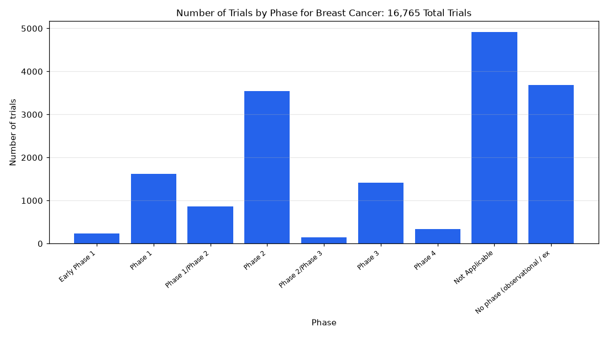

# 001. How are breast cancer trials distributed across phases?

**Question:** How are breast cancer trials distributed across phases?

Asked in **live** mode against `https://api.cheiron.engineeradriel.com` on 2026-10-24 22:46 UTC. [Open in the web app](https://trials.cheiron.engineeradriel.com/?q=How+are+breast+cancer+trials+distributed+across+phases%3F&mode=live).

## Answer

- **Status:** `ok` (HTTP 200)
- **Time to answer:** 1.1 s
- **Title:** Number of Trials by Phase for Breast Cancer: 16,765 Total Trials
- **Chart:** `bar_chart`
- **Interpretation:** intent `distribution`, dimension `phase`, measure `trial_count`
- **Filters:** `{"conditions": ["breast cancer"]}`
- **Trials counted:** 16,765
- **ClinicalTrials.gov data of:** 2026-10-23T09:00:04

## Chart

## Data

| Phase | Number of trials |
|---|---|
| Early Phase 1 | 228 |
| Phase 1 | 1,619 |
| Phase 1/Phase 2 | 868 |
| Phase 2 | 3,546 |
| Phase 2/Phase 3 | 146 |
| Phase 3 | 1,408 |
| Phase 4 | 343 |
| Not Applicable | 4,921 |
| No phase (observational / expanded access) | 3,686 |

## Counting rule

Each trial is counted once; trials with two phases get a combined bucket (e.g. Phase 2/Phase 3).

## Sample citations

- `EARLY_PHASE1`: [NCT04861077](https://clinicaltrials.gov/study/NCT04861077) Monitoring Breast Cancer Immunotherapy Treatment With Advanced Positron Emission Tomography Magnetic Resonance
- `PHASE1`: [NCT07454668](https://clinicaltrials.gov/study/NCT07454668) Trastuzumab Deruxtecan + Stereotactic Radiosurgery (SRS) in HER2+ Breast Cancer Brain Metastases
- `PHASE1/PHASE2`: [NCT04430595](https://clinicaltrials.gov/study/NCT04430595) Multi-4SCAR-T Therapy Targeting Breast Cancer
- `PHASE2`: [NCT07729046](https://clinicaltrials.gov/study/NCT07729046) Neu Direction: Testing the Efficacy of Adding HER Inhibition to Standard of Care in Metastatic MLH1-low Endocr
- `PHASE2/PHASE3`: [NCT07410169](https://clinicaltrials.gov/study/NCT07410169) Efficacy and Safety of Hyperbaric Oxygen Therapy in Improving Nab-paclitaxel-Induced Peripheral Neuropathy

## ClinicalTrials.gov queries

- [search](https://clinicaltrials.gov/api/v2/studies?query.cond=%22breast+cancer%22): 16,765 trials

## Timings (ms)

`{"plan": 1468, "count": 214, "total": 20396, "narrate": 886, "retrieve": 17132, "aggregate": 686}`
