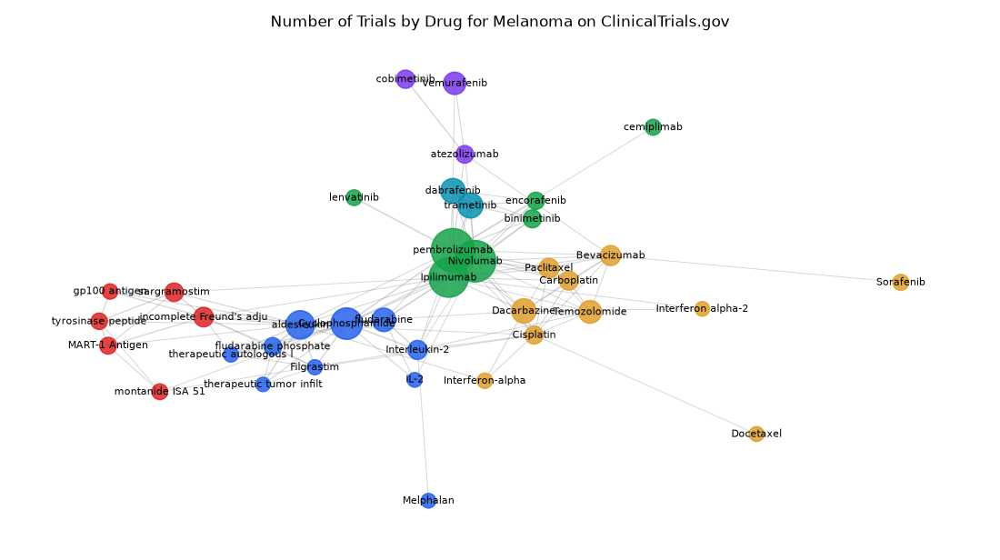

# 002. Which drugs are most often tested together in melanoma trials?

**Question:** Which drugs are most often tested together in melanoma trials?

Asked in **live** mode against `https://api.cheiron.engineeradriel.com` on 2026-10-24 22:46 UTC. [Open in the web app](https://trials.cheiron.engineeradriel.com/?q=Which+drugs+are+most+often+tested+together+in+melanoma+trials%3F&mode=live).

## Answer

- **Status:** `ok` (HTTP 200)
- **Time to answer:** 1.2 s
- **Title:** Number of Trials by Drug for Melanoma on ClinicalTrials.gov
- **Chart:** `network_graph`
- **Interpretation:** intent `network`, dimension `drug`, dimension_2 `drug`, measure `trial_count`
- **Filters:** `{"conditions": ["melanoma"]}`
- **Trials counted:** 1,446
- **ClinicalTrials.gov data of:** 2026-10-23T09:00:04

## Chart

## Data

**Largest nodes** (trials)

| Entity | Type | Trials | Links |
|---|---|---:|---:|
| pembrolizumab | drug | 250 | 19 |
| Nivolumab | drug | 231 | 16 |
| Ipilimumab | drug | 206 | 18 |
| Cyclophosphamide | drug | 126 | 13 |
| aldesleukin | drug | 99 | 16 |
| trametinib | drug | 73 | 6 |
| dabrafenib | drug | 70 | 7 |
| Dacarbazine | drug | 69 | 11 |
| fludarabine | drug | 62 | 7 |
| Temozolomide | drug | 58 | 8 |
| Vemurafenib | drug | 55 | 3 |
| Bevacizumab | drug | 41 | 10 |
| Paclitaxel | drug | 39 | 8 |
| incomplete Freund's adjuvant | drug | 38 | 10 |
| Carboplatin | drug | 35 | 8 |

**Strongest links** (shared trials)

| From | To | Shared trials |
|---|---|---:|
| Ipilimumab | Nivolumab | 122 |
| Cyclophosphamide | fludarabine | 60 |
| dabrafenib | trametinib | 60 |
| aldesleukin | Cyclophosphamide | 50 |
| Nivolumab | pembrolizumab | 37 |
| Carboplatin | Paclitaxel | 25 |
| Cyclophosphamide | fludarabine phosphate | 25 |
| Ipilimumab | pembrolizumab | 25 |
| cobimetinib | Vemurafenib | 24 |
| aldesleukin | fludarabine | 21 |
| binimetinib | encorafenib | 21 |
| aldesleukin | fludarabine phosphate | 18 |
| aldesleukin | incomplete Freund's adjuvant | 15 |
| Cyclophosphamide | Interleukin-2 | 15 |
| lenvatinib | pembrolizumab | 15 |

## Counting rule

Node size = distinct trials with that entity; edge width = distinct trials with both.

## Assumptions

- “Most often tested together” is interpreted as drugs that co-occur in the same melanoma trial.

## Sample citations

- `drug:pembrolizumab`: [NCT05669352](https://clinicaltrials.gov/study/NCT05669352) CA-4948 in Combination With Pembrolizumab and Stereotactic Radiosurgery to Improve Treatment of Melanoma Brain
- `drug:nivolumab`: [NCT07862530](https://clinicaltrials.gov/study/NCT07862530) Neoadjuvant RP2 + Nivolumab in Patients With Melanoma
- `drug:ipilimumab`: [NCT07838974](https://clinicaltrials.gov/study/NCT07838974) Adding Anakinra and Tocilizumab to Nivolumab and Ipilimumab for the Treatment of Melanoma Patients 50 Years of
- `drug:cyclophosphamide`: [NCT07651618](https://clinicaltrials.gov/study/NCT07651618) A Phase II Trial of Tumour Infiltrating Lymphocyte Adoptive Cell Therapy in Patients With Immune Checkpoint In
- `drug:aldesleukin`: [NCT07651618](https://clinicaltrials.gov/study/NCT07651618) A Phase II Trial of Tumour Infiltrating Lymphocyte Adoptive Cell Therapy in Patients With Immune Checkpoint In

## ClinicalTrials.gov queries

- [search](https://clinicaltrials.gov/api/v2/studies?query.cond=%22melanoma%22): 3,780 trials

## Timings (ms)

`{"plan": 691, "count": 0, "total": 5714, "narrate": 886, "retrieve": 3765, "aggregate": 368}`
