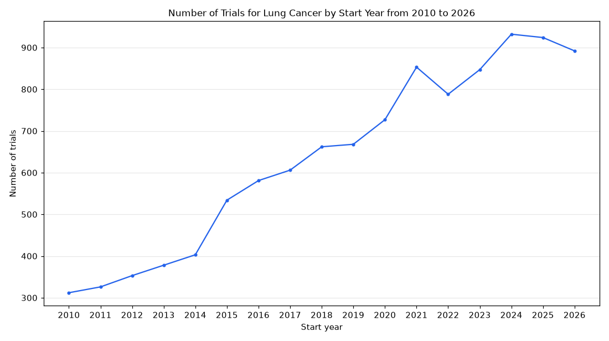

# 003. How many lung cancer trials started each year since 2010?

**Question:** How many lung cancer trials started each year since 2010?

Asked in **live** mode against `https://api.cheiron.engineeradriel.com` on 2026-10-24 22:48 UTC. [Open in the web app](https://trials.cheiron.engineeradriel.com/?q=How+many+lung+cancer+trials+started+each+year+since+2010%3F&mode=live).

## Answer

- **Status:** `ok` (HTTP 200)
- **Time to answer:** 104.6 s
- **Title:** Number of Trials for Lung Cancer by Start Year from 2010 to 2026
- **Chart:** `time_series`
- **Interpretation:** intent `trend`, dimension `start_year`, measure `trial_count`
- **Filters:** `{"conditions": ["lung cancer"], "start_year_min": 2010}`
- **Trials counted:** 10,786
- **ClinicalTrials.gov data of:** 2026-10-23T09:00:04

## Chart

## Data

| Start year | Number of trials | estimated_count |
|---|---|---|
| 2010 | 312 | 1 |
| 2011 | 326 | 0 |
| 2012 | 353 | 0 |
| 2013 | 378 | 0 |
| 2014 | 403 | 1 |
| 2015 | 534 | 4 |
| 2016 | 581 | 0 |
| 2017 | 606 | 34 |
| 2018 | 662 | 70 |
| 2019 | 668 | 59 |
| 2020 | 727 | 87 |
| 2021 | 853 | 95 |
| 2022 | 788 | 92 |
| 2023 | 847 | 126 |
| 2024 | 932 | 185 |
| 2025 | 924 | 246 |
| 2026 | 892 | 481 |

## Counting rule

Each trial is counted once, in the year it started (or is expected to start).

## Assumptions

- Counts trials with condition 'lung cancer' using ClinicalTrials.gov condition matching.
- Interprets 'started each year since 2010' as trials with start year from 2010 onward.

## Warnings

- Most trials in 2026 have estimated (planned) dates.

## Notes

- The year filter excludes trials without a start date.

## Left out

- 29 trials: start after 2026

## Sample citations

- `2010`: [NCT01265433](https://clinicaltrials.gov/study/NCT01265433) Galinpepimut-S (WT-1 Analog Peptide) Vaccine in Malignant Pleural Mesothelioma After Combined Modality Therapy
- `2011`: [NCT01465802](https://clinicaltrials.gov/study/NCT01465802) Study Of Dacomitinib (PF-00299804) In Advanced NSCLC Patients (Post Chemo Or Select First Line) To Evaluate Pr
- `2012`: [NCT01754025](https://clinicaltrials.gov/study/NCT01754025) INHERIT EGFR - Studying Germline EGFR Mutations
- `2013`: [NCT01951586](https://clinicaltrials.gov/study/NCT01951586) Denosumab in Combination With Chemotherapy as First-line Treatment of Metastatic Non-small Cell Lung Cancer
- `2014`: [NCT02300298](https://clinicaltrials.gov/study/NCT02300298) Nintedanib Plus Docetaxel in Japanese Patients With Adenocarcinoma Subtype Non-small Cell Lung Cancer After Fa

## ClinicalTrials.gov queries

- [search](https://clinicaltrials.gov/api/v2/studies?filter.advanced=AREA%5BStartDate%5DRANGE%5B2010-01-01%2CMAX%5D&query.cond=%22lung+cancer%22): 10,815 trials

## Timings (ms)

`{"plan": 1776, "count": 8706, "retrieve": 91744, "aggregate": 580, "narrate": 1053, "total": 103870}`
