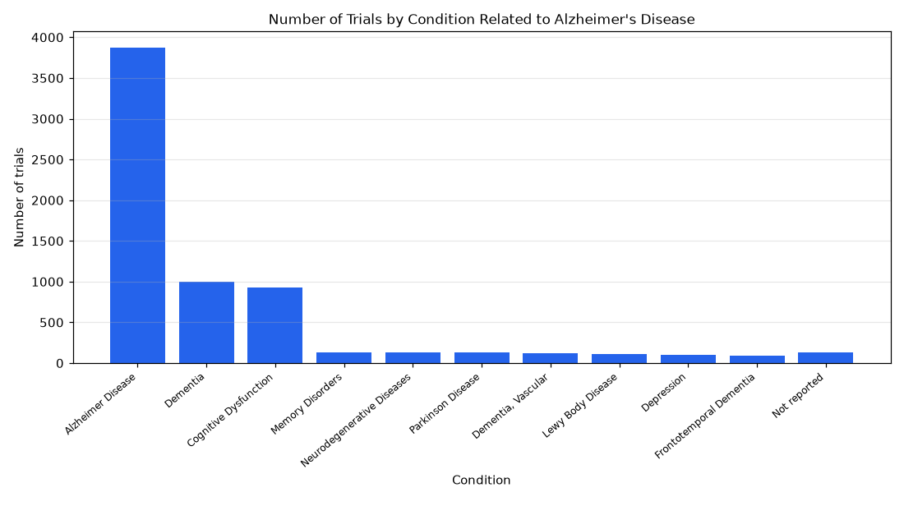

# 004. What are the most common conditions studied in Alzheimer's disease trials?

**Question:** What are the most common conditions studied in Alzheimer's disease trials?

Asked in **live** mode against `https://api.cheiron.engineeradriel.com` on 2026-10-24 22:47 UTC. [Open in the web app](https://trials.cheiron.engineeradriel.com/?q=What+are+the+most+common+conditions+studied+in+Alzheimer%27s+disease+trials%3F&mode=live).

## Answer

- **Status:** `ok` (HTTP 200)
- **Time to answer:** 43.3 s
- **Title:** Number of Trials by Condition Related to Alzheimer's Disease
- **Chart:** `bar_chart`
- **Interpretation:** intent `top_n`, dimension `condition`, measure `trial_count`
- **Filters:** `{"conditions": ["Alzheimer's disease"]}`
- **Trials counted:** 4,238
- **ClinicalTrials.gov data of:** 2026-10-23T09:00:04

## Chart

## Data

| Condition | Number of trials |
|---|---|
| Alzheimer Disease | 3,876 |
| Dementia | 998 |
| Cognitive Dysfunction | 928 |
| Memory Disorders | 130 |
| Neurodegenerative Diseases | 130 |
| Parkinson Disease | 129 |
| Dementia, Vascular | 118 |
| Lewy Body Disease | 111 |
| Depression | 96 |
| Frontotemporal Dementia | 92 |
| Not reported | 130 |

## Counting rule

Each trial is counted once per distinct condition it lists.

## Assumptions

- Counts trials studying Alzheimer's disease and groups them by condition.

## Notes

- Showing the top 10 of 613 conditions.

## Sample citations

- `alzheimer disease`: [NCT07871487](https://clinicaltrials.gov/study/NCT07871487) Tau Pathology in the Brain After Hip or Knee Replacement Surgery
- `dementia`: [NCT07824245](https://clinicaltrials.gov/study/NCT07824245) Advancing Ethical Goals In Society Trial
- `cognitive dysfunction`: [NCT07871487](https://clinicaltrials.gov/study/NCT07871487) Tau Pathology in the Brain After Hip or Knee Replacement Surgery
- `memory disorders`: [NCT07773493](https://clinicaltrials.gov/study/NCT07773493) A Mobile Informatics Solution to Assist Caregivers in Care Coordination and Monitoring Social Engagement
- `neurodegenerative diseases`: [NCT07669272](https://clinicaltrials.gov/study/NCT07669272) Deep Cervical Lymphovenous Anastomosis for Severe Alzheimer's Disease

## ClinicalTrials.gov queries

- [search](https://clinicaltrials.gov/api/v2/studies?query.cond=%22Alzheimer%27s+disease%22): 4,238 trials

## Timings (ms)

`{"plan": 2046, "count": 215, "retrieve": 39290, "aggregate": 352, "narrate": 872, "total": 42784}`
