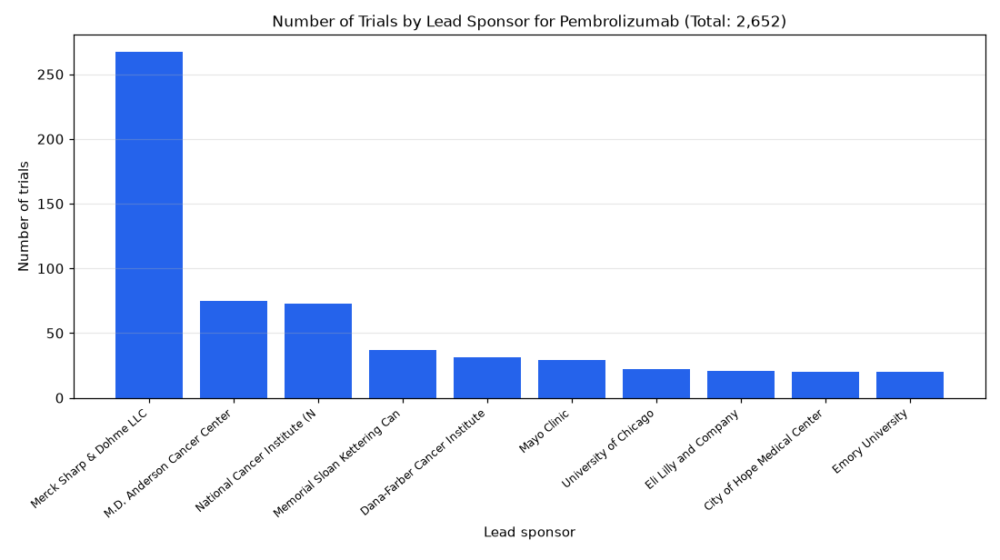

# 005. Which sponsors run the most pembrolizumab trials?

**Question:** Which sponsors run the most pembrolizumab trials?

Asked in **live** mode against `https://api.cheiron.engineeradriel.com` on 2026-10-24 22:47 UTC. [Open in the web app](https://trials.cheiron.engineeradriel.com/?q=Which+sponsors+run+the+most+pembrolizumab+trials%3F&mode=live).

## Answer

- **Status:** `ok` (HTTP 200)
- **Time to answer:** 31.3 s
- **Title:** Number of Trials by Lead Sponsor for Pembrolizumab (Total: 2,652)
- **Chart:** `bar_chart`
- **Interpretation:** intent `top_n`, dimension `sponsor`, measure `trial_count`
- **Filters:** `{"drugs": ["pembrolizumab"]}`
- **Trials counted:** 2,652
- **ClinicalTrials.gov data of:** 2026-10-23T09:00:04

## Chart

## Data

| Lead sponsor | Number of trials |
|---|---|
| Merck Sharp & Dohme LLC | 267 |
| M.D. Anderson Cancer Center | 75 |
| National Cancer Institute (NCI) | 73 |
| Memorial Sloan Kettering Cancer Center | 37 |
| Dana-Farber Cancer Institute | 31 |
| Mayo Clinic | 29 |
| University of Chicago | 22 |
| Eli Lilly and Company | 21 |
| City of Hope Medical Center | 20 |
| Emory University | 20 |

## Counting rule

Each trial is counted once.

## Assumptions

- Interpreting 'run' as lead sponsor.

## Notes

- Showing the top 10 of 979 lead sponsors.

## Sample citations

- `merck sharp & dohme llc`: [NCT07801027](https://clinicaltrials.gov/study/NCT07801027) A Trial of Pembrolizumab With Chemotherapy or Chemoradiotherapy in Participants From India With Different Type
- `m.d. anderson cancer center`: [NCT07843550](https://clinicaltrials.gov/study/NCT07843550) A Phase 1/2 Trial Of Larotrectinib And Pembrolizumab In Patients With Solid Tumors Previously Treated With Imm
- `national cancer institute (nci)`: [NCT07689240](https://clinicaltrials.gov/study/NCT07689240) Testing the Investigational Medication Pembrolizumab After Kidney Removal for Patients With Non-Clear Cell Ren
- `memorial sloan kettering cancer center`: [NCT07872553](https://clinicaltrials.gov/study/NCT07872553) A Study of Treatment Delivery Preference In People With Kidney Cancer
- `dana-farber cancer institute`: [NCT07513324](https://clinicaltrials.gov/study/NCT07513324) Risk-adapted Therapy in HPV-positive Oropharyngeal Cancer Using Circulating Tumor (ct) HPV DNA Profiling (ReAC

## ClinicalTrials.gov queries

- [search](https://clinicaltrials.gov/api/v2/studies?filter.advanced=AREA%5BInterventionNameSearch%5D%22pembrolizumab%22): 2,652 trials

## Timings (ms)

`{"plan": 1628, "count": 7475, "retrieve": 20986, "aggregate": 72, "narrate": 976, "total": 31145}`
