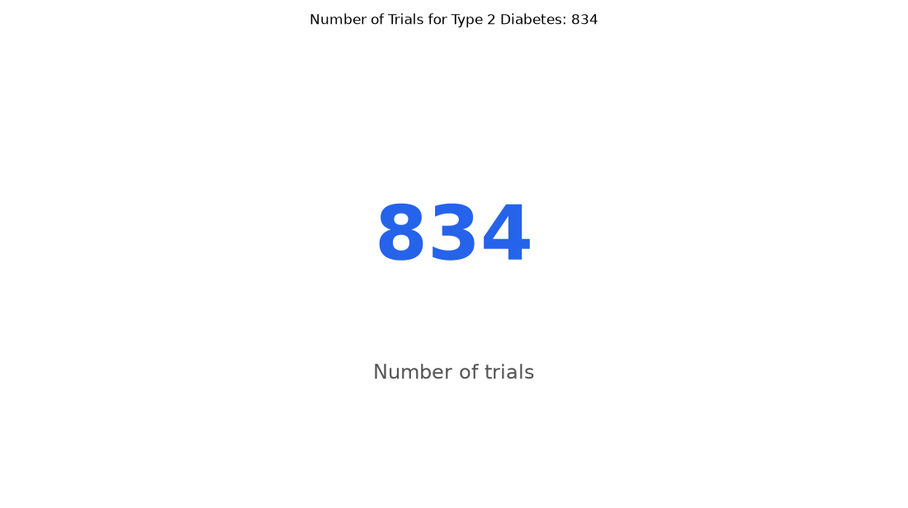

# 006. How many trials are currently recruiting for type 2 diabetes?

**Question:** How many trials are currently recruiting for type 2 diabetes?

Asked in **live** mode against `https://api.cheiron.engineeradriel.com` on 2026-10-24 22:46 UTC. [Open in the web app](https://trials.cheiron.engineeradriel.com/?q=How+many+trials+are+currently+recruiting+for+type+2+diabetes%3F&mode=live).

## Answer

- **Status:** `ok` (HTTP 200)
- **Time to answer:** 4.2 s
- **Title:** Number of Trials for Type 2 Diabetes: 834
- **Chart:** `metric`
- **Interpretation:** intent `single_number`, measure `trial_count`
- **Filters:** `{"conditions": ["type 2 diabetes"], "statuses": ["RECRUITING"]}`
- **Trials counted:** 834
- **ClinicalTrials.gov data of:** 2026-10-23T09:00:04

## Chart

## Data

| Number of trials |
|---|
| 834 |

## Counting rule

Each matching trial is counted once.

## Assumptions

- 'currently' interpreted as trials with status RECRUITING in ClinicalTrials.gov live data.

## Sample citations

- `all`: [NCT07748208](https://clinicaltrials.gov/study/NCT07748208) A Study Evaluating the Safety of Inavolisib and Fulvestrant With or Without Palbociclib in Participants With A

## ClinicalTrials.gov queries

- [search](https://clinicaltrials.gov/api/v2/studies?filter.overallStatus=RECRUITING&query.cond=%22type+2+diabetes%22): 834 trials

## Timings (ms)

`{"plan": 2234, "count": 223, "retrieve": 733, "aggregate": 148, "narrate": 744, "total": 4090}`
