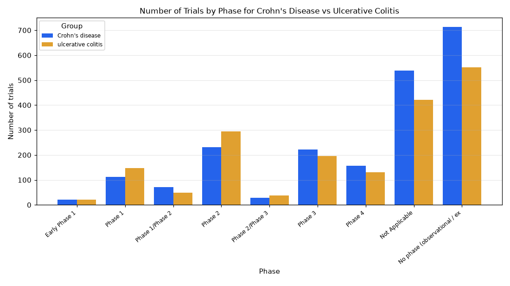

# 007. Compare the phases of Crohn's disease and ulcerative colitis trials

**Question:** Compare the phases of Crohn's disease and ulcerative colitis trials

Asked in **live** mode against `https://api.cheiron.engineeradriel.com` on 2026-10-24 22:47 UTC. [Open in the web app](https://trials.cheiron.engineeradriel.com/?q=Compare+the+phases+of+Crohn%27s+disease+and+ulcerative+colitis+trials&mode=live).

## Answer

- **Status:** `ok` (HTTP 200)
- **Time to answer:** 23.6 s
- **Title:** Number of Trials by Phase for Crohn's Disease vs Ulcerative Colitis
- **Chart:** `grouped_bar_chart`
- **Interpretation:** intent `comparison`, dimension `phase`, measure `trial_count`
- **Filters:** `{"groups": [{"label": "Crohn's disease", "conditions": ["Crohn's disease"]}, {"label": "ulcerative colitis", "conditions": ["ulcerative colitis"]}]}`
- **Trials counted:** 3,286
- **ClinicalTrials.gov data of:** 2026-10-23T09:00:04

## Chart

## Data

| Phase | Group | Number of trials |
|---|---|---|
| Early Phase 1 | Crohn's disease | 21 |
| Phase 1 | Crohn's disease | 112 |
| Phase 1/Phase 2 | Crohn's disease | 71 |
| Phase 2 | Crohn's disease | 232 |
| Phase 2/Phase 3 | Crohn's disease | 28 |
| Phase 3 | Crohn's disease | 222 |
| Phase 4 | Crohn's disease | 157 |
| Not Applicable | Crohn's disease | 538 |
| No phase (observational / expanded access) | Crohn's disease | 714 |
| Early Phase 1 | ulcerative colitis | 21 |
| Phase 1 | ulcerative colitis | 147 |
| Phase 1/Phase 2 | ulcerative colitis | 48 |
| Phase 2 | ulcerative colitis | 294 |
| Phase 2/Phase 3 | ulcerative colitis | 37 |
| Phase 3 | ulcerative colitis | 196 |
| Phase 4 | ulcerative colitis | 130 |
| Not Applicable | ulcerative colitis | 421 |
| No phase (observational / expanded access) | ulcerative colitis | 551 |

## Counting rule

Each trial is counted once; trials with two phases get a combined bucket (e.g. Phase 2/Phase 3).

## Assumptions

- Comparing trial counts by phase for each condition using ClinicalTrials.gov condition matching.

## Sample citations

- `Crohn's disease|EARLY_PHASE1`: [NCT07636304](https://clinicaltrials.gov/study/NCT07636304) VIBRANT-IBD: Brain Effects of Non-Invasive Vagus Nerve Stimulation in IBD Remission
- `Crohn's disease|PHASE1`: [NCT05659953](https://clinicaltrials.gov/study/NCT05659953) LMT503 First-in-human SAD, MAD, and FE Study
- `Crohn's disease|PHASE1/PHASE2`: [NCT06109961](https://clinicaltrials.gov/study/NCT06109961) Hyperbaric Oxygen Therapy for Perianal Fistulizing Crohn's Disease Not Responsive or Intolerant to Conventiona
- `Crohn's disease|PHASE2`: [NCT07871669](https://clinicaltrials.gov/study/NCT07871669) Efficacy and Safety of TRA16 Administered Orally in Patients With Enteric Hyperoxaluria (EH).
- `Crohn's disease|PHASE2/PHASE3`: [NCT07582458](https://clinicaltrials.gov/study/NCT07582458) Modafinil for Debilitating Fatigue in Quiescent Inflammatory Bowel Disease MODIFI-IBD Trial)

## ClinicalTrials.gov queries

- [Crohn's disease](https://clinicaltrials.gov/api/v2/studies?query.cond=%22Crohn%27s+disease%22): 2,095 trials
- [ulcerative colitis](https://clinicaltrials.gov/api/v2/studies?query.cond=%22ulcerative+colitis%22): 1,845 trials

## Timings (ms)

`{"plan": 1861, "count": 223, "retrieve": 20027, "aggregate": 136, "narrate": 909, "total": 23166}`
