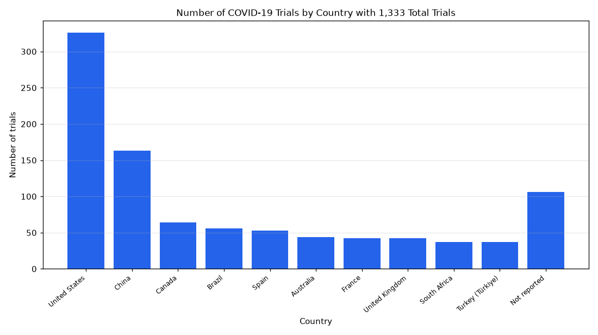

# 008. Which countries host the most COVID-19 vaccine trials?

**Question:** Which countries host the most COVID-19 vaccine trials?

Asked in **live** mode against `https://api.cheiron.engineeradriel.com` on 2026-10-24 22:47 UTC. [Open in the web app](https://trials.cheiron.engineeradriel.com/?q=Which+countries+host+the+most+COVID-19+vaccine+trials%3F&mode=live).

## Answer

- **Status:** `ok` (HTTP 200)
- **Time to answer:** 34.1 s
- **Title:** Number of COVID-19 Trials by Country with 1,333 Total Trials
- **Chart:** `bar_chart`
- **Interpretation:** intent `top_n`, dimension `country`, measure `trial_count`
- **Filters:** `{"conditions": ["COVID-19"], "study_types": ["INTERVENTIONAL"], "primary_purposes": ["PREVENTION"]}`
- **Trials counted:** 1,333
- **ClinicalTrials.gov data of:** 2026-10-23T09:00:04

## Chart

## Data

| Country | Number of trials |
|---|---|
| United States | 326 |
| China | 163 |
| Canada | 64 |
| Brazil | 56 |
| Spain | 53 |
| Australia | 44 |
| France | 42 |
| United Kingdom | 42 |
| South Africa | 37 |
| Turkey (Türkiye) | 37 |
| Not reported | 106 |

## Counting rule

Each trial is counted once per country where it has at least one site.

## Assumptions

- Primary purpose PREVENTION is used as a proxy for vaccine trials.

## Notes

- Showing the top 10 of 109 countries.

## Sample citations

- `United States`: [NCT07390968](https://clinicaltrials.gov/study/NCT07390968) Self-Amplifying mRNA COVID-19 Vaccine (LUNAR-COV19) Versus Comirnaty Vaccine in Adult Hematopoietic Cell Trans
- `China`: [NCT07678619](https://clinicaltrials.gov/study/NCT07678619) Smart Analysis and Decision-Making for Emerging Infectious Diseases
- `Canada`: [NCT06381739](https://clinicaltrials.gov/study/NCT06381739) A Trial of a Next Generation COVID-19 Vaccine Delivered by Inhaled Aerosol
- `Brazil`: [NCT05745896](https://clinicaltrials.gov/study/NCT05745896) A Telemedicine Prenatal Care Model on Low Risk Pregnants: The m@Mae-e Study
- `Spain`: [NCT07790523](https://clinicaltrials.gov/study/NCT07790523) Effectiveness of An Influenza/COVID-19 Vaccine (mCombriax [mRNA-1083]) in Adults ≥ 65 Years

## ClinicalTrials.gov queries

- [search](https://clinicaltrials.gov/api/v2/studies?filter.advanced=%28AREA%5BStudyType%5DINTERVENTIONAL+AND+AREA%5BDesignPrimaryPurpose%5DPREVENTION%29&query.cond=%22COVID-19%22): 1,333 trials

## Timings (ms)

`{"plan": 7685, "count": 5452, "retrieve": 19581, "aggregate": 250, "narrate": 890, "total": 33867}`
