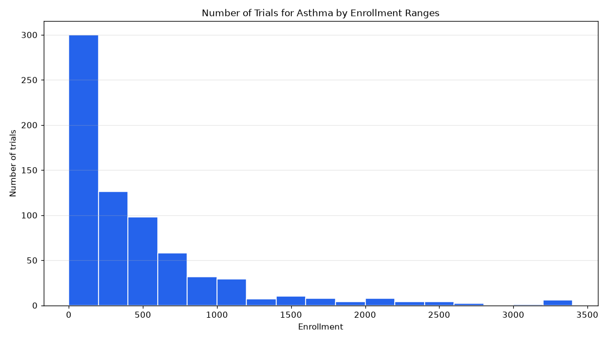

# 009. What is the distribution of enrollment sizes in phase 3 asthma trials?

**Question:** What is the distribution of enrollment sizes in phase 3 asthma trials?

Asked in **live** mode against `https://api.cheiron.engineeradriel.com` on 2026-10-24 22:54 UTC. [Open in the web app](https://trials.cheiron.engineeradriel.com/?q=What+is+the+distribution+of+enrollment+sizes+in+phase+3+asthma+trials%3F&mode=live).

## Answer

- **Status:** `ok` (HTTP 200)
- **Time to answer:** 0.9 s (a stored answer)
- **Title:** Number of Trials for Asthma by Enrollment Ranges
- **Chart:** `histogram`
- **Interpretation:** intent `numeric_distribution`, dimension `enrollment`, measure `trial_count`
- **Filters:** `{"phases": ["PHASE3"], "conditions": ["asthma"]}`
- **Trials counted:** 697
- **ClinicalTrials.gov data of:** 2026-10-23T09:00:04

## Chart

## Data

| Enrollment | to | Number of trials |
|---|---|---|
| 0 | 200 | 300 |
| 200 | 400 | 126 |
| 400 | 600 | 98 |
| 600 | 800 | 58 |
| 800 | 1,000 | 32 |
| 1,000 | 1,200 | 29 |
| 1,200 | 1,400 | 7 |
| 1,400 | 1,600 | 10 |
| 1,600 | 1,800 | 8 |
| 1,800 | 2,000 | 4 |
| 2,000 | 2,200 | 8 |
| 2,200 | 2,400 | 4 |
| 2,400 | 2,600 | 4 |
| 2,600 | 2,800 | 2 |
| 2,800 | 3,000 | 0 |
| 3,000 | 3,200 | 1 |
| 3,200 | None | 6 |

## Counting rule

One value per trial: its enrollment (actual or estimated).

## Assumptions

- Phase 3 refers to PHASE3.

## Notes

- Bins are 200 wide; values above 3092 (99th percentile) overflow.

## Left out

- 7 trials: no enrollment reported

## Sample citations

- `0-200`: [NCT07318350](https://clinicaltrials.gov/study/NCT07318350) Study of Formoterol 6 mcg/Fluticasone 125 mcg by Eurofarma Laboratórios S.A. Versus Alenia® 6 mcg/200 mcg in P
- `200-400`: [NCT07782996](https://clinicaltrials.gov/study/NCT07782996) A Study to Investigate the Efficacy and Safety of GSK5784283 Compared With Placebo in Participants With Uncont
- `400-600`: [NCT07780643](https://clinicaltrials.gov/study/NCT07780643) A Study to Investigate the Efficacy and Safety of GSK5784283 Compared With Placebo in Participants With Uncont
- `600-800`: [NCT07858123](https://clinicaltrials.gov/study/NCT07858123) Safety and Efficacy Comparison Between CHF5993 100/6 12.5µg pMDI to Seretide Evohaler 125/25µg pMDI in Adolesc
- `800-1000`: [NCT06264674](https://clinicaltrials.gov/study/NCT06264674) Comparison Between CHF5993 pMDI 200/6/12.5 µg HFA-152a VS CHF5993 pMDI 200/6/12.5 µg HFA-134a in Subjects With

## ClinicalTrials.gov queries

- [search](https://clinicaltrials.gov/api/v2/studies?filter.advanced=AREA%5BPhase%5DPHASE3&query.cond=%22asthma%22): 704 trials

## Timings (ms)

`{"plan": 1514, "count": 7485, "total": 19801, "narrate": 679, "retrieve": 10089, "aggregate": 25}`
