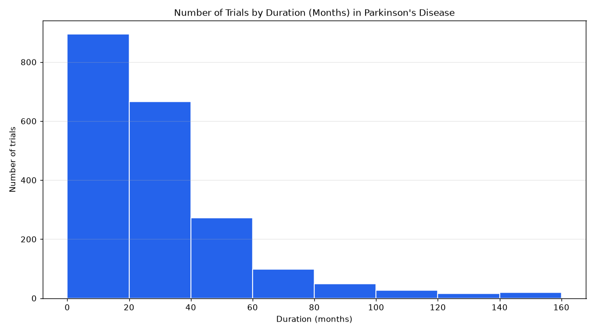

# 010. How long do completed Parkinson's disease trials last?

**Question:** How long do completed Parkinson's disease trials last?

Asked in **live** mode against `https://api.cheiron.engineeradriel.com` on 2026-10-24 22:54 UTC. [Open in the web app](https://trials.cheiron.engineeradriel.com/?q=How+long+do+completed+Parkinson%27s+disease+trials+last%3F&mode=live).

## Answer

- **Status:** `ok` (HTTP 200)
- **Time to answer:** 12.1 s
- **Title:** Number of Trials by Duration (Months) in Parkinson's Disease
- **Chart:** `histogram`
- **Interpretation:** intent `numeric_distribution`, dimension `duration_months`, measure `trial_count`
- **Filters:** `{"conditions": ["Parkinson's disease"], "statuses": ["COMPLETED"]}`
- **Trials counted:** 2,041
- **ClinicalTrials.gov data of:** 2026-10-23T09:00:04

## Chart

## Data

| Duration (months) | to | Number of trials |
|---|---|---|
| 0 | 20 | 895 |
| 20 | 40 | 665 |
| 40 | 60 | 272 |
| 60 | 80 | 99 |
| 80 | 100 | 49 |
| 100 | 120 | 26 |
| 120 | 140 | 15 |
| 140 | None | 20 |

## Counting rule

One value per trial: months from start to completion (approximate for partial dates).

## Assumptions

- Interpreting 'how long' as the distribution of trial duration in months.

## Notes

- Bins are 20 wide; values above 133.6 (99th percentile) overflow.

## Left out

- 72 trials: no duration (months) reported

## Sample citations

- `0-20`: [NCT07641569](https://clinicaltrials.gov/study/NCT07641569) Comparison of Two Different Dual-Task Training Methods in Patients With Parkinson's Disease
- `20-40`: [NCT06671938](https://clinicaltrials.gov/study/NCT06671938) Safety, Tolerability, and Pharmacokinetics of Exidavnemab in Patients With Parkinson's Disease and Patients Wi
- `40-60`: [NCT05773885](https://clinicaltrials.gov/study/NCT05773885) Telerehabilitation in People With Parkinson's Disease
- `60-80`: [NCT05286736](https://clinicaltrials.gov/study/NCT05286736) Neuroplasticity in Parkinson's Disease
- `80-100`: [NCT04101968](https://clinicaltrials.gov/study/NCT04101968) The GBA Multimodal Study in Parkinson's Disease

## ClinicalTrials.gov queries

- [search](https://clinicaltrials.gov/api/v2/studies?filter.overallStatus=COMPLETED&query.cond=%22Parkinson%27s+disease%22): 2,113 trials

## Timings (ms)

`{"plan": 2286, "count": 5661, "retrieve": 3013, "aggregate": 76, "narrate": 870, "total": 11915}`
