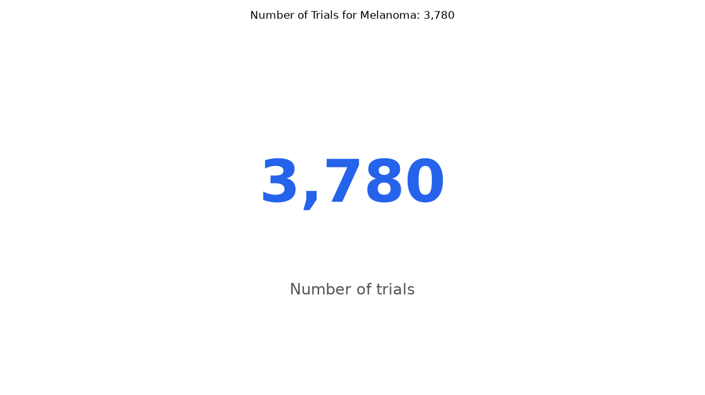

# 011. How many melanoma trials have posted results?

**Question:** How many melanoma trials have posted results?

Asked in **live** mode against `https://api.cheiron.engineeradriel.com` on 2026-10-24 22:47 UTC. [Open in the web app](https://trials.cheiron.engineeradriel.com/?q=How+many+melanoma+trials+have+posted+results%3F&mode=live).

## Answer

- **Status:** `ok` (HTTP 200)
- **Time to answer:** 34.8 s
- **Title:** Number of Trials for Melanoma: 3,780
- **Chart:** `metric`
- **Interpretation:** intent `single_number`, measure `trial_count`
- **Filters:** `{"conditions": ["melanoma"]}`
- **Trials counted:** 3,780
- **ClinicalTrials.gov data of:** 2026-10-23T09:00:04

## Chart

## Data

| Number of trials |
|---|
| 3,780 |

## Counting rule

Each matching trial is counted once.

## Assumptions

- Interpreting 'posted results' as trials with results posted on ClinicalTrials.gov.

## Sample citations

- `all`: [NCT07170293](https://clinicaltrials.gov/study/NCT07170293) Phase II Trial of Tunlametinib in Patients With NRAS Mutant Non-melanoma Refractory Solid Tumors

## ClinicalTrials.gov queries

- [search](https://clinicaltrials.gov/api/v2/studies?query.cond=%22melanoma%22): 3,780 trials

## Timings (ms)

`{"plan": 3337, "count": 0, "retrieve": 30313, "aggregate": 74, "narrate": 798, "total": 34529}`
