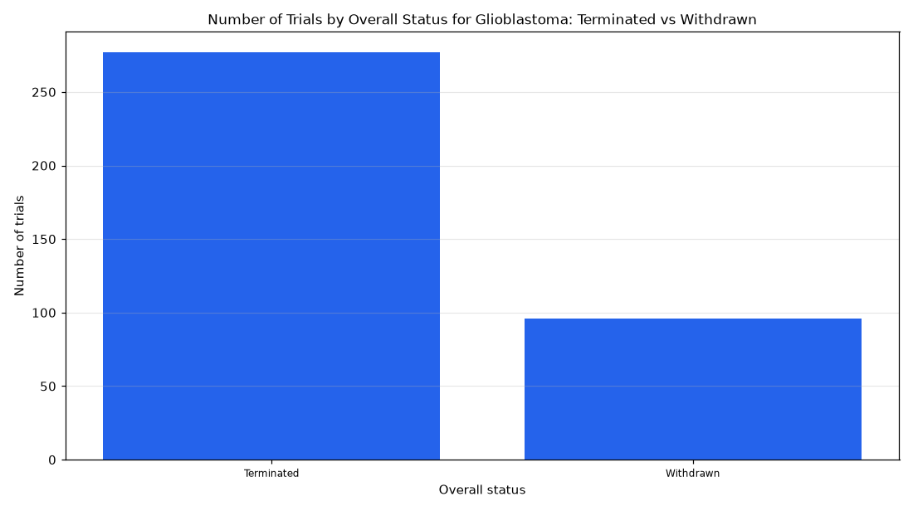

# 012. Show the status breakdown of terminated or withdrawn glioblastoma trials

**Question:** Show the status breakdown of terminated or withdrawn glioblastoma trials

Asked in **live** mode against `https://api.cheiron.engineeradriel.com` on 2026-10-24 22:48 UTC. [Open in the web app](https://trials.cheiron.engineeradriel.com/?q=Show+the+status+breakdown+of+terminated+or+withdrawn+glioblastoma+trials&mode=live).

## Answer

- **Status:** `ok` (HTTP 200)
- **Time to answer:** 14.2 s
- **Title:** Number of Trials by Overall Status for Glioblastoma: Terminated vs Withdrawn
- **Chart:** `bar_chart`
- **Interpretation:** intent `distribution`, dimension `status`, measure `trial_count`
- **Filters:** `{"conditions": ["glioblastoma"], "statuses": ["TERMINATED", "WITHDRAWN"]}`
- **Trials counted:** 373
- **ClinicalTrials.gov data of:** 2026-10-23T09:00:04

## Chart

## Data

| Overall status | Number of trials |
|---|---|
| Terminated | 277 |
| Withdrawn | 96 |

## Counting rule

Each trial is counted once.

## Assumptions

- Interpreting 'status breakdown' as counts of trials by trial status among glioblastoma studies with status terminated or withdrawn.

## Sample citations

- `TERMINATED`: [NCT06359379](https://clinicaltrials.gov/study/NCT06359379) Ropidoxuridine as a Radiosensitizer in Newly Diagnosed IDH-Wildtype Glioblastoma With Unmethylated MGMT Promot
- `WITHDRAWN`: [NCT05341947](https://clinicaltrials.gov/study/NCT05341947) Activated Autologous T Cells Against Glioma Cancer Stem Cell Antigens for Patients With Recurrent Glioblastoma

## ClinicalTrials.gov queries

- [search](https://clinicaltrials.gov/api/v2/studies?filter.overallStatus=TERMINATED%7CWITHDRAWN&query.cond=%22glioblastoma%22): 373 trials

## Timings (ms)

`{"plan": 1565, "count": 1640, "retrieve": 10167, "aggregate": 9, "narrate": 691, "total": 14081}`
