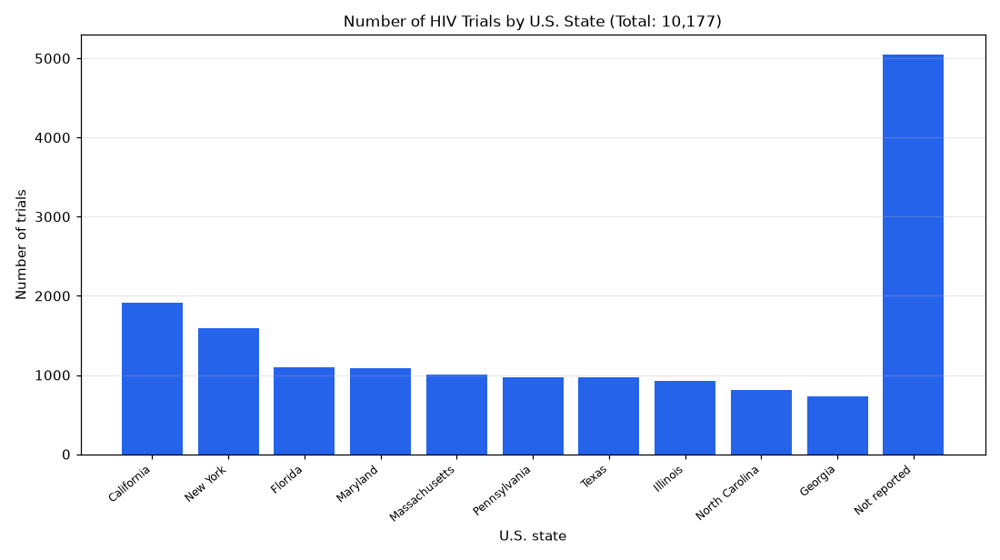

# 013. Which US states have the most HIV trials?

**Question:** Which US states have the most HIV trials?

Asked in **live** mode against `https://api.cheiron.engineeradriel.com` on 2026-10-24 22:49 UTC. [Open in the web app](https://trials.cheiron.engineeradriel.com/?q=Which+US+states+have+the+most+HIV+trials%3F&mode=live).

## Answer

- **Status:** `ok` (HTTP 200)
- **Time to answer:** 109.5 s
- **Title:** Number of HIV Trials by U.S. State (Total: 10,177)
- **Chart:** `bar_chart`
- **Interpretation:** intent `top_n`, dimension `us_state`, measure `trial_count`
- **Filters:** `{"conditions": ["HIV"]}`
- **Trials counted:** 10,177
- **ClinicalTrials.gov data of:** 2026-10-23T09:00:04

## Chart

## Data

| U.S. state | Number of trials |
|---|---|
| California | 1,912 |
| New York | 1,588 |
| Florida | 1,097 |
| Maryland | 1,088 |
| Massachusetts | 1,008 |
| Pennsylvania | 976 |
| Texas | 968 |
| Illinois | 924 |
| North Carolina | 806 |
| Georgia | 728 |
| Not reported | 5,043 |

## Counting rule

Each trial is counted once per U.S. state where it has at least one site.

## Assumptions

- Treating 'HIV trials' as trials for condition HIV.
- Using lead sponsor only by default.

## Notes

- Showing the top 10 of 51 u.s. states.

## Sample citations

- `California`: [NCT07219862](https://clinicaltrials.gov/study/NCT07219862) Evaluating a Clinical Decision Support Tool for Antiretroviral Therapy Optimization
- `New York`: [NCT06766331](https://clinicaltrials.gov/study/NCT06766331) Integrated Care Versus Usual Care for Opioid Use Disorder and Infectious Diseases in Veterans
- `Florida`: [NCT07638618](https://clinicaltrials.gov/study/NCT07638618) Healthy Choices to Reduce Stigma and Improve Self-Management of Alcohol and HIV Among Young Adults
- `Maryland`: [NCT07520188](https://clinicaltrials.gov/study/NCT07520188) C-3002: Enhancing Cervical Cancer Screening Access and Follow-up Care at 'CASCADE' Clinical Sites in the Unite
- `Massachusetts`: [NCT06487351](https://clinicaltrials.gov/study/NCT06487351) Intervention to Reduce Implicit Bias in Pharmacies

## ClinicalTrials.gov queries

- [search](https://clinicaltrials.gov/api/v2/studies?query.cond=%22HIV%22): 10,177 trials

## Timings (ms)

`{"plan": 3326, "count": 2456, "retrieve": 100837, "aggregate": 791, "narrate": 862, "total": 108279}`
