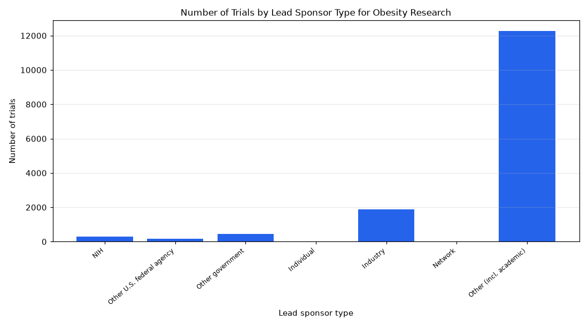

# 014. What share of obesity trials are sponsored by industry vs NIH vs others?

**Question:** What share of obesity trials are sponsored by industry vs NIH vs others?

Asked in **live** mode against `https://api.cheiron.engineeradriel.com` on 2026-10-24 22:49 UTC. [Open in the web app](https://trials.cheiron.engineeradriel.com/?q=What+share+of+obesity+trials+are+sponsored+by+industry+vs+NIH+vs+others%3F&mode=live).

## Answer

- **Status:** `ok` (HTTP 200)
- **Time to answer:** 149.8 s
- **Title:** Number of Trials by Lead Sponsor Type for Obesity Research
- **Chart:** `bar_chart`
- **Interpretation:** intent `distribution`, dimension `sponsor_class`, measure `trial_count`
- **Filters:** `{"conditions": ["obesity"]}`
- **Trials counted:** 15,091
- **ClinicalTrials.gov data of:** 2026-10-23T09:00:04

## Chart

## Data

| Lead sponsor type | Number of trials |
|---|---|
| NIH | 282 |
| Other U.S. federal agency | 163 |
| Other government | 444 |
| Individual | 17 |
| Industry | 1,890 |
| Network | 29 |
| Other (incl. academic) | 12,266 |

## Counting rule

Each trial is counted once.

## Assumptions

- “Share” will be shown as the distribution of trial counts across sponsor classes, which the chart can display as proportions.

## Sample citations

- `NIH`: [NCT07349641](https://clinicaltrials.gov/study/NCT07349641) A Study of Weight Loss Intervention With Tirzepatide and Progestin Intrauterine Device to Treat Endometrial Hy
- `FED`: [NCT07252037](https://clinicaltrials.gov/study/NCT07252037) Dietary Guidelines for Americans-Ultra Processed Study
- `OTHER_GOV`: [NCT07845994](https://clinicaltrials.gov/study/NCT07845994) SEMAFORCRANIO : Multicenter, Double-blind, Parallel, Randomized Controlled Trial of the Efficacy of Semaglutid
- `INDIV`: [NCT06791044](https://clinicaltrials.gov/study/NCT06791044) 25(OH)-Vitamin D and Its Association With Structural and Functional Parameters in Hospitalized Patients With N
- `INDUSTRY`: [NCT07639684](https://clinicaltrials.gov/study/NCT07639684) Impact of Endoscopic Sleeve Gastroplasty (ESG) in Obese Adults With Type 2 Diabetes (T2D)

## ClinicalTrials.gov queries

- [search](https://clinicaltrials.gov/api/v2/studies?query.cond=%22obesity%22): 15,091 trials

## Timings (ms)

`{"plan": 1949, "count": 5444, "retrieve": 139344, "aggregate": 912, "narrate": 646, "total": 148303}`
