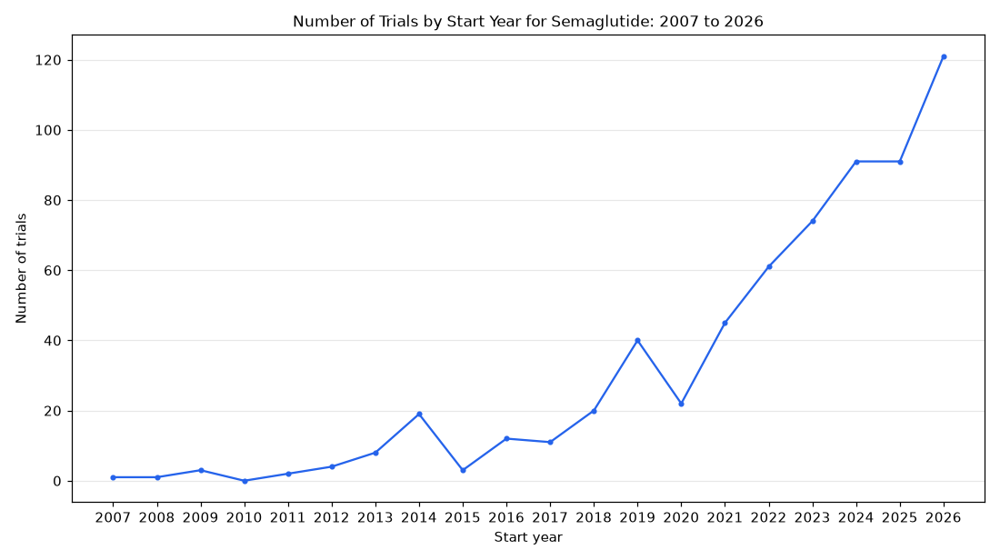

# 015. Trend of semaglutide trials over time

**Question:** Trend of semaglutide trials over time

Asked in **live** mode against `https://api.cheiron.engineeradriel.com` on 2026-10-24 22:47 UTC. [Open in the web app](https://trials.cheiron.engineeradriel.com/?q=Trend+of+semaglutide+trials+over+time&mode=live).

## Answer

- **Status:** `ok` (HTTP 200)
- **Time to answer:** 15.8 s
- **Title:** Number of Trials by Start Year for Semaglutide: 2007 to 2026
- **Chart:** `time_series`
- **Interpretation:** intent `trend`, dimension `start_year`, measure `trial_count`
- **Filters:** `{"drugs": ["semaglutide"]}`
- **Trials counted:** 629
- **ClinicalTrials.gov data of:** 2026-10-23T09:00:04

## Chart

## Data

| Start year | Number of trials | estimated_count |
|---|---|---|
| 2007 | 1 | 0 |
| 2008 | 1 | 0 |
| 2009 | 3 | 0 |
| 2010 | 0 | 0 |
| 2011 | 2 | 0 |
| 2012 | 4 | 0 |
| 2013 | 8 | 0 |
| 2014 | 19 | 0 |
| 2015 | 3 | 0 |
| 2016 | 12 | 0 |
| 2017 | 11 | 0 |
| 2018 | 20 | 0 |
| 2019 | 40 | 2 |
| 2020 | 22 | 0 |
| 2021 | 45 | 1 |
| 2022 | 61 | 4 |
| 2023 | 74 | 3 |
| 2024 | 91 | 12 |
| 2025 | 91 | 15 |
| 2026 | 121 | 56 |

## Counting rule

Each trial is counted once, in the year it started (or is expected to start).

## Assumptions

- Interpreting 'over time' as trial start year.

## Left out

- 10 trials: start after 2026
- 1 trials: no start date

## Sample citations

- `2007`: [NCT03144271](https://clinicaltrials.gov/study/NCT03144271) Dose Escalation Trial of Single Subcutaneous Doses of NNC 0113-0217 to Assess Safety, Tolerability, Pharmacoki
- `2008`: [NCT00696657](https://clinicaltrials.gov/study/NCT00696657) A Randomised Controlled Clinical Trial in Type 2 Diabetes Comparing Semaglutide to Placebo and Liraglutide
- `2009`: [NCT00833716](https://clinicaltrials.gov/study/NCT00833716) Effect of Renal Impairment on the Pharmacokinetics of NN9535
- `2011`: [NCT01324505](https://clinicaltrials.gov/study/NCT01324505) Effect of Oral Contraceptives After Administration of Semaglutide in Subjects With Type 2 Diabetes
- `2012`: [NCT01766245](https://clinicaltrials.gov/study/NCT01766245) A Randomised, Single Centre, Double-blind, Two-period, Cross-over Trial in Healthy Subjects Investigating the 

## ClinicalTrials.gov queries

- [search](https://clinicaltrials.gov/api/v2/studies?filter.advanced=AREA%5BInterventionNameSearch%5D%22semaglutide%22): 640 trials

## Timings (ms)

`{"plan": 1549, "count": 2809, "retrieve": 10392, "aggregate": 23, "narrate": 855, "total": 15636}`
