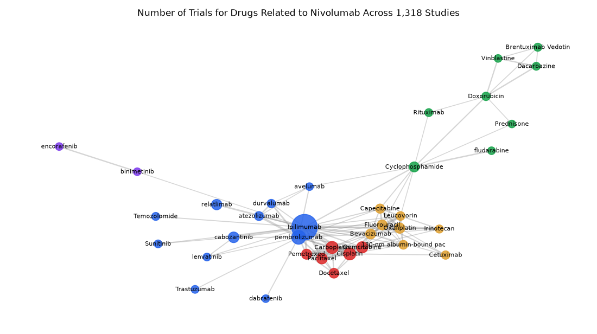

# 016. Which drugs are most often combined with nivolumab?

**Question:** Which drugs are most often combined with nivolumab?

Asked in **live** mode against `https://api.cheiron.engineeradriel.com` on 2026-10-24 22:47 UTC. [Open in the web app](https://trials.cheiron.engineeradriel.com/?q=Which+drugs+are+most+often+combined+with+nivolumab%3F&mode=live).

## Answer

- **Status:** `ok` (HTTP 200)
- **Time to answer:** 35.4 s
- **Title:** Number of Trials for Drugs Related to Nivolumab Across 1,318 Studies
- **Chart:** `network_graph`
- **Interpretation:** intent `network`, dimension `drug`, measure `trial_count`
- **Filters:** `{"drugs": ["nivolumab"]}`
- **Trials counted:** 1,318
- **ClinicalTrials.gov data of:** 2026-10-23T09:00:04

## Chart

## Data

**Largest nodes** (trials)

| Entity | Type | Trials | Links |
|---|---|---:|---:|
| Ipilimumab | drug | 468 | 23 |
| pembrolizumab | drug | 114 | 18 |
| Carboplatin | drug | 79 | 10 |
| Cisplatin | drug | 79 | 11 |
| Gemcitabine | drug | 64 | 13 |
| Paclitaxel | drug | 55 | 8 |
| cabozantinib | drug | 55 | 4 |
| relatlimab | drug | 51 | 1 |
| Oxaliplatin | drug | 48 | 10 |
| Pemetrexed | drug | 46 | 7 |
| Cyclophosphamide | drug | 45 | 9 |
| Bevacizumab | drug | 43 | 13 |
| Fluorouracil | drug | 43 | 13 |
| Docetaxel | drug | 41 | 6 |
| Capecitabine | drug | 33 | 8 |

**Strongest links** (shared trials)

| From | To | Shared trials |
|---|---|---:|
| Carboplatin | Paclitaxel | 41 |
| Carboplatin | Cisplatin | 38 |
| Carboplatin | Pemetrexed | 37 |
| Ipilimumab | pembrolizumab | 34 |
| Fluorouracil | Oxaliplatin | 29 |
| Cisplatin | Pemetrexed | 28 |
| cabozantinib | Ipilimumab | 27 |
| Cisplatin | Gemcitabine | 27 |
| Carboplatin | Ipilimumab | 25 |
| Paclitaxel | Pemetrexed | 24 |
| atezolizumab | pembrolizumab | 23 |
| Fluorouracil | Leucovorin | 23 |
| Capecitabine | Oxaliplatin | 22 |
| Leucovorin | Oxaliplatin | 22 |
| Cisplatin | Paclitaxel | 21 |

## Counting rule

Node size = distinct trials with that entity; edge width = distinct trials with both.

## Assumptions

- Counts co-occurring drugs in trials that include nivolumab.

## Sample citations

- `drug:ipilimumab`: [NCT07838974](https://clinicaltrials.gov/study/NCT07838974) Adding Anakinra and Tocilizumab to Nivolumab and Ipilimumab for the Treatment of Melanoma Patients 50 Years of
- `drug:pembrolizumab`: [NCT07572123](https://clinicaltrials.gov/study/NCT07572123) Evaluating the Addition of Maintenance Immunotherapy Compared to the Usual Treatment of Chemotherapy and Autol
- `drug:carboplatin`: [NCT07885709](https://clinicaltrials.gov/study/NCT07885709) MRD and Imaging Guided Adaptive Neoadjuvant Therapy for Resectable NSCLC
- `drug:cisplatin`: [NCT07369791](https://clinicaltrials.gov/study/NCT07369791) Nivolumab Plus Relatlimab and Gemcitabine/Cisplatin as First-Line Treatment in Advanced Biliary Tract Cancer.
- `drug:gemcitabine`: [NCT07369791](https://clinicaltrials.gov/study/NCT07369791) Nivolumab Plus Relatlimab and Gemcitabine/Cisplatin as First-Line Treatment in Advanced Biliary Tract Cancer.

## ClinicalTrials.gov queries

- [search](https://clinicaltrials.gov/api/v2/studies?filter.advanced=AREA%5BInterventionNameSearch%5D%22nivolumab%22): 1,750 trials

## Timings (ms)

`{"plan": 3976, "count": 8909, "retrieve": 20680, "aggregate": 612, "narrate": 791, "total": 34978}`
