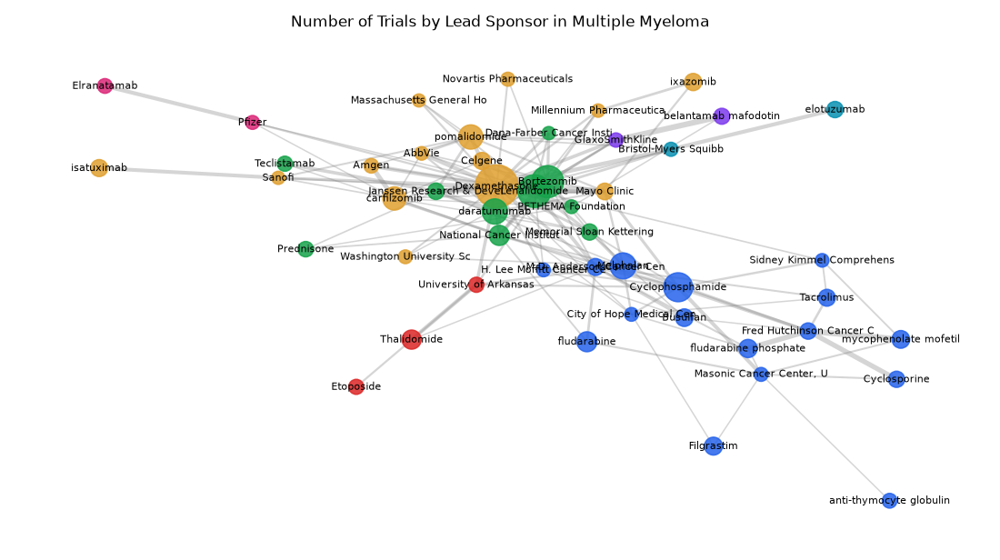

# 017. Network of sponsors and drugs in multiple myeloma trials

**Question:** Network of sponsors and drugs in multiple myeloma trials

Asked in **live** mode against `https://api.cheiron.engineeradriel.com` on 2026-10-24 22:48 UTC. [Open in the web app](https://trials.cheiron.engineeradriel.com/?q=Network+of+sponsors+and+drugs+in+multiple+myeloma+trials&mode=live).

## Answer

- **Status:** `ok` (HTTP 200)
- **Time to answer:** 56.0 s
- **Title:** Number of Trials by Lead Sponsor in Multiple Myeloma
- **Chart:** `network_graph`
- **Interpretation:** intent `network`, dimension `sponsor`, dimension_2 `drug`, measure `trial_count`
- **Filters:** `{"conditions": ["multiple myeloma"]}`
- **Trials counted:** 3,241
- **ClinicalTrials.gov data of:** 2026-10-23T09:00:04

## Chart

## Data

**Largest nodes** (trials)

| Entity | Type | Trials | Links |
|---|---|---:|---:|
| Dexamethasone | drug | 777 | 21 |
| Lenalidomide | drug | 428 | 18 |
| Bortezomib | drug | 406 | 15 |
| Cyclophosphamide | drug | 323 | 10 |
| Melphalan | drug | 249 | 11 |
| daratumumab | drug | 233 | 9 |
| pomalidomide | drug | 211 | 9 |
| carfilzomib | drug | 188 | 11 |
| National Cancer Institute (NCI) | sponsor | 128 | 10 |
| fludarabine | drug | 126 | 3 |
| Thalidomide | drug | 111 | 2 |
| fludarabine phosphate | drug | 95 | 4 |
| Filgrastim | drug | 91 | 2 |
| mycophenolate mofetil | drug | 88 | 3 |
| Busulfan | drug | 86 | 4 |

**Strongest links** (shared trials)

| From | To | Shared trials |
|---|---|---:|
| Dexamethasone | Mayo Clinic | 33 |
| Dexamethasone | Celgene | 32 |
| mycophenolate mofetil | Fred Hutchinson Cancer Center | 30 |
| belantamab mafodotin | GlaxoSmithKline | 29 |
| daratumumab | Janssen Research & Development, LLC | 27 |
| fludarabine phosphate | Fred Hutchinson Cancer Center | 26 |
| Cyclosporine | Fred Hutchinson Cancer Center | 25 |
| Dexamethasone | Janssen Research & Development, LLC | 25 |
| Melphalan | M.D. Anderson Cancer Center | 24 |
| carfilzomib | Amgen | 23 |
| Dexamethasone | National Cancer Institute (NCI) | 22 |
| Dexamethasone | Amgen | 20 |
| Dexamethasone | Bristol-Myers Squibb | 20 |
| Dexamethasone | AbbVie | 19 |
| elotuzumab | Bristol-Myers Squibb | 19 |

## Counting rule

Node size = distinct trials with that entity; edge width = distinct trials with both.

## Assumptions

- Interpreting 'in multiple myeloma trials' as trials with condition multiple myeloma.

## Sample citations

- `drug:dexamethasone`: [NCT06948084](https://clinicaltrials.gov/study/NCT06948084) Testing the Investigational Medication Combination of Daratumumab and Teclistamab Compared to the Usual Treatm
- `drug:lenalidomide`: [NCT07605416](https://clinicaltrials.gov/study/NCT07605416) Testing an Experimental Approach to Treat Patients With Plasma Cell Leukemia, The QUANTUM Trial
- `drug:bortezomib`: [NCT07887672](https://clinicaltrials.gov/study/NCT07887672) A Trial to Evaluate Safety and Efficacy of Anitocabtagene Autoleucel Versus Standard of Care in Newly Diagnose
- `drug:cyclophosphamide`: [NCT04579523](https://clinicaltrials.gov/study/NCT04579523) ²¹¹At-OKT10-B10 and Fludarabine Alone or in Combination With Cyclophosphamide and Low-Dose TBI Before Donor St
- `drug:melphalan`: [NCT07605416](https://clinicaltrials.gov/study/NCT07605416) Testing an Experimental Approach to Treat Patients With Plasma Cell Leukemia, The QUANTUM Trial

## ClinicalTrials.gov queries

- [search](https://clinicaltrials.gov/api/v2/studies?query.cond=%22multiple+myeloma%22): 4,061 trials

## Timings (ms)

`{"plan": 1636, "count": 1751, "retrieve": 50311, "aggregate": 818, "narrate": 803, "total": 55326}`
