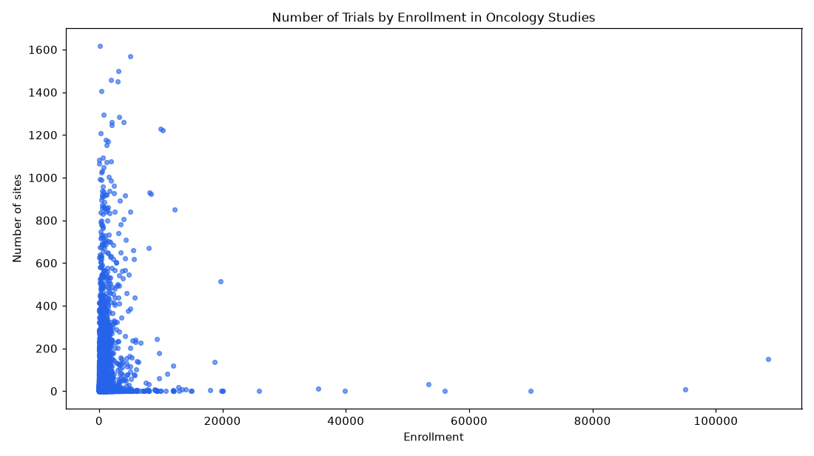

# 018. How do enrollment and number of sites relate in phase 3 oncology trials?

**Question:** How do enrollment and number of sites relate in phase 3 oncology trials?

Asked in **live** mode against `https://api.cheiron.engineeradriel.com` on 2026-10-24 22:49 UTC. [Open in the web app](https://trials.cheiron.engineeradriel.com/?q=How+do+enrollment+and+number+of+sites+relate+in+phase+3+oncology+trials%3F&mode=live).

## Answer

- **Status:** `ok` (HTTP 200)
- **Time to answer:** 146.2 s
- **Title:** Number of Trials by Enrollment in Oncology Studies
- **Chart:** `scatter_plot`
- **Interpretation:** intent `numeric_relationship`, dimension `enrollment`, dimension_2 `site_count`, measure `trial_count`
- **Filters:** `{"conditions": ["oncology"], "phases": ["PHASE3"]}`
- **Trials counted:** 10,836
- **ClinicalTrials.gov data of:** 2026-10-23T09:00:04

## Chart

## Data

| Enrollment | Number of sites | citation_count |
|---|---|---|
| 39,876 | 0 | 1 |
| 250 | 22 | 1 |
| 158 | 21 | 1 |
| 240 | 22 | 1 |
| 150 | 40 | 1 |
| 260 | 1 | 1 |
| 122 | 1 | 1 |
| 150 | 1 | 1 |
| 65 | 1 | 1 |
| 30 | 1 | 1 |
| 170 | 1 | 1 |
| 220 | 4 | 1 |
| 225 | 28 | 1 |
| 200 | 42 | 1 |
| 224 | 28 | 1 |
| 615 | 56 | 1 |
| 348 | 22 | 1 |
| 204 | 21 | 1 |
| 1,005 | 1 | 1 |
| 1,929 | 94 | 1 |
| 1,011 | 35 | 1 |
| 859 | 1 | 1 |
| 635 | 42 | 1 |
| 473 | 21 | 1 |
| 452 | 20 | 1 |
| 214 | 16 | 1 |
| 672 | 48 | 1 |
| 300 | 1 | 1 |
| 200 | 260 | 1 |
| 216 | 65 | 1 |
| 899 | 34 | 1 |
| 1,520 | 75 | 1 |
| 429 | 16 | 1 |
| 1,917 | 37 | 1 |
| 338 | 19 | 1 |
| 312 | 1 | 1 |
| 405 | 22 | 1 |
| 2,500 | 37 | 1 |
| 61 | 3 | 1 |
| 280 | 1 | 1 |

_10796 more rows in the API response._

## Counting rule

One point per trial with both values.

## Assumptions

- Interpreting 'oncology trials' as trials with condition 'oncology'.

## Left out

- 231 trials: no enrollment or site_count reported

## Sample citations

- `NCT00000479`: [NCT00000479](https://clinicaltrials.gov/study/NCT00000479) Women's Health Study (WHS): A Randomized Trial of Low-dose Aspirin and Vitamin E in the Primary Prevention of 
- `NCT00000658`: [NCT00000658](https://clinicaltrials.gov/study/NCT00000658) A Phase III Randomized Trial of Low-Dose Versus Standard-Dose mBACOD Chemotherapy With rGM-CSF for Treatment o
- `NCT00000758`: [NCT00000758](https://clinicaltrials.gov/study/NCT00000758) A Phase III Randomized Trial of Topical Vaginal Fluorouracil (5-Fluorouracil, 5-FU) Maintenance Therapy Versus
- `NCT00000994`: [NCT00000994](https://clinicaltrials.gov/study/NCT00000994) A Study of AZT in HIV-Infected Patients With AIDS-Related Kaposi's Sarcoma
- `NCT00001073`: [NCT00001073](https://clinicaltrials.gov/study/NCT00001073) Safety and Effectiveness of Giving Isotretinoin to HIV-Infected Women to Treat Cervical Tumors

## ClinicalTrials.gov queries

- [search](https://clinicaltrials.gov/api/v2/studies?filter.advanced=AREA%5BPhase%5DPHASE3&query.cond=%22oncology%22): 11,067 trials

## Timings (ms)

`{"plan": 3346, "count": 7677, "retrieve": 129691, "aggregate": 1043, "narrate": 1005, "total": 142771}`
