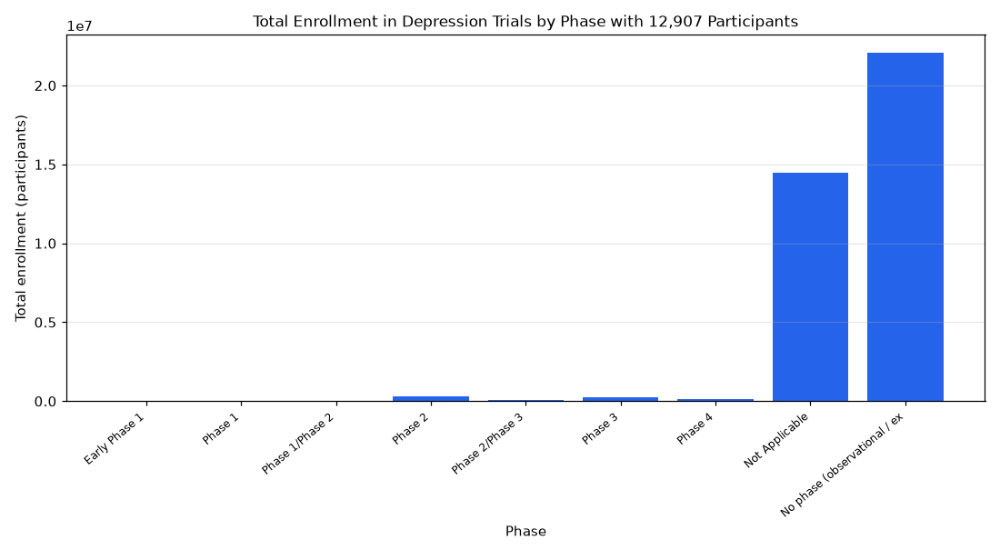

# 019. Total enrollment of depression trials by phase

**Question:** Total enrollment of depression trials by phase

Asked in **live** mode against `https://api.cheiron.engineeradriel.com` on 2026-10-24 22:49 UTC. [Open in the web app](https://trials.cheiron.engineeradriel.com/?q=Total+enrollment+of+depression+trials+by+phase&mode=live).

## Answer

- **Status:** `ok` (HTTP 200)
- **Time to answer:** 135.2 s
- **Title:** Total Enrollment in Depression Trials by Phase with 12,907 Participants
- **Chart:** `bar_chart`
- **Interpretation:** intent `comparison`, dimension `phase`, measure `total_enrollment`
- **Filters:** `{"conditions": ["depression"]}`
- **Trials counted:** 12,907
- **ClinicalTrials.gov data of:** 2026-10-23T09:00:04

## Chart

## Data

| Phase | Total enrollment (participants) | citation_count |
|---|---|---|
| Early Phase 1 | 10,249 | 117 |
| Phase 1 | 32,312 | 418 |
| Phase 1/Phase 2 | 20,848 | 160 |
| Phase 2 | 311,437 | 885 |
| Phase 2/Phase 3 | 74,445 | 147 |
| Phase 3 | 261,259 | 726 |
| Phase 4 | 154,063 | 809 |
| Not Applicable | 14,486,824 | 7,506 |
| No phase (observational / expanded access) | 22,094,015 | 2,064 |

## Counting rule

Each trial is counted once; trials with two phases get a combined bucket (e.g. Phase 2/Phase 3).

## Left out

- 75 trials: no enrollment reported

## Sample citations

- `EARLY_PHASE1`: [NCT07785908](https://clinicaltrials.gov/study/NCT07785908) Individualized (fMRI-guided) TMS Intervention for Post-Traumatic Stress Disorder (PTSD)
- `PHASE1`: [NCT07818720](https://clinicaltrials.gov/study/NCT07818720) MLS101 Study in PMDD
- `PHASE1/PHASE2`: [NCT07499583](https://clinicaltrials.gov/study/NCT07499583) Psilocybin Assisted Psychotherapy for Treatment Resistant Depression and Co-occurring Substance Use Disorder
- `PHASE2`: [NCT07649291](https://clinicaltrials.gov/study/NCT07649291) Duloxetine and aeRobic Exercise to Improve Function in VEterans With Knee Osteoarthritis (DRIVE)
- `PHASE2/PHASE3`: [NCT07227103](https://clinicaltrials.gov/study/NCT07227103) A Randomized, Double-Blind Controlled Comparison of NRX-101 vs. Placebo for Adults Being Treated With Robotic 

## ClinicalTrials.gov queries

- [search](https://clinicaltrials.gov/api/v2/studies?query.cond=%22depression%22): 12,907 trials

## Timings (ms)

`{"plan": 1976, "count": 9776, "retrieve": 119992, "aggregate": 1154, "narrate": 891, "total": 133800}`
