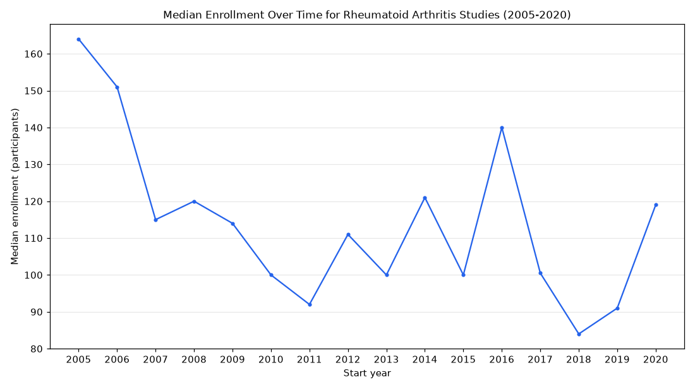

# 020. Median enrollment of rheumatoid arthritis trials by start year from 2005 to 2020

**Question:** Median enrollment of rheumatoid arthritis trials by start year from 2005 to 2020

Asked in **live** mode against `https://api.cheiron.engineeradriel.com` on 2026-10-24 22:47 UTC. [Open in the web app](https://trials.cheiron.engineeradriel.com/?q=Median+enrollment+of+rheumatoid+arthritis+trials+by+start+year+from+2005+to+2020&mode=live).

## Answer

- **Status:** `ok` (HTTP 200)
- **Time to answer:** 36.4 s
- **Title:** Median Enrollment Over Time for Rheumatoid Arthritis Studies (2005-2020)
- **Chart:** `time_series`
- **Interpretation:** intent `trend`, dimension `start_year`, measure `median_enrollment`
- **Filters:** `{"conditions": ["rheumatoid arthritis"], "start_year_min": 2005, "start_year_max": 2020}`
- **Trials counted:** 2,266
- **ClinicalTrials.gov data of:** 2026-10-23T09:00:04

## Chart

## Data

| Start year | Median enrollment (participants) | estimated_count | citation_count |
|---|---|---|---|
| 2005 | 164 | 0 | 81 |
| 2006 | 151 | 0 | 100 |
| 2007 | 115 | 0 | 125 |
| 2008 | 120 | 0 | 116 |
| 2009 | 114 | 0 | 156 |
| 2010 | 100 | 1 | 163 |
| 2011 | 92 | 0 | 181 |
| 2012 | 111 | 0 | 193 |
| 2013 | 100 | 0 | 155 |
| 2014 | 121 | 0 | 148 |
| 2015 | 100 | 0 | 142 |
| 2016 | 140 | 0 | 171 |
| 2017 | 100.5 | 8 | 130 |
| 2018 | 84 | 14 | 123 |
| 2019 | 91 | 10 | 130 |
| 2020 | 119 | 14 | 146 |

## Counting rule

Each trial is counted once, in the year it started (or is expected to start).

## Assumptions

- Interpreting 'rheumatoid arthritis trials' as trials with the condition rheumatoid arthritis.

## Notes

- The year filter excludes trials without a start date.

## Left out

- 6 trials: no enrollment reported

## Sample citations

- `2005`: [NCT00264537](https://clinicaltrials.gov/study/NCT00264537) A Study of the Safety and Efficacy of Golimumab in Subjects With Rheumatoid Arthritis That Are Methotrexate-na
- `2006`: [NCT00406419](https://clinicaltrials.gov/study/NCT00406419) A Study of Ocrelizumab Compared to Placebo in Patients With Active Rheumatoid Arthritis Continuing Methotrexat
- `2007`: [NCT01362153](https://clinicaltrials.gov/study/NCT01362153) A Pharmacokinetic (PK) and Pharmacodynamic (PD) Study of Golimumab in Patients With Rheumatoid Arthritis (RA)
- `2008`: [NCT00848120](https://clinicaltrials.gov/study/NCT00848120) A Study to Assess the Effect of Tocilizumab on Signs and Symptoms in Patients With Rheumatoid Arthritis
- `2009`: [NCT00950989](https://clinicaltrials.gov/study/NCT00950989) Brodalumab (AMG 827) in Rheumatoid Arthritis (RA) Participants With Inadequate Response to Methotrexate

## ClinicalTrials.gov queries

- [search](https://clinicaltrials.gov/api/v2/studies?filter.advanced=AREA%5BStartDate%5DRANGE%5B2005-01-01%2C2020-12-31%5D&query.cond=%22rheumatoid+arthritis%22): 2,266 trials

## Timings (ms)

`{"plan": 1448, "count": 3710, "retrieve": 29906, "aggregate": 328, "narrate": 677, "total": 36077}`
