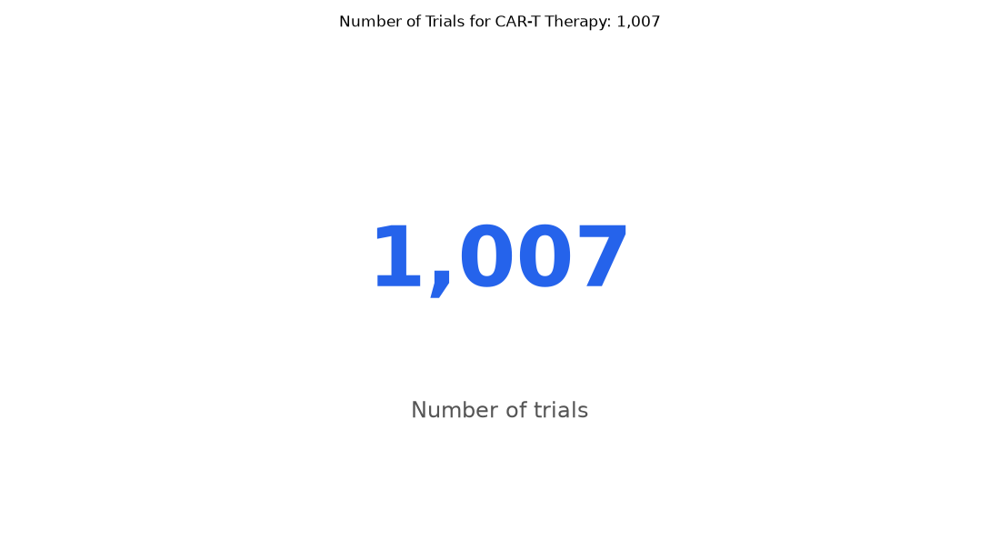

# 021. How many trials are testing CAR-T therapy?

**Question:** How many trials are testing CAR-T therapy?

Asked in **live** mode against `https://api.cheiron.engineeradriel.com` on 2026-10-24 22:49 UTC. [Open in the web app](https://trials.cheiron.engineeradriel.com/?q=How+many+trials+are+testing+CAR-T+therapy%3F&mode=live).

## Answer

- **Status:** `ok` (HTTP 200)
- **Time to answer:** 25.1 s
- **Title:** Number of Trials for CAR-T Therapy: 1,007
- **Chart:** `metric`
- **Interpretation:** intent `single_number`, measure `trial_count`
- **Filters:** `{"drugs": ["CAR-T therapy"], "match_mode": "broad"}`
- **Trials counted:** 1,007
- **ClinicalTrials.gov data of:** 2026-10-23T09:00:04

## Chart

## Data

| Number of trials |
|---|
| 1,007 |

## Counting rule

Each matching trial is counted once.

## Assumptions

- Interpreting 'CAR-T therapy' as the intervention/drug term used in ClinicalTrials.gov.

## Sample citations

- `all`: [NCT06752876](https://clinicaltrials.gov/study/NCT06752876) CRISPR-Edited Allogeneic Anti-CD19 CAR-T Cell Therapy, in Patients With Refractory Systemic Lupus Erythematosu

## ClinicalTrials.gov queries

- [search](https://clinicaltrials.gov/api/v2/studies?query.intr=%22CAR-T+therapy%22): 1,007 trials

## Timings (ms)

`{"plan": 1830, "count": 3807, "retrieve": 18491, "aggregate": 22, "narrate": 776, "total": 24935}`
