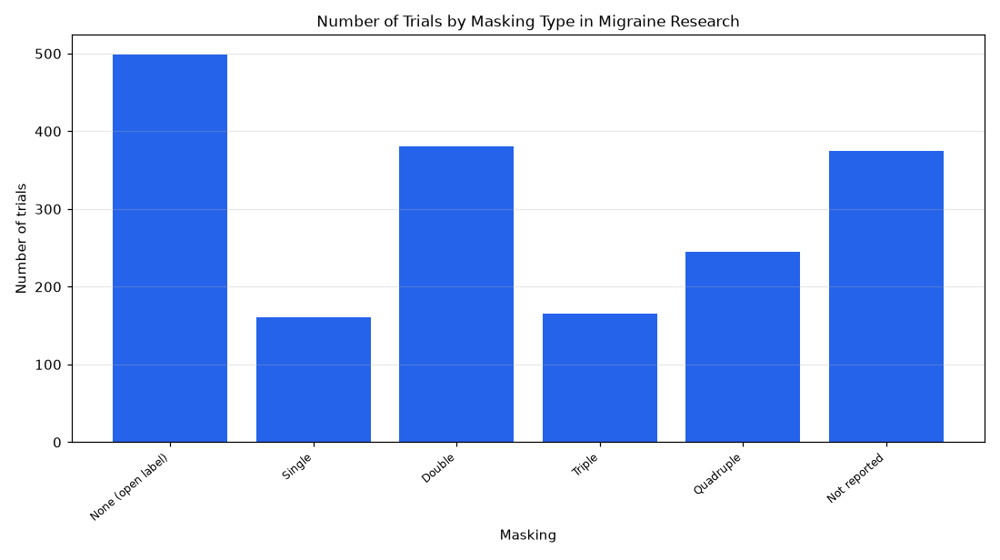

# 022. Break down migraine trials by masking type

**Question:** Break down migraine trials by masking type

Asked in **live** mode against `https://api.cheiron.engineeradriel.com` on 2026-10-24 22:49 UTC. [Open in the web app](https://trials.cheiron.engineeradriel.com/?q=Break+down+migraine+trials+by+masking+type&mode=live).

## Answer

- **Status:** `ok` (HTTP 200)
- **Time to answer:** 23.8 s
- **Title:** Number of Trials by Masking Type in Migraine Research
- **Chart:** `bar_chart`
- **Interpretation:** intent `distribution`, dimension `masking`, measure `trial_count`
- **Filters:** `{"conditions": ["migraine"]}`
- **Trials counted:** 1,826
- **ClinicalTrials.gov data of:** 2026-10-23T09:00:04

## Chart

## Data

| Masking | Number of trials |
|---|---|
| None (open label) | 499 |
| Single | 161 |
| Double | 381 |
| Triple | 165 |
| Quadruple | 245 |
| Not reported | 375 |

## Counting rule

Each trial is counted once.

## Assumptions

- The query refers to ClinicalTrials.gov trials matching the condition migraine.

## Sample citations

- `NONE`: [NCT07313800](https://clinicaltrials.gov/study/NCT07313800) EMBRACE Study: Enduring Migraine Benefit From Responsive Artery Coil Embolization
- `SINGLE`: [NCT07856056](https://clinicaltrials.gov/study/NCT07856056) Nortriptyline Compared With Amitriptyline for Migraine Prevention at SQUH
- `DOUBLE`: [NCT07751497](https://clinicaltrials.gov/study/NCT07751497) A Randomized, Open-Label, Multi-Center Study of Vestibular Migraine Prevention: Rimegepant Versus Flunarizine 
- `TRIPLE`: [NCT07816367](https://clinicaltrials.gov/study/NCT07816367) A Study to Assess the Efficacy and Safety of Elismetrep (K-304) in the Acute Treatment of Migraine
- `QUADRUPLE`: [NCT07653516](https://clinicaltrials.gov/study/NCT07653516) Calcitonin Gene-related Peptide Antibody in Acute Mountain Sickness

## ClinicalTrials.gov queries

- [search](https://clinicaltrials.gov/api/v2/studies?query.cond=%22migraine%22): 1,826 trials

## Timings (ms)

`{"plan": 1390, "count": 2264, "retrieve": 18964, "aggregate": 186, "narrate": 694, "total": 23506}`
