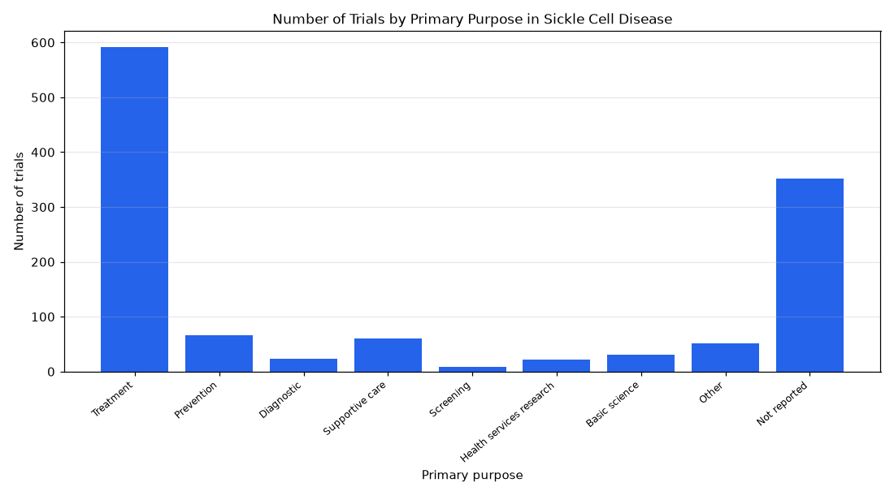

# 023. What are the primary purposes of sickle cell disease trials?

**Question:** What are the primary purposes of sickle cell disease trials?

Asked in **live** mode against `https://api.cheiron.engineeradriel.com` on 2026-10-24 22:50 UTC. [Open in the web app](https://trials.cheiron.engineeradriel.com/?q=What+are+the+primary+purposes+of+sickle+cell+disease+trials%3F&mode=live).

## Answer

- **Status:** `ok` (HTTP 200)
- **Time to answer:** 23.2 s
- **Title:** Number of Trials by Primary Purpose in Sickle Cell Disease
- **Chart:** `bar_chart`
- **Interpretation:** intent `distribution`, dimension `primary_purpose`, measure `trial_count`
- **Filters:** `{"conditions": ["sickle cell disease"]}`
- **Trials counted:** 1,204
- **ClinicalTrials.gov data of:** 2026-10-23T09:00:04

## Chart

## Data

| Primary purpose | Number of trials |
|---|---|
| Treatment | 591 |
| Prevention | 66 |
| Diagnostic | 23 |
| Supportive care | 60 |
| Screening | 8 |
| Health services research | 22 |
| Basic science | 31 |
| Other | 51 |
| Not reported | 352 |

## Counting rule

Each trial is counted once.

## Assumptions

- Interpreting 'sickle cell disease trials' as trials with condition 'sickle cell disease'.

## Sample citations

- `TREATMENT`: [NCT07875777](https://clinicaltrials.gov/study/NCT07875777) Self-administered Acupressure in Patients With Sickle Cell Disease
- `PREVENTION`: [NCT06979492](https://clinicaltrials.gov/study/NCT06979492) Prophylactic Transfusion In Pregnant in Women With Sickle Cell Disease
- `DIAGNOSTIC`: [NCT06880679](https://clinicaltrials.gov/study/NCT06880679) Ultrasound Acute Chest Syndrome Sickle Cell Disease
- `SUPPORTIVE_CARE`: [NCT07797582](https://clinicaltrials.gov/study/NCT07797582) MBI for Pain and Sleep in Adolescents and Young Adults With Sickle Cell Disease
- `SCREENING`: [NCT04925492](https://clinicaltrials.gov/study/NCT04925492) PET Imaging of Vaso-Occlusive Crisis (VOC) in SCD

## ClinicalTrials.gov queries

- [search](https://clinicaltrials.gov/api/v2/studies?query.cond=%22sickle+cell+disease%22): 1,204 trials

## Timings (ms)

`{"plan": 1541, "count": 2377, "retrieve": 18233, "aggregate": 29, "narrate": 805, "total": 22993}`
