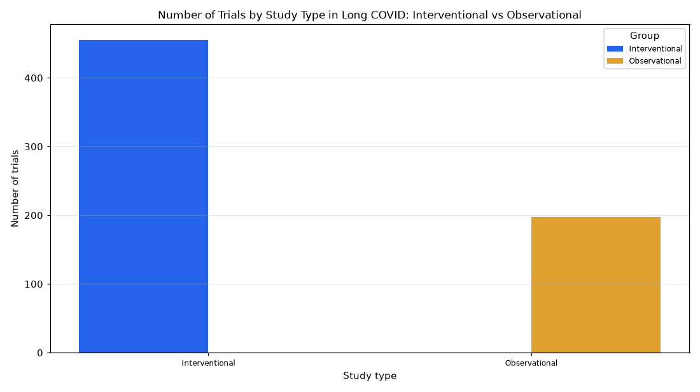

# 025. How many interventional vs observational trials study long COVID?

**Question:** How many interventional vs observational trials study long COVID?

Asked in **live** mode against `https://api.cheiron.engineeradriel.com` on 2026-10-24 22:48 UTC. [Open in the web app](https://trials.cheiron.engineeradriel.com/?q=How+many+interventional+vs+observational+trials+study+long+COVID%3F&mode=live).

## Answer

- **Status:** `ok` (HTTP 200)
- **Time to answer:** 25.7 s
- **Title:** Number of Trials by Study Type in Long COVID: Interventional vs Observational
- **Chart:** `grouped_bar_chart`
- **Interpretation:** intent `comparison`, dimension `study_type`, measure `trial_count`
- **Filters:** `{"conditions": ["long COVID"], "groups": [{"label": "Interventional", "study_types": ["INTERVENTIONAL"]}, {"label": "Observational", "study_types": ["OBSERVATIONAL"]}]}`
- **Trials counted:** 652
- **ClinicalTrials.gov data of:** 2026-10-23T09:00:04

## Chart

## Data

| Study type | Group | Number of trials |
|---|---|---|
| Interventional | Interventional | 455 |
| Observational | Interventional | 0 |
| Interventional | Observational | 0 |
| Observational | Observational | 197 |

## Counting rule

Each trial is counted once.

## Assumptions

- Treating long COVID as the condition phrase from the query.

## Sample citations

- `Interventional|INTERVENTIONAL`: [NCT07682402](https://clinicaltrials.gov/study/NCT07682402) Taurine Supplementation in Adolescents With Post-COVID Condition
- `Observational|OBSERVATIONAL`: [NCT07757620](https://clinicaltrials.gov/study/NCT07757620) Epigenetic Changes in Long COVID Patients

## ClinicalTrials.gov queries

- [Interventional](https://clinicaltrials.gov/api/v2/studies?filter.advanced=AREA%5BStudyType%5DINTERVENTIONAL&query.cond=%22long+COVID%22): 455 trials
- [Observational](https://clinicaltrials.gov/api/v2/studies?filter.advanced=AREA%5BStudyType%5DOBSERVATIONAL&query.cond=%22long+COVID%22): 197 trials

## Timings (ms)

`{"plan": 1665, "count": 12585, "retrieve": 10278, "aggregate": 30, "narrate": 1045, "total": 25612}`
