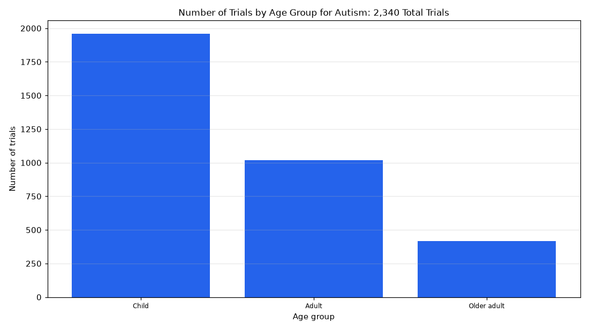

# 026. Which age groups are included in autism trials?

**Question:** Which age groups are included in autism trials?

Asked in **live** mode against `https://api.cheiron.engineeradriel.com` on 2026-10-24 22:48 UTC. [Open in the web app](https://trials.cheiron.engineeradriel.com/?q=Which+age+groups+are+included+in+autism+trials%3F&mode=live).

## Answer

- **Status:** `ok` (HTTP 200)
- **Time to answer:** 35.4 s
- **Title:** Number of Trials by Age Group for Autism: 2,340 Total Trials
- **Chart:** `bar_chart`
- **Interpretation:** intent `distribution`, dimension `age_group`, measure `trial_count`
- **Filters:** `{"conditions": ["autism"]}`
- **Trials counted:** 2,340
- **ClinicalTrials.gov data of:** 2026-10-23T09:00:04

## Chart

## Data

| Age group | Number of trials |
|---|---|
| Child | 1,959 |
| Adult | 1,017 |
| Older adult | 418 |

## Counting rule

Each trial is counted once per distinct age group it lists.

## Assumptions

- Interpreting autism trials as trials with condition autism.

## Sample citations

- `CHILD`: [NCT07624448](https://clinicaltrials.gov/study/NCT07624448) Regulating Together for Intellectual Disability and Autism: A Group Behavioral Therapy for for Emotion Dysregu
- `ADULT`: [NCT07821619](https://clinicaltrials.gov/study/NCT07821619) Pilot of an AI-Enabled Autism Caregiver Support Tool in Indiana and Kenya
- `OLDER_ADULT`: [NCT07821619](https://clinicaltrials.gov/study/NCT07821619) Pilot of an AI-Enabled Autism Caregiver Support Tool in Indiana and Kenya

## ClinicalTrials.gov queries

- [search](https://clinicaltrials.gov/api/v2/studies?query.cond=%22autism%22): 2,340 trials

## Timings (ms)

`{"plan": 1611, "count": 2960, "retrieve": 29086, "aggregate": 82, "narrate": 1326, "total": 35075}`
