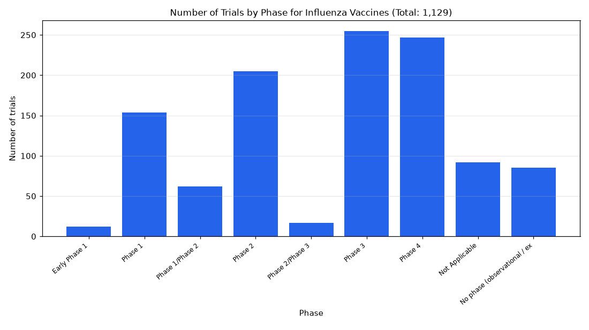

# 027. Trials accepting healthy volunteers for influenza vaccines by phase

**Question:** Trials accepting healthy volunteers for influenza vaccines by phase

Asked in **live** mode against `https://api.cheiron.engineeradriel.com` on 2026-10-24 22:50 UTC. [Open in the web app](https://trials.cheiron.engineeradriel.com/?q=Trials+accepting+healthy+volunteers+for+influenza+vaccines+by+phase&mode=live).

## Answer

- **Status:** `ok` (HTTP 200)
- **Time to answer:** 19.9 s
- **Title:** Number of Trials by Phase for Influenza Vaccines (Total: 1,129)
- **Chart:** `bar_chart`
- **Interpretation:** intent `distribution`, dimension `phase`, measure `trial_count`
- **Filters:** `{"drugs": ["influenza vaccines"], "healthy_volunteers": true}`
- **Trials counted:** 1,129
- **ClinicalTrials.gov data of:** 2026-10-23T09:00:04

## Chart

## Data

| Phase | Number of trials |
|---|---|
| Early Phase 1 | 12 |
| Phase 1 | 154 |
| Phase 1/Phase 2 | 62 |
| Phase 2 | 205 |
| Phase 2/Phase 3 | 17 |
| Phase 3 | 255 |
| Phase 4 | 247 |
| Not Applicable | 92 |
| No phase (observational / expanded access) | 85 |

## Counting rule

Each trial is counted once; trials with two phases get a combined bucket (e.g. Phase 2/Phase 3).

## Assumptions

- Interpreting 'accepting' as trials that allow healthy volunteers.

## Sample citations

- `EARLY_PHASE1`: [NCT05921448](https://clinicaltrials.gov/study/NCT05921448) Vaccine Pandemic Preparedness Through Airway Immunology Characterization
- `PHASE1`: [NCT07870330](https://clinicaltrials.gov/study/NCT07870330) A Study to Evaluate the Safety, Reactogenicity, and Immunogenicity of mRNA-1010 in Healthy Children
- `PHASE1/PHASE2`: [NCT07291635](https://clinicaltrials.gov/study/NCT07291635) Phase 1/2 Study of a Plant-Based Seasonal Recombinant Trivalent VLP Influenza Vaccine
- `PHASE2`: [NCT07842367](https://clinicaltrials.gov/study/NCT07842367) Inflammation and Medical Provider Attitudes, Cognition, and Treatment Decisions Study
- `PHASE2/PHASE3`: [NCT06482359](https://clinicaltrials.gov/study/NCT06482359) Lot Consistency Study of COVID-19 and Influenza Combination Vaccine

## ClinicalTrials.gov queries

- [search](https://clinicaltrials.gov/api/v2/studies?filter.advanced=%28AREA%5BInterventionNameSearch%5D%22influenza+vaccines%22+AND+AREA%5BHealthyVolunteers%5Dtrue%29): 1,129 trials

## Timings (ms)

`{"plan": 2326, "count": 6136, "retrieve": 10466, "aggregate": 43, "narrate": 775, "total": 19755}`
