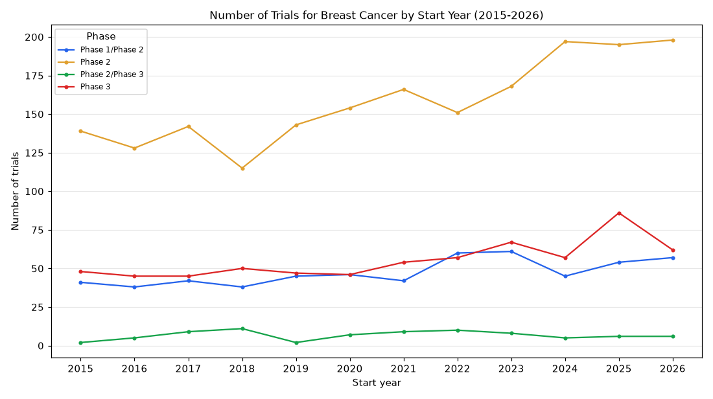

# 028. Phase 2 vs phase 3 breast cancer trials started per year since 2015

**Question:** Phase 2 vs phase 3 breast cancer trials started per year since 2015

Asked in **live** mode against `https://api.cheiron.engineeradriel.com` on 2026-10-24 22:49 UTC. [Open in the web app](https://trials.cheiron.engineeradriel.com/?q=Phase+2+vs+phase+3+breast+cancer+trials+started+per+year+since+2015&mode=live).

## Answer

- **Status:** `ok` (HTTP 200)
- **Time to answer:** 44.2 s
- **Title:** Number of Trials for Breast Cancer by Start Year (2015-2026)
- **Chart:** `time_series`
- **Interpretation:** intent `trend`, dimension `start_year`, dimension_2 `phase`, measure `trial_count`
- **Filters:** `{"conditions": ["breast cancer"], "phases": ["PHASE2", "PHASE3"], "start_year_min": 2015}`
- **Trials counted:** 3,209
- **ClinicalTrials.gov data of:** 2026-10-23T09:00:04

## Chart

## Data

| Start year | Phase | Number of trials | estimated_count |
|---|---|---|---|
| 2015 | Phase 1/Phase 2 | 41 | 0 |
| 2016 | Phase 1/Phase 2 | 38 | 0 |
| 2017 | Phase 1/Phase 2 | 42 | 1 |
| 2018 | Phase 1/Phase 2 | 38 | 1 |
| 2019 | Phase 1/Phase 2 | 45 | 4 |
| 2020 | Phase 1/Phase 2 | 46 | 7 |
| 2021 | Phase 1/Phase 2 | 42 | 2 |
| 2022 | Phase 1/Phase 2 | 60 | 5 |
| 2023 | Phase 1/Phase 2 | 61 | 10 |
| 2024 | Phase 1/Phase 2 | 45 | 4 |
| 2025 | Phase 1/Phase 2 | 54 | 12 |
| 2026 | Phase 1/Phase 2 | 57 | 30 |
| 2015 | Phase 2 | 139 | 0 |
| 2016 | Phase 2 | 128 | 0 |
| 2017 | Phase 2 | 142 | 7 |
| 2018 | Phase 2 | 115 | 13 |
| 2019 | Phase 2 | 143 | 23 |
| 2020 | Phase 2 | 154 | 14 |
| 2021 | Phase 2 | 166 | 23 |
| 2022 | Phase 2 | 151 | 26 |
| 2023 | Phase 2 | 168 | 34 |
| 2024 | Phase 2 | 197 | 44 |
| 2025 | Phase 2 | 195 | 56 |
| 2026 | Phase 2 | 198 | 120 |
| 2015 | Phase 2/Phase 3 | 2 | 0 |
| 2016 | Phase 2/Phase 3 | 5 | 0 |
| 2017 | Phase 2/Phase 3 | 9 | 2 |
| 2018 | Phase 2/Phase 3 | 11 | 5 |
| 2019 | Phase 2/Phase 3 | 2 | 1 |
| 2020 | Phase 2/Phase 3 | 7 | 0 |
| 2021 | Phase 2/Phase 3 | 9 | 2 |
| 2022 | Phase 2/Phase 3 | 10 | 3 |
| 2023 | Phase 2/Phase 3 | 8 | 1 |
| 2024 | Phase 2/Phase 3 | 5 | 2 |
| 2025 | Phase 2/Phase 3 | 6 | 0 |
| 2026 | Phase 2/Phase 3 | 6 | 3 |
| 2015 | Phase 3 | 48 | 0 |
| 2016 | Phase 3 | 45 | 0 |
| 2017 | Phase 3 | 45 | 2 |
| 2018 | Phase 3 | 50 | 5 |

_8 more rows in the API response._

## Counting rule

Each trial is counted once, in the year it started (or is expected to start).

## Assumptions

- Interpreting the request as trials that started in 2015 or later.

## Warnings

- Most trials in 2026 have estimated (planned) dates.

## Notes

- The year filter excludes trials without a start date.

## Left out

- 9 trials: start after 2026

## Sample citations

- `Phase 1/Phase 2|2015`: [NCT02605486](https://clinicaltrials.gov/study/NCT02605486) Palbociclib in Combination With Bicalutamide for the Treatment of AR(+) Metastatic Breast Cancer (MBC)
- `Phase 1/Phase 2|2016`: [NCT02643303](https://clinicaltrials.gov/study/NCT02643303) A Study of Tremelimumab and IV Durvalumab Plus Poly-ICLC in Subjects With Biopsy-accessible Cancers
- `Phase 1/Phase 2|2017`: [NCT03272334](https://clinicaltrials.gov/study/NCT03272334) Her2-BATS and Pembrolizumab in Metastatic Breast Cancer
- `Phase 1/Phase 2|2018`: [NCT03616886](https://clinicaltrials.gov/study/NCT03616886) Paclitaxel + Carboplatin + Durvalumab With or Without Oleclumab for Previously Untreated Locally Recurrent Ino
- `Phase 1/Phase 2|2019`: [NCT04115306](https://clinicaltrials.gov/study/NCT04115306) Phase 1/1b/2 Study of Oral PMD-026 in Patients With Metastatic Breast Cancer

## ClinicalTrials.gov queries

- [search](https://clinicaltrials.gov/api/v2/studies?filter.advanced=%28%28AREA%5BPhase%5DPHASE2+OR+AREA%5BPhase%5DPHASE3%29+AND+AREA%5BStartDate%5DRANGE%5B2015-01-01%2CMAX%5D%29&query.cond=%22breast+cancer%22): 3,218 trials

## Timings (ms)

`{"plan": 6619, "count": 6304, "retrieve": 29886, "aggregate": 153, "narrate": 821, "total": 43799}`
