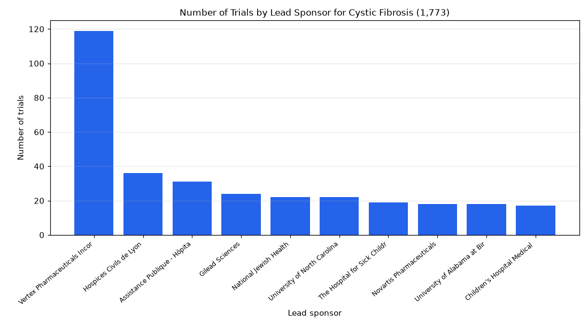

# 029. Top 10 lead sponsors of cystic fibrosis trials

**Question:** Top 10 lead sponsors of cystic fibrosis trials

Asked in **live** mode against `https://api.cheiron.engineeradriel.com` on 2026-10-24 22:48 UTC. [Open in the web app](https://trials.cheiron.engineeradriel.com/?q=Top+10+lead+sponsors+of+cystic+fibrosis+trials&mode=live).

## Answer

- **Status:** `ok` (HTTP 200)
- **Time to answer:** 27.0 s
- **Title:** Number of Trials by Lead Sponsor for Cystic Fibrosis (1,773)
- **Chart:** `bar_chart`
- **Interpretation:** intent `top_n`, dimension `sponsor`, measure `trial_count`
- **Filters:** `{"conditions": ["cystic fibrosis"]}`
- **Trials counted:** 1,773
- **ClinicalTrials.gov data of:** 2026-10-23T09:00:04

## Chart

## Data

| Lead sponsor | Number of trials |
|---|---|
| Vertex Pharmaceuticals Incorporated | 119 |
| Hospices Civils de Lyon | 36 |
| Assistance Publique - Hôpitaux de Paris | 31 |
| Gilead Sciences | 24 |
| National Jewish Health | 22 |
| University of North Carolina, Chapel Hill | 22 |
| The Hospital for Sick Children | 19 |
| Novartis Pharmaceuticals | 18 |
| University of Alabama at Birmingham | 18 |
| Children's Hospital Medical Center, Cincinnati | 17 |

## Counting rule

Each trial is counted once.

## Notes

- Showing the top 10 of 575 lead sponsors.

## Sample citations

- `vertex pharmaceuticals incorporated`: [NCT07813039](https://clinicaltrials.gov/study/NCT07813039) A Phase 1 Relative Bioavailability Study of a VX-581 Tablet Formulation
- `hospices civils de lyon`: [NCT07851831](https://clinicaltrials.gov/study/NCT07851831) Reproducibility of Continuous Glucose Monitoring (CGM) in the Assessment of Glucose Metabolism Disorders in Ch
- `assistance publique - hôpitaux de paris`: [NCT06356246](https://clinicaltrials.gov/study/NCT06356246) Oral Health Status of Cystic Fibrosis Patients. An Online Survey in Collaboration With the Vaincre la Mucovisc
- `gilead sciences`: [NCT03219164](https://clinicaltrials.gov/study/NCT03219164) Study of Aztreonam for Inhalation in Children With Cystic Fibrosis and New Infection of the Airways by Pseudom
- `national jewish health`: [NCT06262282](https://clinicaltrials.gov/study/NCT06262282) Mycobacteriophage Treatment of Non-tuberculosis Mycobacteria

## ClinicalTrials.gov queries

- [search](https://clinicaltrials.gov/api/v2/studies?query.cond=%22cystic+fibrosis%22): 1,773 trials

## Timings (ms)

`{"plan": 1596, "count": 3912, "retrieve": 19973, "aggregate": 168, "narrate": 1202, "total": 26860}`
