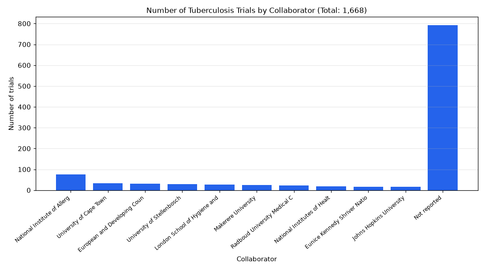

# 030. Which collaborators appear most in tuberculosis trials?

**Question:** Which collaborators appear most in tuberculosis trials?

Asked in **live** mode against `https://api.cheiron.engineeradriel.com` on 2026-10-24 22:49 UTC. [Open in the web app](https://trials.cheiron.engineeradriel.com/?q=Which+collaborators+appear+most+in+tuberculosis+trials%3F&mode=live).

## Answer

- **Status:** `ok` (HTTP 200)
- **Time to answer:** 20.7 s
- **Title:** Number of Tuberculosis Trials by Collaborator (Total: 1,668)
- **Chart:** `bar_chart`
- **Interpretation:** intent `top_n`, dimension `collaborator`, measure `trial_count`
- **Filters:** `{"conditions": ["tuberculosis"]}`
- **Trials counted:** 1,668
- **ClinicalTrials.gov data of:** 2026-10-23T09:00:04

## Chart

## Data

| Collaborator | Number of trials |
|---|---|
| National Institute of Allergy and Infectious Diseases (NIAID) | 75 |
| University of Cape Town | 34 |
| European and Developing Countries Clinical Trials Partnership (EDCTP) | 32 |
| University of Stellenbosch | 29 |
| London School of Hygiene and Tropical Medicine | 26 |
| Makerere University | 24 |
| Radboud University Medical Center | 23 |
| National Institutes of Health (NIH) | 19 |
| Eunice Kennedy Shriver National Institute of Child Health and Human Development (NICHD) | 17 |
| Johns Hopkins University | 16 |
| Not reported | 792 |

## Counting rule

Each trial is counted once per distinct collaborator it lists.

## Assumptions

- Interpreting 'appear most' as collaborators associated with the most tuberculosis trials.

## Notes

- Showing the top 10 of 1210 collaborators.

## Sample citations

- `national institute of allergy and infectious diseases (niaid)`: [NCT06205589](https://clinicaltrials.gov/study/NCT06205589) Therapeutic ID93 + GLA-SE Vaccination in Participants With Rifampicin-Susceptible Pulmonary TB
- `university of cape town`: [NCT06590428](https://clinicaltrials.gov/study/NCT06590428) Therapeutic Drug Monitoring for Linezolid in the Treatment of Rifampin-resistant Tuberculosis
- `european and developing countries clinical trials partnership (edctp)`: [NCT06593080](https://clinicaltrials.gov/study/NCT06593080) The DECIDE-TB Trial; Validation of Treatment Decision Algorithms for Childhood Tuberculosis
- `university of stellenbosch`: [NCT07631377](https://clinicaltrials.gov/study/NCT07631377) The LalelaLung Study: Digital Stethoscope Clinical Evaluation
- `london school of hygiene and tropical medicine`: [NCT07163143](https://clinicaltrials.gov/study/NCT07163143) Optimal Treatment Duration for Radiographically Apparent, Bacteriologically Unconfirmed TB, Identified Through

## ClinicalTrials.gov queries

- [search](https://clinicaltrials.gov/api/v2/studies?query.cond=%22tuberculosis%22): 1,668 trials

## Timings (ms)

`{"plan": 1637, "count": 4686, "retrieve": 11907, "aggregate": 422, "narrate": 850, "total": 19511}`
