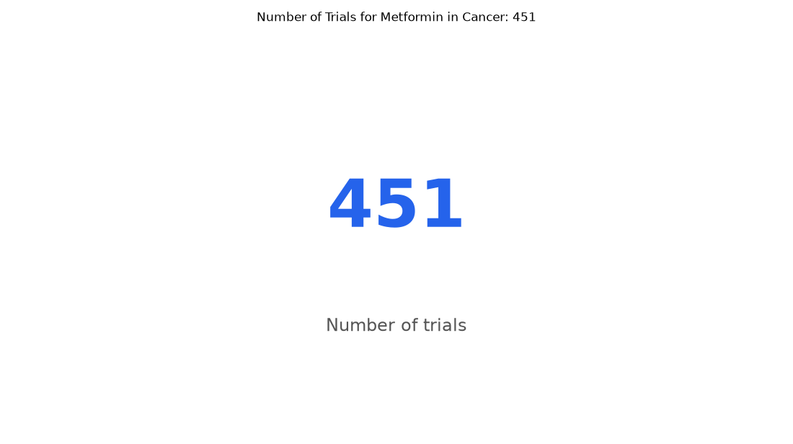

# 031. How many trials of metformin are there in cancer?

**Question:** How many trials of metformin are there in cancer?

Asked in **live** mode against `https://api.cheiron.engineeradriel.com` on 2026-10-24 22:50 UTC. [Open in the web app](https://trials.cheiron.engineeradriel.com/?q=How+many+trials+of+metformin+are+there+in+cancer%3F&mode=live).

## Answer

- **Status:** `ok` (HTTP 200)
- **Time to answer:** 15.8 s
- **Title:** Number of Trials for Metformin in Cancer: 451
- **Chart:** `metric`
- **Interpretation:** intent `single_number`, measure `trial_count`
- **Filters:** `{"drugs": ["metformin"], "conditions": ["cancer"]}`
- **Trials counted:** 451
- **ClinicalTrials.gov data of:** 2026-10-23T09:00:04

## Chart

## Data

| Number of trials |
|---|
| 451 |

## Counting rule

Each matching trial is counted once.

## Assumptions

- Interpreting 'in cancer' as trials with condition cancer.

## Sample citations

- `all`: [NCT07890064](https://clinicaltrials.gov/study/NCT07890064) Canagliflozin Plus Progestin for Atypical Endometrial Hyperplasia and Early-Stage Endometrial Cancer

## ClinicalTrials.gov queries

- [search](https://clinicaltrials.gov/api/v2/studies?filter.advanced=AREA%5BInterventionNameSearch%5D%22metformin%22&query.cond=%22cancer%22): 451 trials

## Timings (ms)

`{"plan": 1611, "count": 3281, "retrieve": 10048, "aggregate": 8, "narrate": 704, "total": 15661}`
