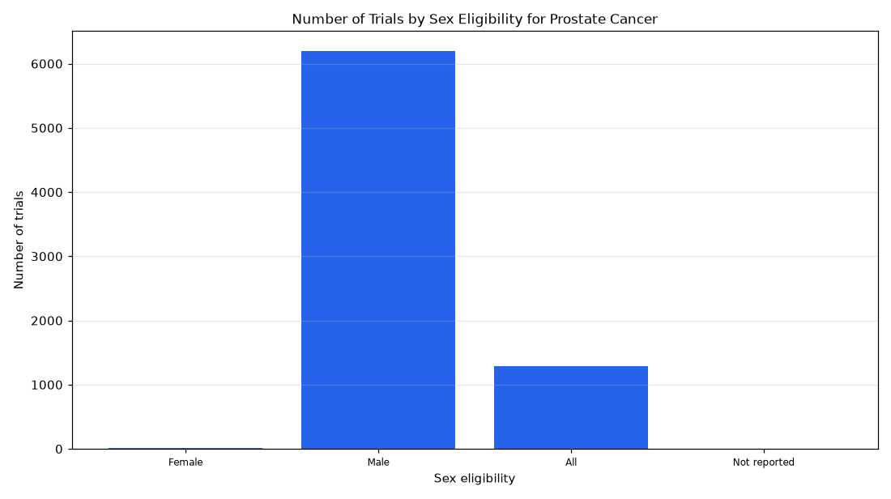

# 032. Sex eligibility of prostate cancer trials

**Question:** Sex eligibility of prostate cancer trials

Asked in **live** mode against `https://api.cheiron.engineeradriel.com` on 2026-10-24 22:51 UTC. [Open in the web app](https://trials.cheiron.engineeradriel.com/?q=Sex+eligibility+of+prostate+cancer+trials&mode=live).

## Answer

- **Status:** `ok` (HTTP 200)
- **Time to answer:** 50.3 s
- **Title:** Number of Trials by Sex Eligibility for Prostate Cancer
- **Chart:** `bar_chart`
- **Interpretation:** intent `distribution`, dimension `sex`, measure `trial_count`
- **Filters:** `{"conditions": ["prostate cancer"]}`
- **Trials counted:** 7,501
- **ClinicalTrials.gov data of:** 2026-10-23T09:00:04

## Chart

## Data

| Sex eligibility | Number of trials |
|---|---|
| Female | 17 |
| Male | 6,197 |
| All | 1,284 |
| Not reported | 3 |

## Counting rule

Each trial is counted once.

## Assumptions

- Interpreting "sex eligibility" as the trial's sex eligibility field.

## Sample citations

- `FEMALE`: [NCT07512076](https://clinicaltrials.gov/study/NCT07512076) A Dose Optimization Study of Enzalutamide in Elderly Patients With Advanced Prostate Cancer
- `MALE`: [NCT07733440](https://clinicaltrials.gov/study/NCT07733440) PROstate Cancer Risk Calculator for ACTionable Clinical Decision-making in Nigeria
- `ALL`: [NCT05896371](https://clinicaltrials.gov/study/NCT05896371) A Phase 1/2 Study of Personalized PSMA Radiopharmaceutical Therapy
- `NOT_REPORTED`: [NCT01960881](https://clinicaltrials.gov/study/NCT01960881) Evaluation of Diet and Exercise in Prostate Cancer Patients

## ClinicalTrials.gov queries

- [search](https://clinicaltrials.gov/api/v2/studies?query.cond=%22prostate+cancer%22): 7,501 trials

## Timings (ms)

`{"plan": 1715, "count": 8310, "retrieve": 38411, "aggregate": 199, "narrate": 888, "total": 49533}`
