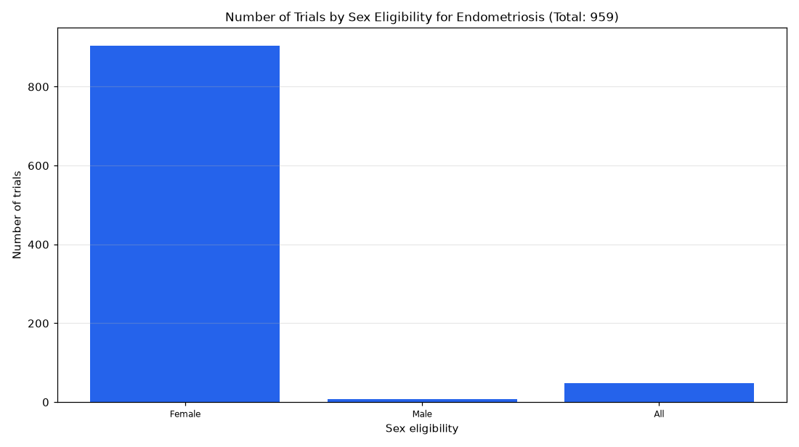

# 033. Sex eligibility of endometriosis trials

**Question:** Sex eligibility of endometriosis trials

Asked in **live** mode against `https://api.cheiron.engineeradriel.com` on 2026-10-24 22:47 UTC. [Open in the web app](https://trials.cheiron.engineeradriel.com/?q=Sex+eligibility+of+endometriosis+trials&mode=live).

## Answer

- **Status:** `ok` (HTTP 200)
- **Time to answer:** 19.1 s
- **Title:** Number of Trials by Sex Eligibility for Endometriosis (Total: 959)
- **Chart:** `bar_chart`
- **Interpretation:** intent `distribution`, dimension `sex`, measure `trial_count`
- **Filters:** `{"conditions": ["endometriosis"]}`
- **Trials counted:** 959
- **ClinicalTrials.gov data of:** 2026-10-23T09:00:04

## Chart

## Data

| Sex eligibility | Number of trials |
|---|---|
| Female | 904 |
| Male | 7 |
| All | 48 |

## Counting rule

Each trial is counted once.

## Assumptions

- Interpreting 'sex eligibility' as the trial's sex eligibility field for trials with condition endometriosis.

## Sample citations

- `FEMALE`: [NCT07881562](https://clinicaltrials.gov/study/NCT07881562) Perioperative Esketamine Safety and Efficacy in Reducing Postoperative ENDometriosis PAIN (the ENDPAIN Trial):
- `MALE`: [NCT06949124](https://clinicaltrials.gov/study/NCT06949124) A Phase 1 Clinical Study to Evaluate the Effects of SHR7280 on the Pharmacokinetics of Midazolam, S-warfarin, 
- `ALL`: [NCT06973603](https://clinicaltrials.gov/study/NCT06973603) Exposure to Persistent Organic Pollutants and Severity of Endometriosis in the ComPaRe-Endometriosis Cohort

## ClinicalTrials.gov queries

- [search](https://clinicaltrials.gov/api/v2/studies?query.cond=%22endometriosis%22): 959 trials

## Timings (ms)

`{"plan": 1431, "count": 6695, "retrieve": 10027, "aggregate": 25, "narrate": 765, "total": 18951}`
