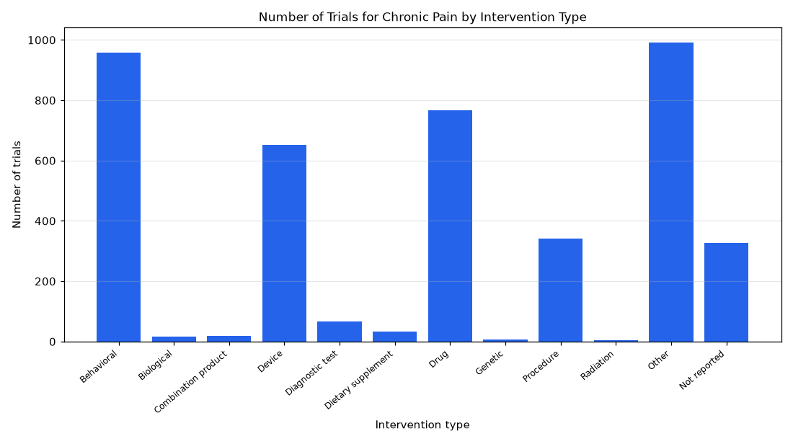

# 034. Intervention types in chronic pain trials

**Question:** Intervention types in chronic pain trials

Asked in **live** mode against `https://api.cheiron.engineeradriel.com` on 2026-10-24 22:49 UTC. [Open in the web app](https://trials.cheiron.engineeradriel.com/?q=Intervention+types+in+chronic+pain+trials&mode=live).

## Answer

- **Status:** `ok` (HTTP 200)
- **Time to answer:** 48.8 s
- **Title:** Number of Trials for Chronic Pain by Intervention Type
- **Chart:** `bar_chart`
- **Interpretation:** intent `distribution`, dimension `intervention_type`, measure `trial_count`
- **Filters:** `{"conditions": ["chronic pain"]}`
- **Trials counted:** 3,726
- **ClinicalTrials.gov data of:** 2026-10-23T09:00:04

## Chart

## Data

| Intervention type | Number of trials |
|---|---|
| Behavioral | 959 |
| Biological | 16 |
| Combination product | 18 |
| Device | 652 |
| Diagnostic test | 67 |
| Dietary supplement | 32 |
| Drug | 766 |
| Genetic | 7 |
| Procedure | 342 |
| Radiation | 4 |
| Other | 991 |
| Not reported | 327 |

## Counting rule

Each trial is counted once per distinct intervention type it lists.

## Assumptions

- Intervention types are grouped as ClinicalTrials.gov intervention type categories.

## Sample citations

- `BEHAVIORAL`: [NCT07456150](https://clinicaltrials.gov/study/NCT07456150) Personalizing Veteran Pain Care: Adapting Coaching Interventions to Support Maintenance of Self-Care
- `BIOLOGICAL`: [NCT07688096](https://clinicaltrials.gov/study/NCT07688096) Regenerative Medicine for Joint Hypermobility and Instability
- `COMBINATION_PRODUCT`: [NCT06994988](https://clinicaltrials.gov/study/NCT06994988) ARPA-H Smart Band-Aid to Measure Chronic Pain in Women
- `DEVICE`: [NCT06362187](https://clinicaltrials.gov/study/NCT06362187) VR Pilot for Pancreatitis
- `DIAGNOSTIC_TEST`: [NCT07834502](https://clinicaltrials.gov/study/NCT07834502) Erector Spinae Plane Block for Chronic Pain After Spinal Surgery

## ClinicalTrials.gov queries

- [search](https://clinicaltrials.gov/api/v2/studies?query.cond=%22chronic+pain%22): 3,726 trials

## Timings (ms)

`{"plan": 1428, "count": 5544, "retrieve": 40102, "aggregate": 141, "narrate": 746, "total": 47970}`
