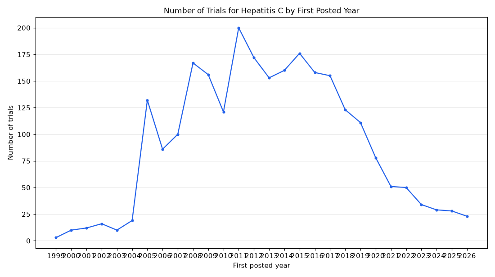

# 036. Number of hepatitis C trials first posted each year

**Question:** Number of hepatitis C trials first posted each year

Asked in **live** mode against `https://api.cheiron.engineeradriel.com` on 2026-10-24 22:50 UTC. [Open in the web app](https://trials.cheiron.engineeradriel.com/?q=Number+of+hepatitis+C+trials+first+posted+each+year&mode=live).

## Answer

- **Status:** `ok` (HTTP 200)
- **Time to answer:** 26.3 s
- **Title:** Number of Trials for Hepatitis C by First Posted Year
- **Chart:** `time_series`
- **Interpretation:** intent `trend`, dimension `first_posted_year`, measure `trial_count`
- **Filters:** `{"conditions": ["hepatitis C"]}`
- **Trials counted:** 2,533
- **ClinicalTrials.gov data of:** 2026-10-23T09:00:04

## Chart

## Data

| First posted year | Number of trials | estimated_count |
|---|---|---|
| 1999 | 3 | 0 |
| 2000 | 10 | 0 |
| 2001 | 12 | 0 |
| 2002 | 16 | 0 |
| 2003 | 10 | 0 |
| 2004 | 19 | 0 |
| 2005 | 132 | 0 |
| 2006 | 86 | 0 |
| 2007 | 100 | 0 |
| 2008 | 167 | 0 |
| 2009 | 156 | 0 |
| 2010 | 121 | 0 |
| 2011 | 200 | 0 |
| 2012 | 172 | 0 |
| 2013 | 153 | 0 |
| 2014 | 160 | 0 |
| 2015 | 176 | 0 |
| 2016 | 158 | 0 |
| 2017 | 155 | 0 |
| 2018 | 123 | 0 |
| 2019 | 111 | 0 |
| 2020 | 78 | 0 |
| 2021 | 51 | 0 |
| 2022 | 50 | 0 |
| 2023 | 34 | 0 |
| 2024 | 29 | 0 |
| 2025 | 28 | 0 |
| 2026 | 23 | 0 |

## Counting rule

Each trial is counted once, in the year it was first posted.

## Assumptions

- 'first posted' refers to the trial first posted year in ClinicalTrials.gov.

## Sample citations

- `1999`: [NCT00001854](https://clinicaltrials.gov/study/NCT00001854) Long-Term Therapy With Ribavirin for Chronic Hepatitis C
- `2000`: [NCT00006301](https://clinicaltrials.gov/study/NCT00006301) Immune Response to Hepatitis C Virus
- `2001`: [NCT00028093](https://clinicaltrials.gov/study/NCT00028093) Pegylated Interferon and Ribavirin to Treat Chronic Hepatitis C With and Without Kidney Disease
- `2002`: [NCT00047814](https://clinicaltrials.gov/study/NCT00047814) Study of FK788 in Subjects With Chronic Hepatitis C Virus Infection
- `2003`: [NCT00055445](https://clinicaltrials.gov/study/NCT00055445) IdB 1016 Treatment for Hepatitis C Disease

## ClinicalTrials.gov queries

- [search](https://clinicaltrials.gov/api/v2/studies?query.cond=%22hepatitis+C%22): 2,533 trials

## Timings (ms)

`{"plan": 1512, "count": 3311, "retrieve": 20328, "aggregate": 87, "narrate": 834, "total": 26079}`
