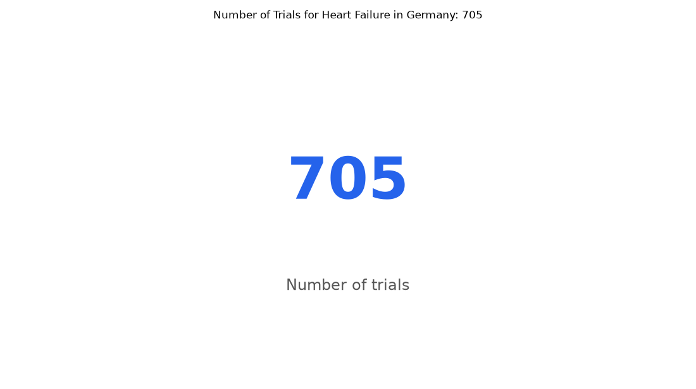

# 037. How many heart failure trials are in Germany?

**Question:** How many heart failure trials are in Germany?

Asked in **live** mode against `https://api.cheiron.engineeradriel.com` on 2026-10-24 22:50 UTC. [Open in the web app](https://trials.cheiron.engineeradriel.com/?q=How+many+heart+failure+trials+are+in+Germany%3F&mode=live).

## Answer

- **Status:** `ok` (HTTP 200)
- **Time to answer:** 16.2 s
- **Title:** Number of Trials for Heart Failure in Germany: 705
- **Chart:** `metric`
- **Interpretation:** intent `single_number`, measure `trial_count`
- **Filters:** `{"conditions": ["heart failure"], "countries": ["Germany"]}`
- **Trials counted:** 705
- **ClinicalTrials.gov data of:** 2026-10-23T09:00:04

## Chart

## Data

| Number of trials |
|---|
| 705 |

## Counting rule

Each matching trial is counted once.

## Sample citations

- `all`: [NCT06650995](https://clinicaltrials.gov/study/NCT06650995) AlEX-DHF: Ablation and Exercise in Diastolic Heart Failure

## ClinicalTrials.gov queries

- [search](https://clinicaltrials.gov/api/v2/studies?filter.advanced=AREA%5BLocationCountry%5D%22Germany%22&query.cond=%22heart+failure%22): 705 trials

## Timings (ms)

`{"plan": 1435, "count": 5374, "retrieve": 8603, "aggregate": 11, "narrate": 658, "total": 16089}`
