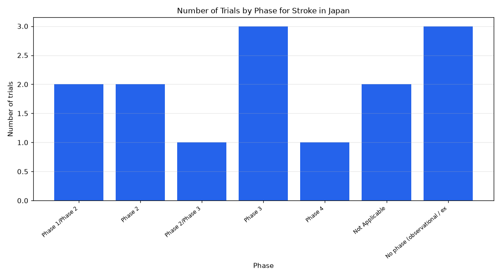

# 038. Recruiting stroke trials in Japan by phase

**Question:** Recruiting stroke trials in Japan by phase

Asked in **live** mode against `https://api.cheiron.engineeradriel.com` on 2026-10-24 22:48 UTC. [Open in the web app](https://trials.cheiron.engineeradriel.com/?q=Recruiting+stroke+trials+in+Japan+by+phase&mode=live).

## Answer

- **Status:** `ok` (HTTP 200)
- **Time to answer:** 16.3 s
- **Title:** Number of Trials by Phase for Stroke in Japan
- **Chart:** `bar_chart`
- **Interpretation:** intent `distribution`, dimension `phase`, measure `trial_count`
- **Filters:** `{"conditions": ["stroke"], "countries": ["Japan"], "statuses": ["RECRUITING"]}`
- **Trials counted:** 14
- **ClinicalTrials.gov data of:** 2026-10-23T09:00:04

## Chart

## Data

| Phase | Number of trials |
|---|---|
| Phase 1/Phase 2 | 2 |
| Phase 2 | 2 |
| Phase 2/Phase 3 | 1 |
| Phase 3 | 3 |
| Phase 4 | 1 |
| Not Applicable | 2 |
| No phase (observational / expanded access) | 3 |

## Counting rule

Each trial is counted once; trials with two phases get a combined bucket (e.g. Phase 2/Phase 3).

## Assumptions

- Interpreting 'stroke trials' as trials with stroke listed as a condition.

## Sample citations

- `PHASE1/PHASE2`: [NCT07318714](https://clinicaltrials.gov/study/NCT07318714) A Study of ASP2246 for People Who Have Movement Problems Caused by Brain Injury After a Stroke
- `PHASE2`: [NCT07392450](https://clinicaltrials.gov/study/NCT07392450) A Study of TAK-755 in Adults With Acute Ischemic Stroke
- `PHASE2/PHASE3`: [NCT06990867](https://clinicaltrials.gov/study/NCT06990867) Optimizing Reperfusion to Improve Outcomes and Neurologic Function
- `PHASE3`: [NCT07626411](https://clinicaltrials.gov/study/NCT07626411) Stroke and Systemic Embolism Prevention in Adult Participants With Atrial Fibrillation
- `PHASE4`: [NCT07111559](https://clinicaltrials.gov/study/NCT07111559) Lacunar Stroke hyperAcute Clinical Utilization of Novel Approach Regimens: Rt-PA vs. DAPT Randomised Clinical 

## ClinicalTrials.gov queries

- [search](https://clinicaltrials.gov/api/v2/studies?filter.advanced=AREA%5BLocationCountry%5D%22Japan%22&filter.overallStatus=RECRUITING&query.cond=%22stroke%22): 14 trials

## Timings (ms)

`{"plan": 1863, "count": 3441, "retrieve": 10012, "aggregate": 1, "narrate": 912, "total": 16238}`
