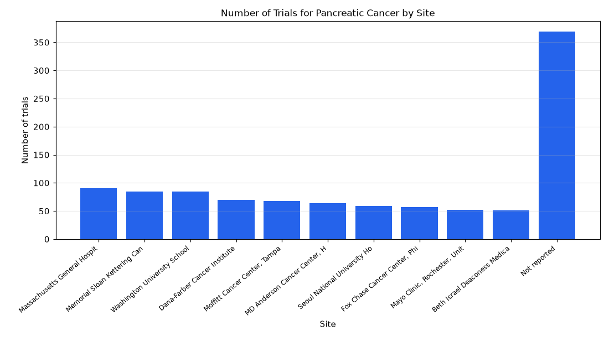

# 039. Which sites run the most pancreatic cancer trials?

**Question:** Which sites run the most pancreatic cancer trials?

Asked in **live** mode against `https://api.cheiron.engineeradriel.com` on 2026-10-24 22:50 UTC. [Open in the web app](https://trials.cheiron.engineeradriel.com/?q=Which+sites+run+the+most+pancreatic+cancer+trials%3F&mode=live).

## Answer

- **Status:** `ok` (HTTP 200)
- **Time to answer:** 45.8 s
- **Title:** Number of Trials for Pancreatic Cancer by Site
- **Chart:** `bar_chart`
- **Interpretation:** intent `top_n`, dimension `site`, measure `trial_count`
- **Filters:** `{"conditions": ["pancreatic cancer"]}`
- **Trials counted:** 4,468
- **ClinicalTrials.gov data of:** 2026-10-23T09:00:04

## Chart

## Data

| Site | Number of trials |
|---|---|
| Massachusetts General Hospital, Boston, United States | 91 |
| Memorial Sloan Kettering Cancer Center, New York, United States | 85 |
| Washington University School of Medicine, St Louis, United States | 85 |
| Dana-Farber Cancer Institute, Boston, United States | 70 |
| Moffitt Cancer Center, Tampa, United States | 68 |
| MD Anderson Cancer Center, Houston, United States | 64 |
| Seoul National University Hospital, Seoul, South Korea | 59 |
| Fox Chase Cancer Center, Philadelphia, United States | 57 |
| Mayo Clinic, Rochester, United States | 52 |
| Beth Israel Deaconess Medical Center, Boston, United States | 51 |
| Not reported | 369 |

## Counting rule

Each trial is counted once per distinct site it lists.

## Assumptions

- Interpreting 'most' as the top 10 sites by trial count.

## Notes

- Showing the top 10 of 17084 sites.

## Sample citations

- `massachusetts general hospital|boston|united states`: [NCT07765836](https://clinicaltrials.gov/study/NCT07765836) Vilastobart+Retifanlimab in BRCA or PALB2 Deficient PC
- `memorial sloan kettering cancer center|new york|united states`: [NCT07492680](https://clinicaltrials.gov/study/NCT07492680) A Study of BMS-986504 Monotherapy and in Combination With Other Agents in Participants With Advanced and/or Me
- `washington university school of medicine|st louis|united states`: [NCT07126158](https://clinicaltrials.gov/study/NCT07126158) Stereotactic Body Radiotherapy Plus FAK and RAF/MEK Inhibition in Advanced Pancreatic Adenocarcinoma
- `dana-farber cancer institute|boston|united states`: [NCT07787156](https://clinicaltrials.gov/study/NCT07787156) Reach and Engagement of GENetic Education, Risk Assessment, and TEsting Feasibility Trial
- `moffitt cancer center|tampa|united states`: [NCT07805954](https://clinicaltrials.gov/study/NCT07805954) Study of Zoldonrasib (RMC-9805) Plus Daraxonrasib (RMC-6236) Versus Gemcitabine and Nab-Paclitaxel as First-Li

## ClinicalTrials.gov queries

- [search](https://clinicaltrials.gov/api/v2/studies?query.cond=%22pancreatic+cancer%22): 4,468 trials

## Timings (ms)

`{"plan": 2409, "count": 8902, "retrieve": 32217, "aggregate": 1224, "narrate": 841, "total": 45650}`
