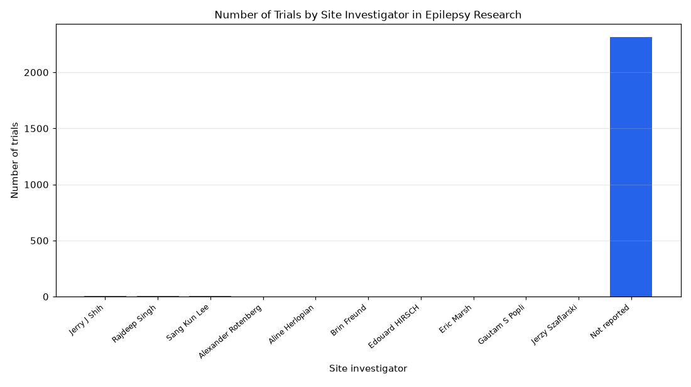

# 040. Which investigators lead the most epilepsy trials?

**Question:** Which investigators lead the most epilepsy trials?

Asked in **live** mode against `https://api.cheiron.engineeradriel.com` on 2026-10-24 22:50 UTC. [Open in the web app](https://trials.cheiron.engineeradriel.com/?q=Which+investigators+lead+the+most+epilepsy+trials%3F&mode=live).

## Answer

- **Status:** `ok` (HTTP 200)
- **Time to answer:** 28.1 s
- **Title:** Number of Trials by Site Investigator in Epilepsy Research
- **Chart:** `bar_chart`
- **Interpretation:** intent `top_n`, dimension `investigator`, measure `trial_count`
- **Filters:** `{"conditions": ["epilepsy"]}`
- **Trials counted:** 2,541
- **ClinicalTrials.gov data of:** 2026-10-23T09:00:04

## Chart

## Data

| Site investigator | Number of trials |
|---|---|
| Jerry J Shih | 4 |
| Rajdeep Singh | 4 |
| Sang Kun Lee | 4 |
| Alexander Rotenberg | 3 |
| Aline Herlopian | 3 |
| Brin Freund | 3 |
| Edouard HIRSCH | 3 |
| Eric Marsh | 3 |
| Gautam S Popli | 3 |
| Jerzy Szaflarski | 3 |
| Not reported | 2,314 |

## Counting rule

Each trial is counted once per distinct site investigator it lists.

## Assumptions

- Interpreting 'lead' as trials where the investigator is listed in the lead role.

## Notes

- Showing the top 10 of 788 site investigators.

## Sample citations

- `jerry j shih`: [NCT07110337](https://clinicaltrials.gov/study/NCT07110337) Diagnosing Epilepsy To EffeCT Change
- `rajdeep singh`: [NCT07110337](https://clinicaltrials.gov/study/NCT07110337) Diagnosing Epilepsy To EffeCT Change
- `sang kun lee`: [NCT03220256](https://clinicaltrials.gov/study/NCT03220256) Protocol Establishment for the Prevention of Lamotrigine-induced Skin Rash in Epilepsy Patients
- `alexander rotenberg`: [NCT05944692](https://clinicaltrials.gov/study/NCT05944692) Epilepsy Seizure Detection With Innovative Tripolar EEG (tEEG)
- `aline herlopian`: [NCT07110337](https://clinicaltrials.gov/study/NCT07110337) Diagnosing Epilepsy To EffeCT Change

## ClinicalTrials.gov queries

- [search](https://clinicaltrials.gov/api/v2/studies?query.cond=%22epilepsy%22): 2,541 trials

## Timings (ms)

`{"plan": 1674, "count": 5597, "retrieve": 19669, "aggregate": 218, "narrate": 659, "total": 27827}`
