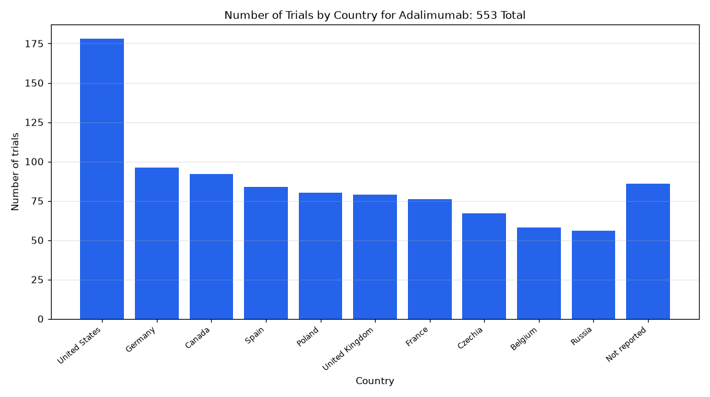

# 041. Countries running trials of adalimumab

**Question:** Countries running trials of adalimumab

Asked in **live** mode against `https://api.cheiron.engineeradriel.com` on 2026-10-24 22:51 UTC. [Open in the web app](https://trials.cheiron.engineeradriel.com/?q=Countries+running+trials+of+adalimumab&mode=live).

## Answer

- **Status:** `ok` (HTTP 200)
- **Time to answer:** 16.0 s
- **Title:** Number of Trials by Country for Adalimumab: 553 Total
- **Chart:** `bar_chart`
- **Interpretation:** intent `distribution`, dimension `country`, measure `trial_count`
- **Filters:** `{"drugs": ["adalimumab"]}`
- **Trials counted:** 553
- **ClinicalTrials.gov data of:** 2026-10-23T09:00:04

## Chart

## Data

| Country | Number of trials |
|---|---|
| United States | 178 |
| Germany | 96 |
| Canada | 92 |
| Spain | 84 |
| Poland | 80 |
| United Kingdom | 79 |
| France | 76 |
| Czechia | 67 |
| Belgium | 58 |
| Russia | 56 |
| Not reported | 86 |

## Counting rule

Each trial is counted once per country where it has at least one site.

## Assumptions

- Interpreting "running trials" as trials recorded in ClinicalTrials.gov for adalimumab.

## Notes

- Showing the top 10 of 75 countries.

## Sample citations

- `United States`: [NCT06926478](https://clinicaltrials.gov/study/NCT06926478) Subconjunctival Humira for Boston Keratoprosthesis
- `Germany`: [NCT06100744](https://clinicaltrials.gov/study/NCT06100744) A Study to Assess Adverse Events, Change in Disease Activity, and How the Drug Moves Through the Body in Child
- `Canada`: [NCT06996652](https://clinicaltrials.gov/study/NCT06996652) An Exploratory Study of the Potential for Rational Immune System Manipulation to Prevent Emergence of Synuclei
- `Spain`: [NCT07151937](https://clinicaltrials.gov/study/NCT07151937) A Study of LAD191 in Adults With Hidradenitis Suppurativa
- `Poland`: [NCT06100744](https://clinicaltrials.gov/study/NCT06100744) A Study to Assess Adverse Events, Change in Disease Activity, and How the Drug Moves Through the Body in Child

## ClinicalTrials.gov queries

- [search](https://clinicaltrials.gov/api/v2/studies?filter.advanced=AREA%5BInterventionNameSearch%5D%22adalimumab%22): 553 trials

## Timings (ms)

`{"plan": 1907, "count": 2399, "retrieve": 9704, "aggregate": 89, "narrate": 1653, "total": 15761}`
