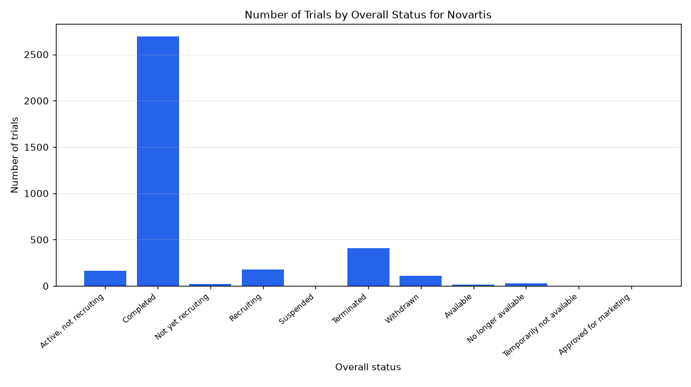

# 043. Novartis trials by status

**Question:** Novartis trials by status

Asked in **live** mode against `https://api.cheiron.engineeradriel.com` on 2026-10-24 22:49 UTC. [Open in the web app](https://trials.cheiron.engineeradriel.com/?q=Novartis+trials+by+status&mode=live).

## Answer

- **Status:** `ok` (HTTP 200)
- **Time to answer:** 37.4 s
- **Title:** Number of Trials by Overall Status for Novartis
- **Chart:** `bar_chart`
- **Interpretation:** intent `distribution`, dimension `status`, measure `trial_count`
- **Filters:** `{"sponsors": ["Novartis"]}`
- **Trials counted:** 3,623
- **ClinicalTrials.gov data of:** 2026-10-23T09:00:04

## Chart

## Data

| Overall status | Number of trials |
|---|---|
| Active, not recruiting | 162 |
| Completed | 2,692 |
| Not yet recruiting | 24 |
| Recruiting | 181 |
| Suspended | 1 |
| Terminated | 409 |
| Withdrawn | 108 |
| Available | 13 |
| No longer available | 29 |
| Temporarily not available | 1 |
| Approved for marketing | 3 |

## Counting rule

Each trial is counted once.

## Assumptions

- Interpreting 'Novartis trials' as trials with Novartis as the lead sponsor.

## Sample citations

- `ACTIVE_NOT_RECRUITING`: [NCT07821411](https://clinicaltrials.gov/study/NCT07821411) A Real-World Study of Ofatumumab in Multiple Sclerosis Patients in Germany and Japan
- `COMPLETED`: [NCT07647042](https://clinicaltrials.gov/study/NCT07647042) A Real-World Study of Early Breast Cancer Patients Eligible for Treatment With CDK4/6 Inhibitors
- `NOT_YET_RECRUITING`: [NCT07739888](https://clinicaltrials.gov/study/NCT07739888) Study to Evaluate the effIcacy and Safety of Abelacimab in High-risk Patients With Atrial Fibrillation Who Hav
- `RECRUITING`: [NCT07748624](https://clinicaltrials.gov/study/NCT07748624) A 52-Week Study Evaluating the Efficacy and Safety of Arumakimig (MAS825) in Participants With VEXAS Followed 
- `SUSPENDED`: [NCT00333307](https://clinicaltrials.gov/study/NCT00333307) Evaluation of the Safety of Relaxin in Preeclampsia

## ClinicalTrials.gov queries

- [search](https://clinicaltrials.gov/api/v2/studies?query.lead=%22Novartis%22): 3,623 trials

## Timings (ms)

`{"plan": 1663, "count": 3776, "retrieve": 30482, "aggregate": 357, "narrate": 810, "total": 37096}`
