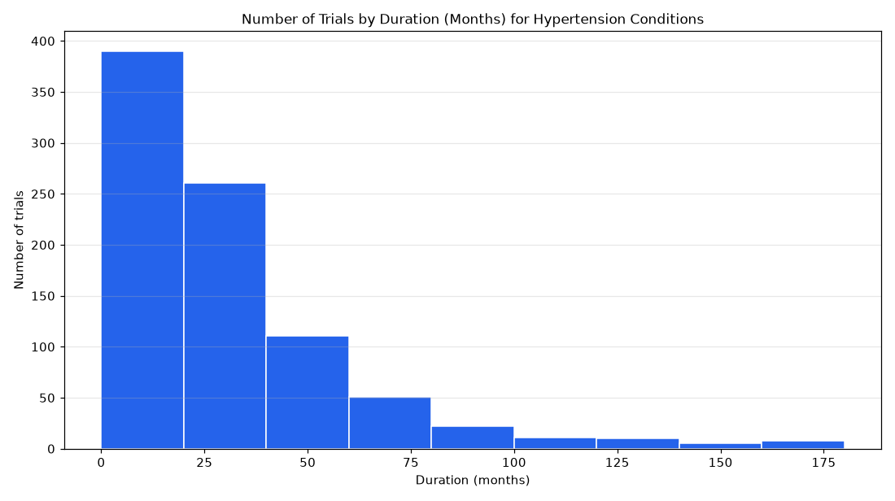

# 046. Distribution of trial durations for completed phase 3 hypertension trials

**Question:** Distribution of trial durations for completed phase 3 hypertension trials

Asked in **live** mode against `https://api.cheiron.engineeradriel.com` on 2026-10-24 22:52 UTC. [Open in the web app](https://trials.cheiron.engineeradriel.com/?q=Distribution+of+trial+durations+for+completed+phase+3+hypertension+trials&mode=live).

## Answer

- **Status:** `ok` (HTTP 200)
- **Time to answer:** 1.2 s (a stored answer)
- **Title:** Number of Trials by Duration (Months) for Hypertension Conditions
- **Chart:** `histogram`
- **Interpretation:** intent `numeric_distribution`, dimension `duration_months`, measure `trial_count`
- **Filters:** `{"phases": ["PHASE3"], "statuses": ["COMPLETED"], "conditions": ["hypertension"]}`
- **Trials counted:** 869
- **ClinicalTrials.gov data of:** 2026-10-23T09:00:04

## Chart

## Data

| Duration (months) | to | Number of trials |
|---|---|---|
| 0 | 20 | 390 |
| 20 | 40 | 261 |
| 40 | 60 | 111 |
| 60 | 80 | 51 |
| 80 | 100 | 22 |
| 100 | 120 | 11 |
| 120 | 140 | 10 |
| 140 | 160 | 5 |
| 160 | None | 8 |

## Counting rule

One value per trial: months from start to completion (approximate for partial dates).

## Assumptions

- Trial duration is measured in months.

## Notes

- Bins are 20 wide; values above 148 (99th percentile) overflow.

## Left out

- 67 trials: no duration (months) reported

## Sample citations

- `0-20`: [NCT07354516](https://clinicaltrials.gov/study/NCT07354516) Study of QLS-111-FDC in Open-Angle Glaucoma or Ocular Hypertension
- `20-40`: [NCT07790120](https://clinicaltrials.gov/study/NCT07790120) A Study to Evaluate the Efficacy and Safety in Participants With Uncontrolled Hypertension on Two or More Medi
- `40-60`: [NCT05405920](https://clinicaltrials.gov/study/NCT05405920) Caribbean and South America Team-based Strategy to Control Hypertension
- `60-80`: [NCT04070573](https://clinicaltrials.gov/study/NCT04070573) Low Doses of Aspirin in the Prevention of Preeclampsia
- `80-100`: [NCT03891446](https://clinicaltrials.gov/study/NCT03891446) Long-term Safety and Efficacy Extension Trial of Bimatoprost SR

## ClinicalTrials.gov queries

- [search](https://clinicaltrials.gov/api/v2/studies?filter.advanced=AREA%5BPhase%5DPHASE3&filter.overallStatus=COMPLETED&query.cond=%22hypertension%22): 936 trials

## Timings (ms)

`{"plan": 1608, "count": 5883, "total": 18001, "narrate": 922, "retrieve": 9504, "aggregate": 75}`
