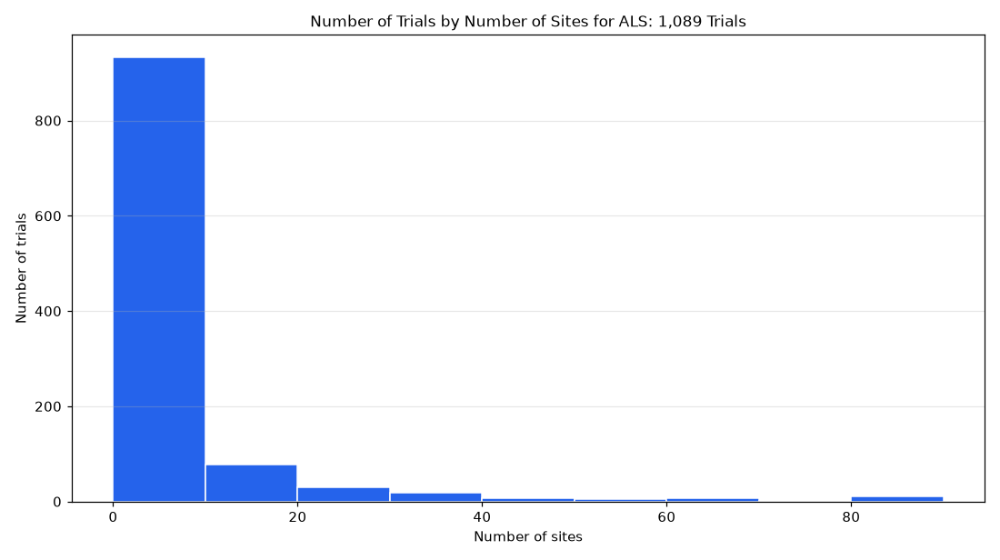

# 047. Number of trials by number of sites for ALS

**Question:** Number of trials by number of sites for ALS

Asked in **live** mode against `https://api.cheiron.engineeradriel.com` on 2026-10-24 22:51 UTC. [Open in the web app](https://trials.cheiron.engineeradriel.com/?q=Number+of+trials+by+number+of+sites+for+ALS&mode=live).

## Answer

- **Status:** `ok` (HTTP 200)
- **Time to answer:** 1.8 s (a stored answer)
- **Title:** Number of Trials by Number of Sites for ALS: 1,089 Trials
- **Chart:** `histogram`
- **Interpretation:** intent `numeric_distribution`, dimension `site_count`, measure `trial_count`
- **Filters:** `{"conditions": ["ALS"]}`
- **Trials counted:** 1,089
- **ClinicalTrials.gov data of:** 2026-10-23T09:00:04

## Chart

## Data

| Number of sites | to | Number of trials |
|---|---|---|
| 0 | 10 | 933 |
| 10 | 20 | 78 |
| 20 | 30 | 30 |
| 30 | 40 | 18 |
| 40 | 50 | 7 |
| 50 | 60 | 5 |
| 60 | 70 | 7 |
| 70 | 80 | 1 |
| 80 | None | 10 |

## Counting rule

One value per trial: its number of listed sites.

## Notes

- Bins are 10 wide; values above 74 (99th percentile) overflow.

## Sample citations

- `0-10`: [NCT04667013](https://clinicaltrials.gov/study/NCT04667013) A Multiple Dose Study to Investigate Safety, Tolerability and Pharmacokinetics of TBN
- `10-20`: [NCT07571174](https://clinicaltrials.gov/study/NCT07571174) A Substudy of LY4256984 in Participants With Sporadic Amyotrophic Lateral Sclerosis
- `20-30`: [NCT07142291](https://clinicaltrials.gov/study/NCT07142291) PHENOGENE-1A (Cromolyn) Treatment in Patients With Mild to Moderate ALS
- `30-40`: [NCT07002034](https://clinicaltrials.gov/study/NCT07002034) RE104 Safety and Efficacy Study in Adjustment Disorder in Cancer and Other Medical Illnesses
- `40-50`: [NCT07023835](https://clinicaltrials.gov/study/NCT07023835) Usnoflast Neuromuscular Investigation for Treatment Efficacy in Amyotrophic Lateral Sclerosis

## ClinicalTrials.gov queries

- [search](https://clinicaltrials.gov/api/v2/studies?query.cond=%22ALS%22): 1,089 trials

## Timings (ms)

`{"plan": 1994, "count": 3821, "total": 25489, "narrate": 793, "retrieve": 18844, "aggregate": 28}`
