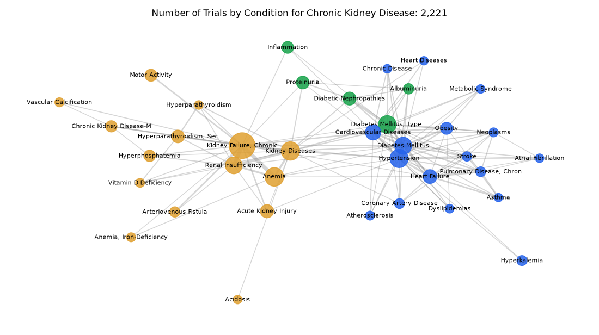

# 048. Which conditions are studied together with chronic kidney disease?

**Question:** Which conditions are studied together with chronic kidney disease?

Asked in **live** mode against `https://api.cheiron.engineeradriel.com` on 2026-10-24 22:50 UTC. [Open in the web app](https://trials.cheiron.engineeradriel.com/?q=Which+conditions+are+studied+together+with+chronic+kidney+disease%3F&mode=live).

## Answer

- **Status:** `ok` (HTTP 200)
- **Time to answer:** 26.2 s
- **Title:** Number of Trials by Condition for Chronic Kidney Disease: 2,221
- **Chart:** `network_graph`
- **Interpretation:** intent `network`, dimension `condition`, dimension_2 `condition`, measure `trial_count`
- **Filters:** `{"conditions": ["chronic kidney disease"]}`
- **Trials counted:** 2,221
- **ClinicalTrials.gov data of:** 2026-10-23T09:00:04

## Chart

## Data

**Largest nodes** (trials)

| Entity | Type | Trials | Links |
|---|---|---:|---:|
| Kidney Failure, Chronic | condition | 433 | 20 |
| Anemia | condition | 211 | 7 |
| Kidney Diseases | condition | 207 | 17 |
| Hypertension | condition | 202 | 22 |
| Diabetes Mellitus, Type 2 | condition | 187 | 17 |
| Diabetes Mellitus | condition | 173 | 22 |
| Renal Insufficiency | condition | 168 | 10 |
| Cardiovascular Diseases | condition | 134 | 16 |
| Heart Failure | condition | 103 | 14 |
| Acute Kidney Injury | condition | 92 | 4 |
| Diabetic Nephropathies | condition | 89 | 5 |
| Hyperparathyroidism, Secondary | condition | 84 | 6 |
| Proteinuria | condition | 84 | 5 |
| Motor Activity | condition | 72 | 1 |
| Obesity | condition | 70 | 9 |

**Strongest links** (shared trials)

| From | To | Shared trials |
|---|---|---:|
| Anemia | Kidney Failure, Chronic | 56 |
| Kidney Failure, Chronic | Renal Insufficiency | 54 |
| Diabetes Mellitus | Hypertension | 48 |
| Kidney Diseases | Renal Insufficiency | 38 |
| Diabetes Mellitus, Type 2 | Diabetic Nephropathies | 34 |
| Cardiovascular Diseases | Hypertension | 32 |
| Kidney Diseases | Kidney Failure, Chronic | 32 |
| Anemia | Kidney Diseases | 27 |
| Heart Failure | Pulmonary Disease, Chronic Obstructive | 27 |
| Cardiovascular Diseases | Diabetes Mellitus | 26 |
| Anemia | Renal Insufficiency | 24 |
| Diabetes Mellitus | Obesity | 24 |
| Heart Failure | Hypertension | 24 |
| Diabetes Mellitus | Heart Failure | 22 |
| Diabetes Mellitus, Type 2 | Hypertension | 21 |

## Counting rule

Node size = distinct trials with that entity; edge width = distinct trials with both.

## Assumptions

- Interpreting 'studied together' as conditions that co-occur with chronic kidney disease in the same trials.

## Sample citations

- `condition:kidney failure, chronic`: [NCT07072767](https://clinicaltrials.gov/study/NCT07072767) Technology-enabled Social Network Intervention to Increase Live Donor Kidney Transplantation
- `condition:anemia`: [NCT07715318](https://clinicaltrials.gov/study/NCT07715318) Efficacy and Safety of Spironolactone in Pediatric Hemodialysis Patients With Anemia.
- `condition:kidney diseases`: [NCT07854808](https://clinicaltrials.gov/study/NCT07854808) Trial Without Borders IMPLEMENT-CKD: IMPLEMENTation of Evidence-Based SGLT2i to Reduce Global Burden of Cardio
- `condition:hypertension`: [NCT07793591](https://clinicaltrials.gov/study/NCT07793591) Veteran Centered Meal Intervention in Chronic Kidney Disease
- `condition:diabetes mellitus, type 2`: [NCT07786571](https://clinicaltrials.gov/study/NCT07786571) Study on Improving Blood Glucose Homeostasis With Dorzagliatin Tablets in the Treatment of Type 2 Diabetes Mel

## ClinicalTrials.gov queries

- [search](https://clinicaltrials.gov/api/v2/studies?query.cond=%22chronic+kidney+disease%22): 3,743 trials

## Timings (ms)

`{"plan": 4341, "count": 206, "retrieve": 19869, "aggregate": 485, "narrate": 758, "total": 25667}`
