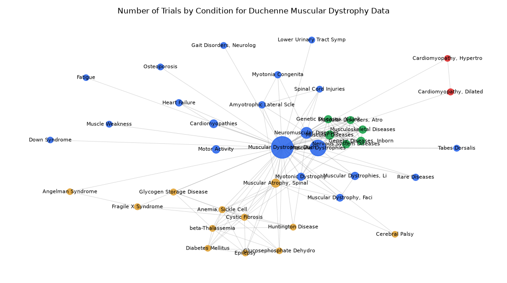

# 049. Network of conditions in rare disease trials for Duchenne muscular dystrophy

**Question:** Network of conditions in rare disease trials for Duchenne muscular dystrophy

Asked in **live** mode against `https://api.cheiron.engineeradriel.com` on 2026-10-24 22:50 UTC. [Open in the web app](https://trials.cheiron.engineeradriel.com/?q=Network+of+conditions+in+rare+disease+trials+for+Duchenne+muscular+dystrophy&mode=live).

## Answer

- **Status:** `ok` (HTTP 200)
- **Time to answer:** 15.6 s
- **Title:** Number of Trials by Condition for Duchenne Muscular Dystrophy Data
- **Chart:** `network_graph`
- **Interpretation:** intent `network`, dimension `condition`, measure `trial_count`
- **Filters:** `{"conditions": ["Duchenne muscular dystrophy"]}`
- **Trials counted:** 181
- **ClinicalTrials.gov data of:** 2026-10-23T09:00:04

## Chart

## Data

**Largest nodes** (trials)

| Entity | Type | Trials | Links |
|---|---|---:|---:|
| Muscular Dystrophy, Duchenne | condition | 179 | 39 |
| Muscular Dystrophies | condition | 89 | 14 |
| Neuromuscular Diseases | condition | 37 | 13 |
| Muscular Diseases | condition | 17 | 9 |
| Muscular Atrophy, Spinal | condition | 16 | 13 |
| Cardiomyopathies | condition | 14 | 2 |
| Genetic Diseases, Inborn | condition | 12 | 9 |
| Motor Activity | condition | 12 | 2 |
| Nervous System Diseases | condition | 12 | 8 |
| Muscular Dystrophies, Limb-Girdle | condition | 11 | 3 |
| Musculoskeletal Diseases | condition | 11 | 8 |
| Genetic Diseases, X-Linked | condition | 10 | 8 |
| Myotonic Dystrophy | condition | 10 | 9 |
| Muscular Disorders, Atrophic | condition | 9 | 8 |
| Muscular Dystrophy, Facioscapulohumeral | condition | 8 | 4 |

**Strongest links** (shared trials)

| From | To | Shared trials |
|---|---|---:|
| Muscular Dystrophies | Muscular Dystrophy, Duchenne | 89 |
| Muscular Dystrophy, Duchenne | Neuromuscular Diseases | 37 |
| Muscular Dystrophies | Neuromuscular Diseases | 22 |
| Muscular Diseases | Muscular Dystrophy, Duchenne | 17 |
| Muscular Atrophy, Spinal | Muscular Dystrophy, Duchenne | 16 |
| Cardiomyopathies | Muscular Dystrophy, Duchenne | 14 |
| Muscular Diseases | Muscular Dystrophies | 14 |
| Genetic Diseases, Inborn | Muscular Dystrophy, Duchenne | 12 |
| Muscular Dystrophy, Duchenne | Nervous System Diseases | 12 |
| Genetic Diseases, Inborn | Muscular Dystrophies | 11 |
| Motor Activity | Muscular Dystrophy, Duchenne | 11 |
| Muscular Dystrophies | Musculoskeletal Diseases | 11 |
| Muscular Dystrophies | Nervous System Diseases | 11 |
| Muscular Dystrophies, Limb-Girdle | Muscular Dystrophy, Duchenne | 11 |
| Muscular Dystrophy, Duchenne | Musculoskeletal Diseases | 11 |

## Counting rule

Node size = distinct trials with that entity; edge width = distinct trials with both.

## Assumptions

- The network shows condition co-occurrence within trials that include Duchenne muscular dystrophy.

## Sample citations

- `condition:muscular dystrophy, duchenne`: [NCT07821125](https://clinicaltrials.gov/study/NCT07821125) Urotherapy Education for Families of Children With Duchenne Muscular Dystrophy
- `condition:muscular dystrophies`: [NCT07587242](https://clinicaltrials.gov/study/NCT07587242) A Phase 3 Study to Evaluate the Safety and Efficacy of AOC 1044 (Also Referred to as Delpacibart Zotadirsen) i
- `condition:neuromuscular diseases`: [NCT07587242](https://clinicaltrials.gov/study/NCT07587242) A Phase 3 Study to Evaluate the Safety and Efficacy of AOC 1044 (Also Referred to as Delpacibart Zotadirsen) i
- `condition:muscular diseases`: [NCT07587242](https://clinicaltrials.gov/study/NCT07587242) A Phase 3 Study to Evaluate the Safety and Efficacy of AOC 1044 (Also Referred to as Delpacibart Zotadirsen) i
- `condition:muscular atrophy, spinal`: [NCT07356063](https://clinicaltrials.gov/study/NCT07356063) Self-Efficacy Enhancement Among Online Support Group of Primary Caregivers of Children With Neuro Muscular Dys

## ClinicalTrials.gov queries

- [search](https://clinicaltrials.gov/api/v2/studies?query.cond=%22Duchenne+muscular+dystrophy%22): 509 trials

## Timings (ms)

`{"plan": 5080, "count": 672, "retrieve": 8428, "aggregate": 385, "narrate": 721, "total": 15296}`
