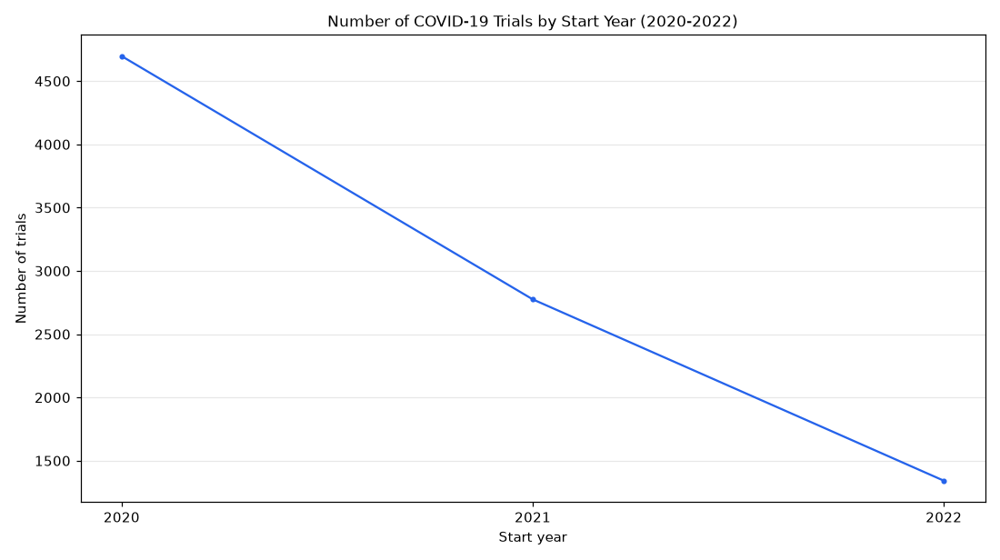

# 050. How many COVID-19 trials started in 2020 vs 2021 vs 2022?

**Question:** How many COVID-19 trials started in 2020 vs 2021 vs 2022?

Asked in **live** mode against `https://api.cheiron.engineeradriel.com` on 2026-10-24 22:51 UTC. [Open in the web app](https://trials.cheiron.engineeradriel.com/?q=How+many+COVID-19+trials+started+in+2020+vs+2021+vs+2022%3F&mode=live).

## Answer

- **Status:** `ok` (HTTP 200)
- **Time to answer:** 27.5 s
- **Title:** Number of COVID-19 Trials by Start Year (2020-2022)
- **Chart:** `time_series`
- **Interpretation:** intent `trend`, dimension `start_year`, measure `trial_count`
- **Filters:** `{"conditions": ["COVID-19"], "start_year_min": 2020, "start_year_max": 2022}`
- **Trials counted:** 8,814
- **ClinicalTrials.gov data of:** 2026-10-23T09:00:04

## Chart

## Data

| Start year | Number of trials | estimated_count |
|---|---|---|
| 2020 | 4,697 | 393 |
| 2021 | 2,775 | 292 |
| 2022 | 1,342 | 207 |

## Counting rule

Each trial is counted once, in the year it started (or is expected to start).

## Assumptions

- Interpreting the question as the yearly count of trials that started in each year from 2020 through 2022.

## Notes

- The year filter excludes trials without a start date.
- Counted with one ClinicalTrials.gov count per year instead of downloading every trial; each year cites its most recent trials.

## Sample citations

- `2020`: [NCT04479319](https://clinicaltrials.gov/study/NCT04479319) Decision Support System Algorithm for COVID-19 Diagnosis
- `2021`: [NCT05172141](https://clinicaltrials.gov/study/NCT05172141) A Safety, Tolerability, and Efficacy Study of IBI314 in Patients With Mild to Moderate COVID-19
- `2022`: [NCT05519839](https://clinicaltrials.gov/study/NCT05519839) A Study to Evaluate the Safety and Immunogenicity of COVID-19 and Influenza Combination Vaccine

## ClinicalTrials.gov queries

- [search](https://clinicaltrials.gov/api/v2/studies?filter.advanced=AREA%5BStartDate%5DRANGE%5B2020-01-01%2C2022-12-31%5D&query.cond=%22COVID-19%22): 8,814 trials

## Timings (ms)

`{"plan": 8119, "count": 460, "retrieve": 17973, "aggregate": 0, "narrate": 818, "total": 27378}`
