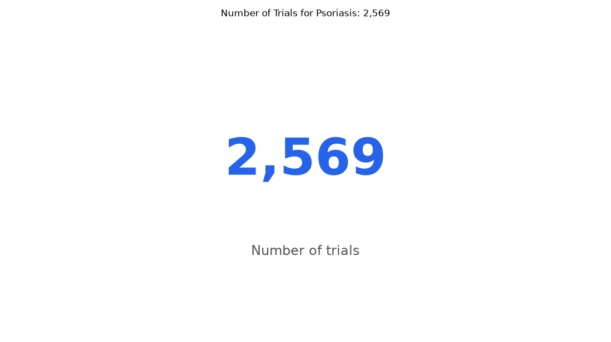

# 051. How many trials are there for psoriasis?

**Question:** How many trials are there for psoriasis?

Asked in **live** mode against `https://api.cheiron.engineeradriel.com` on 2026-10-24 22:48 UTC. [Open in the web app](https://trials.cheiron.engineeradriel.com/?q=How+many+trials+are+there+for+psoriasis%3F&mode=live).

## Answer

- **Status:** `ok` (HTTP 200)
- **Time to answer:** 42.4 s
- **Title:** Number of Trials for Psoriasis: 2,569
- **Chart:** `metric`
- **Interpretation:** intent `single_number`, measure `trial_count`
- **Filters:** `{"conditions": ["psoriasis"]}`
- **Trials counted:** 2,569
- **ClinicalTrials.gov data of:** 2026-10-23T09:00:04

## Chart

## Data

| Number of trials |
|---|
| 2,569 |

## Counting rule

Each matching trial is counted once.

## Sample citations

- `all`: [NCT07841314](https://clinicaltrials.gov/study/NCT07841314) Comparative Study on Unani Formulation Vs Active Control in Plaque Psoriasis

## ClinicalTrials.gov queries

- [search](https://clinicaltrials.gov/api/v2/studies?query.cond=%22psoriasis%22): 2,569 trials

## Timings (ms)

`{"plan": 1970, "count": 8884, "retrieve": 30131, "aggregate": 53, "narrate": 759, "total": 41808}`
