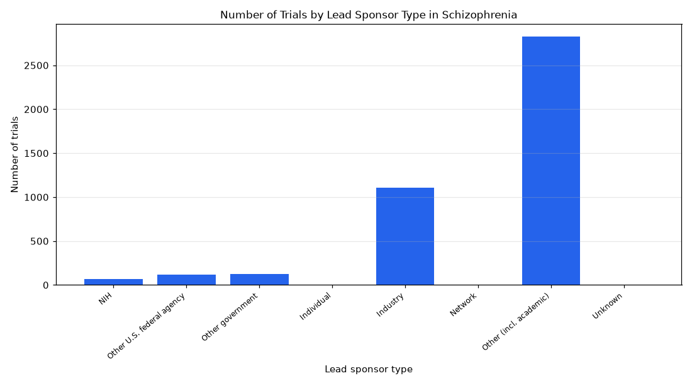

# 052. Bar chart of schizophrenia trials by sponsor type

**Question:** Bar chart of schizophrenia trials by sponsor type

Asked in **live** mode against `https://api.cheiron.engineeradriel.com` on 2026-10-24 22:50 UTC. [Open in the web app](https://trials.cheiron.engineeradriel.com/?q=Bar+chart+of+schizophrenia+trials+by+sponsor+type&mode=live).

## Answer

- **Status:** `ok` (HTTP 200)
- **Time to answer:** 44.8 s
- **Title:** Number of Trials by Lead Sponsor Type in Schizophrenia
- **Chart:** `bar_chart`
- **Interpretation:** intent `distribution`, dimension `sponsor_class`, measure `trial_count`
- **Filters:** `{"conditions": ["schizophrenia"]}`
- **Trials counted:** 4,252
- **ClinicalTrials.gov data of:** 2026-10-23T09:00:04

## Chart

## Data

| Lead sponsor type | Number of trials |
|---|---|
| NIH | 69 |
| Other U.S. federal agency | 118 |
| Other government | 122 |
| Individual | 3 |
| Industry | 1,107 |
| Network | 3 |
| Other (incl. academic) | 2,826 |
| Unknown | 4 |

## Counting rule

Each trial is counted once.

## Assumptions

- "sponsor type" refers to sponsor class.

## Sample citations

- `NIH`: [NCT03092687](https://clinicaltrials.gov/study/NCT03092687) Procedures for Sample Acquisition and Distribution for The Human Brain Collection Core
- `FED`: [NCT07555275](https://clinicaltrials.gov/study/NCT07555275) Testing a Peer-Support Group for Veterans Who Hear Voices
- `OTHER_GOV`: [NCT07781007](https://clinicaltrials.gov/study/NCT07781007) Effectiveness of a Board Game Intervention on Cognitive and Functional Outcomes in Older Adults With Schizophr
- `INDIV`: [NCT04025073](https://clinicaltrials.gov/study/NCT04025073) The Impact of Dietary Habits and Nutrition Intervention on Metabolic Syndrome in Individuals With Schizophreni
- `INDUSTRY`: [NCT07659938](https://clinicaltrials.gov/study/NCT07659938) Frontal Gamma Coherence Neurofeedback for Patients With Schizophrenia

## ClinicalTrials.gov queries

- [search](https://clinicaltrials.gov/api/v2/studies?query.cond=%22schizophrenia%22): 4,252 trials

## Timings (ms)

`{"plan": 1417, "count": 2561, "retrieve": 39157, "aggregate": 260, "narrate": 912, "total": 44314}`
