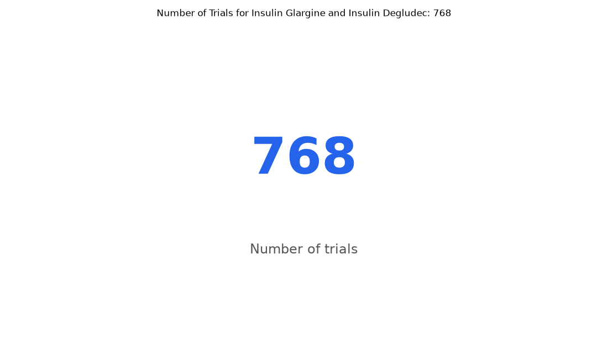

# 055. How many trials compare insulin glargine with insulin degludec?

**Question:** How many trials compare insulin glargine with insulin degludec?

Asked in **live** mode against `https://api.cheiron.engineeradriel.com` on 2026-10-24 22:50 UTC. [Open in the web app](https://trials.cheiron.engineeradriel.com/?q=How+many+trials+compare+insulin+glargine+with+insulin+degludec%3F&mode=live).

## Answer

- **Status:** `ok` (HTTP 200)
- **Time to answer:** 12.0 s
- **Title:** Number of Trials for Insulin Glargine and Insulin Degludec: 768
- **Chart:** `metric`
- **Interpretation:** intent `single_number`, measure `trial_count`
- **Filters:** `{"drugs": ["insulin glargine", "insulin degludec"]}`
- **Trials counted:** 768
- **ClinicalTrials.gov data of:** 2026-10-23T09:00:04

## Chart

## Data

| Number of trials |
|---|
| 768 |

## Counting rule

Each matching trial is counted once.

## Assumptions

- Interpreting 'compare' as trials that include both insulin glargine and insulin degludec.

## Sample citations

- `all`: [NCT07797335](https://clinicaltrials.gov/study/NCT07797335) AMBITION 7: A Research Study Investigating How Well Zenagamtide Lowers Blood Sugar and Body Weight Compared to

## ClinicalTrials.gov queries

- [search](https://clinicaltrials.gov/api/v2/studies?filter.advanced=%28AREA%5BInterventionNameSearch%5D%22insulin+glargine%22+OR+AREA%5BInterventionNameSearch%5D%22insulin+degludec%22%29): 768 trials

## Timings (ms)

`{"plan": 2193, "count": 7819, "retrieve": 986, "aggregate": 23, "narrate": 821, "total": 11850}`
