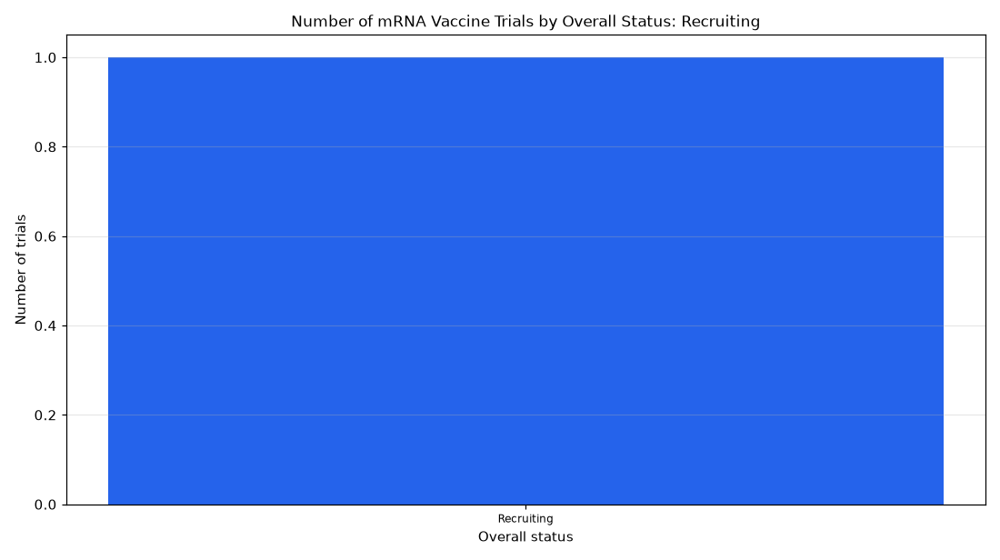

# 056. Phase 1 trials of mRNA vaccines by status

**Question:** Phase 1 trials of mRNA vaccines by status

Asked in **live** mode against `https://api.cheiron.engineeradriel.com` on 2026-10-24 22:49 UTC. [Open in the web app](https://trials.cheiron.engineeradriel.com/?q=Phase+1+trials+of+mRNA+vaccines+by+status&mode=live).

## Answer

- **Status:** `ok` (HTTP 200)
- **Time to answer:** 23.3 s
- **Title:** Number of mRNA Vaccine Trials by Overall Status: Recruiting
- **Chart:** `bar_chart`
- **Interpretation:** intent `distribution`, dimension `status`, measure `trial_count`
- **Filters:** `{"drugs": ["mRNA vaccines"], "phases": ["PHASE1"]}`
- **Trials counted:** 1
- **ClinicalTrials.gov data of:** 2026-10-23T09:00:04

## Chart

## Data

| Overall status | Number of trials |
|---|---|
| Recruiting | 1 |

## Counting rule

Each trial is counted once.

## Assumptions

- Interpreting 'mRNA vaccines' as a drug/intervention term in ClinicalTrials.gov.

## Sample citations

- `RECRUITING`: [NCT07306299](https://clinicaltrials.gov/study/NCT07306299) A Phase I Clinical Trial of a mRNA Vaccine for Recurrent or Progressive High-grade Glioma

## ClinicalTrials.gov queries

- [search](https://clinicaltrials.gov/api/v2/studies?filter.advanced=%28AREA%5BInterventionNameSearch%5D%22mRNA+vaccines%22+AND+AREA%5BPhase%5DPHASE1%29): 1 trials

## Timings (ms)

`{"plan": 3267, "count": 8576, "retrieve": 8963, "aggregate": 175, "narrate": 921, "total": 21911}`
